# Libre Terminal

A free, open-source market research terminal that runs on your own computer and opens in your browser.

It brings equities, options, sovereign yield curves, corporate bonds, credit spreads, FX, commodities, energy inventories, shipping flows, macro data, SEC filings, and market news together across **28 dashboards**. All data comes directly from public and official sources (Federal Reserve, ECB, BIS, IMF, OECD, SEC, FINRA, CFTC, U.S. EIA, FDIC, Yahoo Finance, Nasdaq, TMX, and Deribit) through the open-source [OpenBB Platform](https://github.com/OpenBB-finance/OpenBB).

Most of the terminal works immediately with no account, login, or API key. Optional free keys from FRED, EIA, BLS, and Congress.gov add deeper U.S. economic, energy, labor, and legislative series.

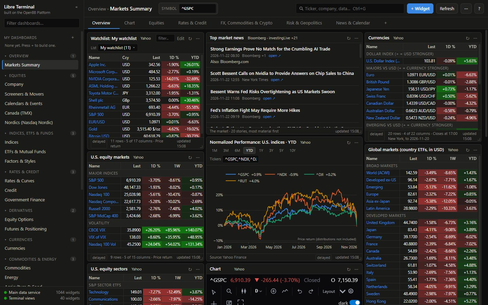

*Markets Summary: watchlist, top market news, index and Treasury futures, U.S. indices and sectors, normalized returns, currencies, and country ETFs on a single screen.*

## Download and run (Windows 10 / 11)

> **[Download Libre Terminal for Windows (.zip)](https://github.com/samlazs/libre-terminal/releases/latest/download/Libre-Terminal-Windows.zip)** &nbsp;·&nbsp; [Latest release notes](https://github.com/samlazs/libre-terminal/releases/latest)

No coding tools, Python setup, or accounts needed. You only need an internet connection and about 1 GB of free space:

1. **Download** [`Libre-Terminal-Windows.zip`](https://github.com/samlazs/libre-terminal/releases/latest/download/Libre-Terminal-Windows.zip).
2. **Extract the ZIP.** Right-click the downloaded file, choose **Extract All...**, and click **Extract**. Do not open files directly from inside the ZIP window.
3. **Install once.** Open the extracted `Libre-Terminal` folder and double-click **`Install.cmd`** (this takes 2 to 5 minutes).
   - If Windows shows *"Windows protected your PC"*, click **More info** and then **Run anyway**. You only need to do this once.
4. **Launch.** Double-click **`Start.cmd`**. On the first launch, allow up to about a minute while the data services start; your browser opens automatically to `http://127.0.0.1:6950`, and cards say the data services are starting until their data arrives.
   - Use **`Stop.cmd`** to close the terminal cleanly, and **`Setup-Keys.cmd`** later if you want to add optional free API keys.

Everything runs locally on your machine. Nothing leaves your computer except the requests to the data providers themselves.

> Unofficial project, not affiliated with OpenBB or any data provider. Built for research only: market data can be delayed, incomplete, or revised, and nothing here is investment advice. See [License and disclaimer](#license-and-disclaimer).

## Inside the terminal

### Equities, comps, and SEC filings

Type a ticker or company name once (`AAPL`, `RY.TO`, `7203.T`, `SHEL.L`) to get price history, a business snapshot, financial statements, Street price targets, and recent analyst rating changes. Below the overview, an editable comparable-companies table converts market cap and enterprise value to USD and shows multiples, margins, growth, leverage, and peer medians. Statements switch between reported values, common size (percent of revenue or of total assets), and year-over-year change. Growth & Ratios plots 3, 5, or 10 years of P/E, EV/EBITDA, EV/Sales, P/S, or P/B against each multiple's own median and 10th-90th percentile band. It uses figures as they were known on each day (SEC filings for U.S. companies, Yahoo Finance with automatic currency and ADR/share-class scaling elsewhere), and sits beside ROIC and a DuPont breakdown of ROE. For U.S. banks, the snapshot adds FDIC asset-quality figures and skips multiples that have no meaning for a bank. Other tabs cover insider transactions, 13F institutional holders, FINRA short interest, extracted 10-K/10-Q Risk Factors and MD&A, and cross-company SEC comparisons.

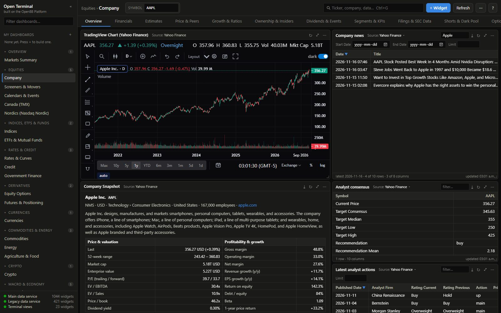

*Company Overview: interactive price chart, valuation and profitability snapshot, analyst consensus, and company news.*

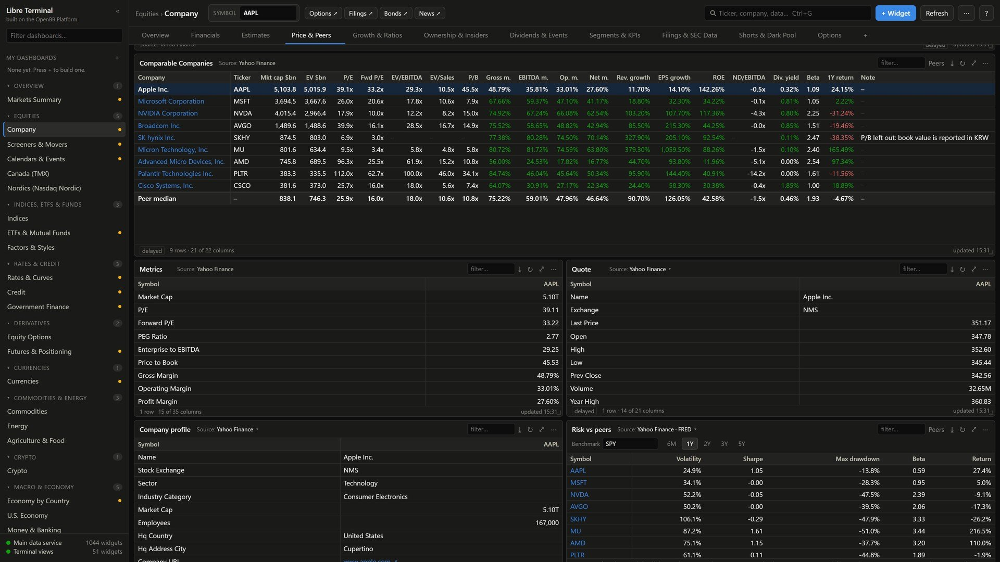

*Company > Price & Peers: editable peer table with multiples, margins, growth, ROE, leverage, and peer medians, above metrics, quote, and risk-versus-peers cards.*

### Earnings day and options volatility

On earnings day, the Estimates tab sets expected against reported EPS and revenue beside the company's SEC Form 8-K press release (Exhibit 99.1). It also shows the two-day share price move, options-implied versus past realized moves, 12 quarters of surprise history (click any past date to load that quarter's scorecard and press release), and 30- and 90-day analyst estimate revisions.

The options views go beyond raw chains. They plot implied volatility term structure, out-of-the-money volatility smiles, 3D volatility surfaces, open interest by expiration, and strategy payoffs (straddles, strangles, and spreads). The Volatility tab adds dealer gamma exposure by strike with the Max Pain level, and a cone of realized volatility over 10 to 126 days with today's implied volatility on top. Ticker routing is automatic: U.S. stocks pull from Yahoo Finance, Nasdaq, or Cboe, Canadian names route to the Montreal Exchange (TMX), and crypto options route to Deribit.

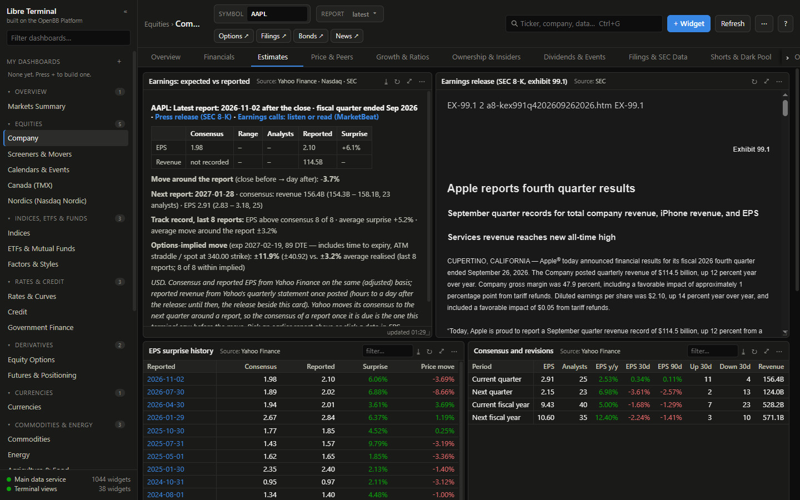

*Company > Estimates: consensus vs. reported results, options-implied vs. realized moves, revisions, and the inline SEC 8-K release.*

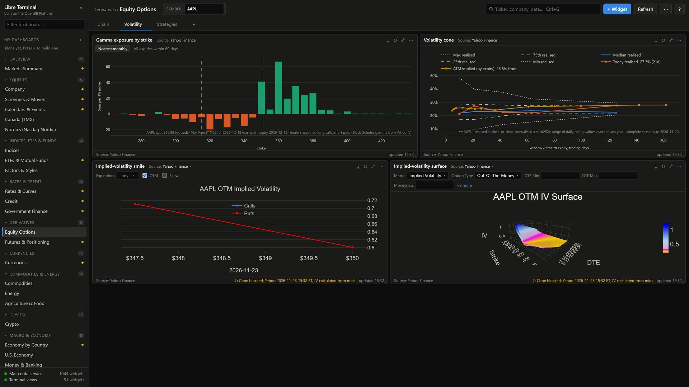

*Equity Options > Volatility: dealer gamma exposure by strike with the Max Pain level, a cone of realized volatility with today's implied volatility on top, the implied-volatility smile, and the 3D volatility surface.*

### Sovereign yield curves and central bank policy paths

Government curves come directly from central banks and ministries of finance rather than scraped quotes. Pick a country to plot today's curve against 1 month, 3 months, 6 months, 1 year, 2 years, or 5 years ago, read basis-point changes across tenors, and review BIS policy-rate history alongside OECD long-term rates. A separate global screen shows a 45-country yields matrix and roughly 40 central bank policy rates.

On Policy Expectations, meeting-dated overnight index swap (OIS) trade reports from the CFTC are turned into market-implied rate paths for six major central banks (Fed, ECB, BoE, BoJ, BoC, and RBA). Today's pricing is compared against one week and one month ago. A table lists each meeting period with the step priced at that meeting (in basis points and as a share of a 25 bp move) and how it has changed over the week and the month. FOMC statements, minutes, and economic projections open directly underneath, followed by San Francisco Fed term-premium estimates and Atlanta Fed rate probabilities.

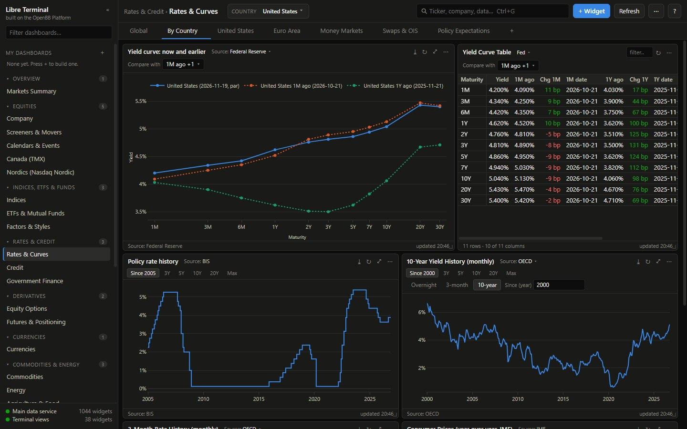

*Rates & Curves > By Country: Treasury par curve against 1M and 1Y ago, basis-point table, BIS policy history, and OECD 10Y yields.*

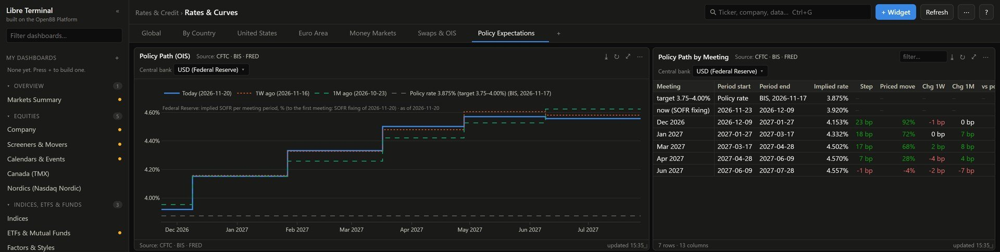

*Rates & Curves > Policy Expectations: OIS-implied Fed path (today vs. 1W and 1M ago) from CFTC swap prints above FOMC releases.*

### Futures and currencies

One front-month board covers equity-index, Treasury, currency, commodity, and CME crypto futures. Moves are measured from the last settlement (on Sunday evening, from Friday's close) and ranked. Beneath it sit the VIX term structure, Fed funds implied policy rates by month, and the WTI curve. The Currencies dashboard pairs a spot board with currency strength: each currency against the other seven majors, set beside its move against the dollar alone, using 17:00 New York closes.

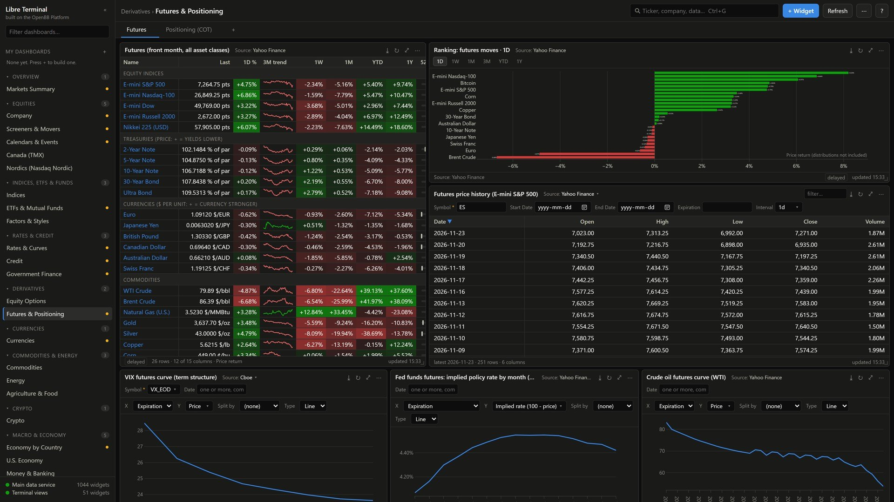

*Futures & Positioning > Futures: front-month board across asset classes, ranking of the day's moves, price history, and the VIX, Fed funds implied-rate, and WTI curves.*

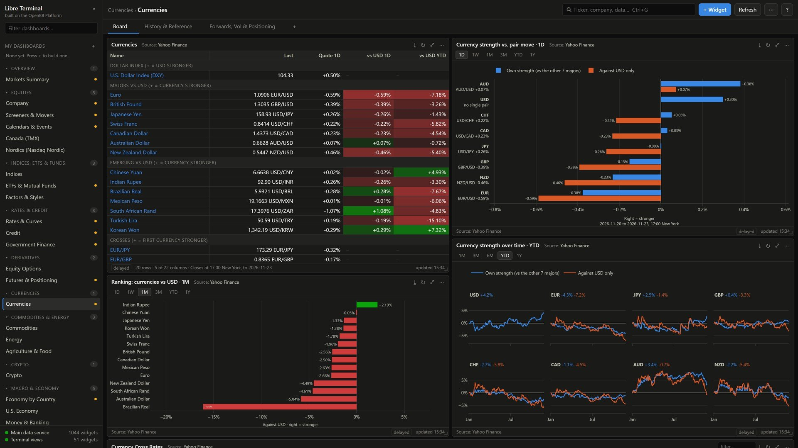

*Currencies > Board: spot board by region, currency strength against pair moves, and a ranking against the dollar.*

### Corporate credit: FINRA TRACE bonds, spreads, and CDS indices

Enter a U.S. ticker, company name, or CUSIP on Bond Lookup to pull an issuer's traded corporate bonds from FINRA TRACE. Each row shows coupon, maturity, Moody's and S&P ratings, last reported price, last-sale yield (yield-to-worst on callables), and call dates. The terminal adds its own yield, modified duration, convexity, DV01, and G-spread over the matching Treasury. The issuer's full maturity yield curve and historical TRACE prices sit alongside. Clicking a CUSIP opens a bond pricer for that bond, and the issuer's debt maturity wall comes from its latest 10-K.

For broader credit markets, the Spreads tab pairs ICE BofA option-adjusted spreads (investment grade, high yield, rating tiers from AAA to CCC, and regional corporate spreads) with live on-the-run 5-year CDS index levels (CDX IG, HY, and EM; iTraxx Main and Crossover) derived from CFTC swap-repository prints. Other credit tabs cover private credit (BDCs, leveraged loans, CLOs, and listed alternative managers), corporate leverage, NY Fed bond distress, and bank lending surveys.

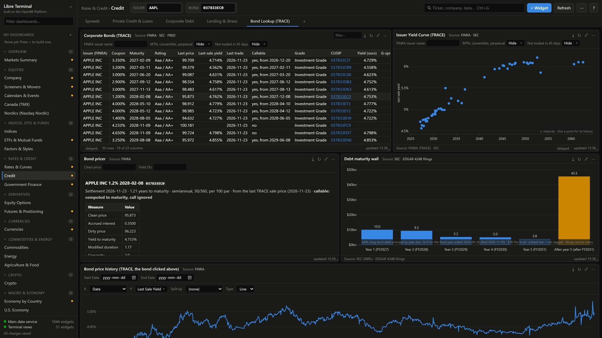

*Credit > Bond Lookup (TRACE): active Apple bonds with ratings and yields, the issuer yield curve, a bond pricer, the debt maturity wall from the latest 10-K, and TRACE price history for the selected CUSIP.*

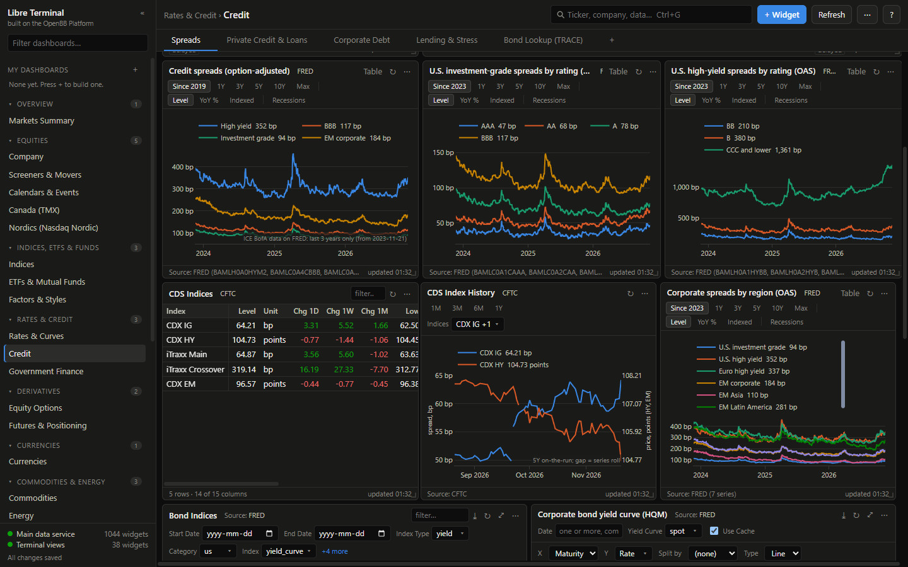

*Credit > Spreads: ICE BofA option-adjusted spreads by rating and region alongside CFTC 5-year CDX and iTraxx index levels and history.*

### Energy markets and EIA physical fundamentals

The Energy desk covers crude benchmarks (WTI and Brent), refining margins (3-2-1, diesel, and gasoline crack spreads), European TTF versus U.S. Henry Hub natural gas, uranium, and hourly U.S. power grid demand and generation by fuel.

With a free U.S. EIA API key, weekly and monthly physical balances fill in. These include commercial and Strategic Petroleum Reserve crude inventories, Cushing, gasoline, and distillate stocks plotted against their 5-year seasonal ranges and averages, refinery utilization, U.S. crude trade flows, LNG exports, and Short-Term Energy Outlook forecasts. International crude production and exports from JODI are built in as well.

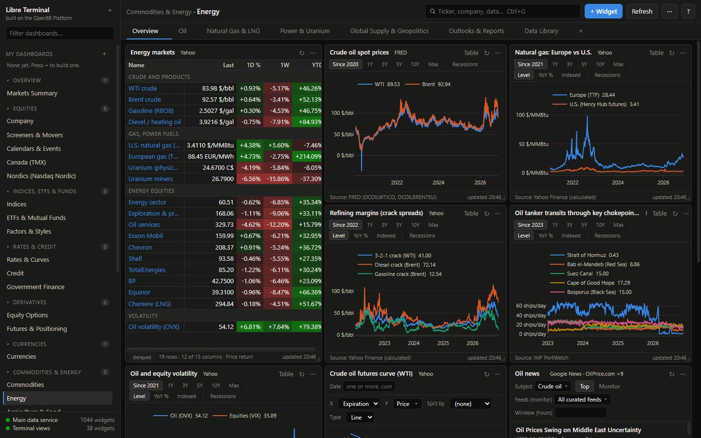

*Energy > Overview: energy futures and equities, WTI/Brent, TTF vs. Henry Hub, crack spreads, and tanker transits through key straits.*

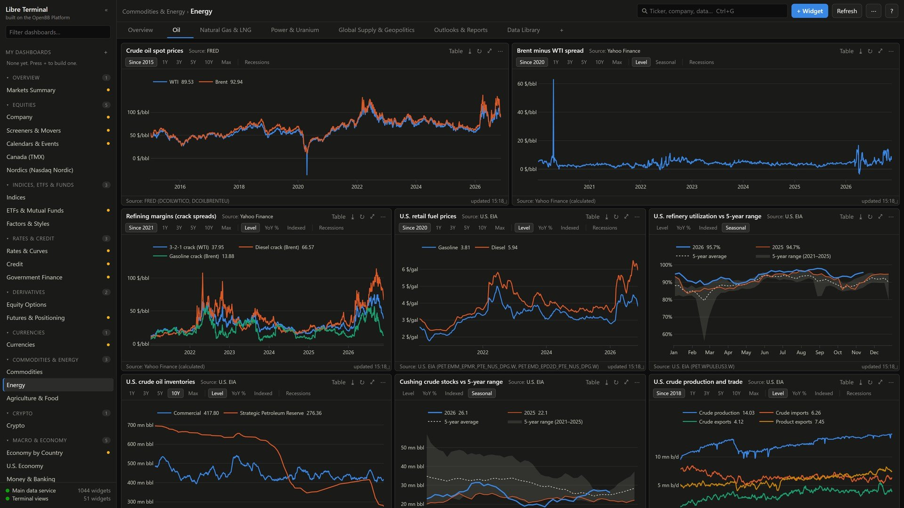

*Energy > Oil: commercial and SPR crude stocks, 5-year seasonal bands for Cushing, gasoline, and diesel, plus production, trade, and demand (uses free EIA key).*

### Maritime shipping, global macro, and situation-room news

Physical trade flows often move before official economic releases. Using IMF PortWatch data, Trade & Shipping tracks daily vessel transits through the Strait of Hormuz, Bab el-Mandeb, Suez Canal, Cape of Good Hope, Bosporus, Panama Canal, Malacca Strait, and Taiwan Strait. Traffic is split into tankers, container ships, and dry bulk, and compared with a year earlier and the pre-crisis 2023 baseline. Further tabs add port disruption maps, trade-flow diagrams, and bilateral tariffs.

The Country Monitor puts GDP growth, inflation, unemployment, policy rates, and sovereign yields for 17 major economies in one table. Clicking a country updates the IMF inflation, BIS policy-rate, yield curve, and news panels beneath it. Other tabs track Caldara-Iacoviello geopolitical risk across 44 countries, U.S. bank credit quality, FDIC bank failures, and individual bank ratios against peer-group percentiles (FFIEC UBPR).

The News dashboard separates curated market headlines (folding duplicate wire stories into a single row) from a dedicated stream of official releases published by central banks, statistical offices, and financial regulators.

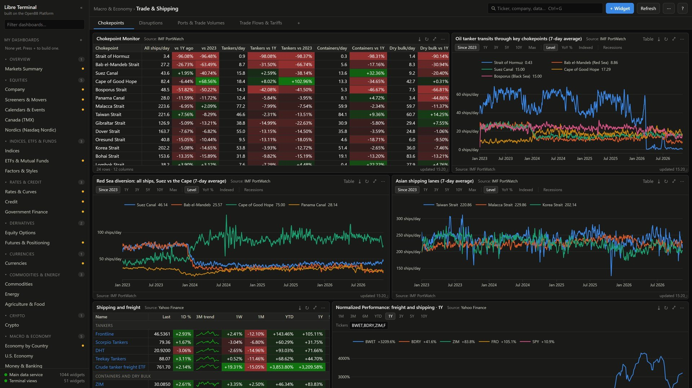

*Trade & Shipping > Chokepoints: daily vessel counts vs. 1Y ago and 2023, oil tanker transits, Red Sea vs. Cape diversions, and Asian lanes.*

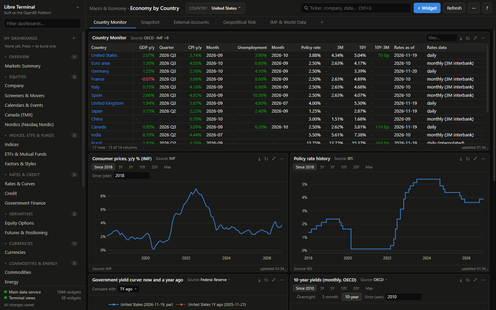

*Economy by Country > Country Monitor: 17-economy macro scorecard with IMF consumer-price inflation and BIS policy-rate history.*

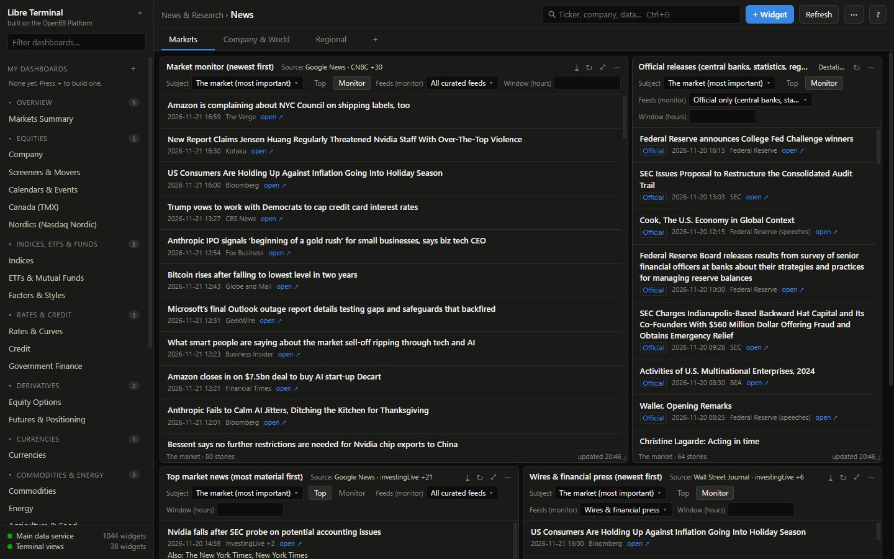

*News > Markets: curated financial press with duplicate stories folded on the left, beside official releases from the Fed, SEC, BEA, and other regulators.*

## Coverage by dashboard

| Area | Dashboards and main tabs |
|---|---|
| **Overview** | **Markets Summary**: cross-asset quote boards over five return horizons, index and Treasury futures, watchlists, normalized performance, G10 yields, U.S. equity style box, movers, geopolitical risk, shipping chokepoints, news, and calendars |
| **Equities** | **Company** (overview, statements, estimates and 8-K releases, peers and comps, growth and ratios with valuation bands, ownership and insiders, dividends, SEC filings, shorts and dark pool, options), **Screeners & Movers**, **Calendars & Events**, **Canada (TMX)**, **Nordics (Nasdaq Nordic)** |
| **Indices, ETFs & Factors** | **Indices** (world boards, constituents, S&P 500 valuation multiples back to 1871 including Shiller CAPE, VIX futures curve), **ETFs & Mutual Funds** (holdings, exposures, sector weights, N-PORT filings, holdings overlap between two funds), **Factors & Styles** (factor boards, Relative Rotation Graph, cross-asset correlation and risk statistics, Fama-French factors) |
| **Rates & Credit** | **Rates & Curves** (global yields, by country, U.S., euro area, money markets, CFTC swaps and OIS, policy expectations, FOMC documents), **Credit** (OAS spreads, CFTC CDS indices, private credit and BDCs, corporate debt, bank lending surveys and stress, FINRA TRACE bond lookup, issuer curve, bond pricer, debt maturity wall), **Government Finance** (public debt, Treasury cash balance, auctions, Fed balance sheet, primary dealer fails) |
| **Derivatives** | **Equity Options** (chains, stats, term structure, IV smile, 3D surface, gamma exposure and Max Pain, volatility cone, straddles, strangles, spreads, payoff), **Futures & Positioning** (front-month board, VIX term structure, Fed funds implied policy rates, WTI curve, price history, CFTC Commitments of Traders for S&P 500, Nasdaq, Treasury, and currency futures) |
| **Currencies** | **Currencies** (spot board, currency strength vs. pair moves, cross-rate matrix, policy-rate differentials, spot against the 2-year rate differential, real effective exchange rates, FX reserves, CFTC FX forwards, implied volatility, COT positioning) |
| **Commodities & Energy** | **Commodities** (boards, WTI, gas, gold and copper curves, COT positioning), **Energy** (crude, products, refining cracks, TTF vs. Henry Hub, EIA 5-year seasonal inventories, LNG exports, hourly grid demand and fuel mix, nuclear outages, uranium, JODI, STEO forecasts), **Agriculture & Food** (grain, softs and livestock curves, COT positioning, WASDE/PSD balances, USDA and regional Fed farm data) |
| **Crypto** | **Crypto** (spot boards, price history, Deribit order books, option chains, volatility smile and surface, funding rates, DVOL vs. 30-day realized volatility) |
| **Macro & Economy** | **Economy by Country** (Country Monitor, OECD snapshot, external accounts, Caldara-Iacoviello geopolitical risk, IMF WEO forecasts), **U.S. Economy** (Atlanta Fed GDPNow, Cleveland Fed inflation nowcasts, BLS CPI/PPI/payrolls/JOLTS tables, housing and CRE, business surveys, all 12 regional Feds), **Money & Banking** (delinquencies, charge-offs, FDIC bank failures, single-bank UBPR peer percentiles and FFIEC call reports, Fed and ECB liquidity), **Trade & Shipping** (IMF PortWatch chokepoints, disruption maps and flows, port volumes, bilateral trade and tariffs), **Data Explorers** (search FRED, BLS, IMF, OECD, ECB, and Federal Reserve series, plus Data Status) |
| **Government & Regulation** | **U.S. Congress** (bills, laws, amendments, votes, members, committee calendars), **Federal Spending** (USAspending agency budgets, contract awards, and top recipients) |
| **News & Research** | **News** (market monitor, official central bank and regulator feed, ranked company and regional news), **SEC Filings & Enforcement** (EDGAR full-text search, filing viewer, extracted sections, SEC litigation releases, Form ADV advisers) |

## Working in the terminal

- **Search from anywhere (`/` or `Ctrl+G`):** Type a ticker, company name, SEC CIK, CUSIP, or dataset (`toyota`, `rheinmetall`, `SHEL.L`, `CIK 320193`, `037833100`, `cpi`, `sofr`, `wasde`). Stocks open in Company, ETFs in ETFs & Funds, and indices, currencies, futures, or coins in the main chart.
- **Watchlists:** Keep your own lists of tickers with last price, daily change, five return horizons, 3-month sparklines, and 52-week ranges in each security's trading currency.
- **Compare chart:** Plot up to eight securities or FRED series (`FRED:DGS10`) on one axis as price, percent change, ratio, spread, or drawdown, with candlesticks, volume, 50- and 200-day moving averages, log scale, and NBER recession shading.
- **Editable comps:** Comparable companies tables auto-select peers and compute medians, and you can add or remove tickers per company with your list saved locally.
- **Source attribution on every card:** Each card names its source in the header (`Source: SEC`). Click it to switch to another provider for the same data or open the original source page. Cards that depend on a ticker route automatically to the exchange or provider that covers it (U.S. options via Yahoo/Nasdaq/Cboe, Canadian options via TMX, crypto options via Deribit; U.S. ETF holdings via Nasdaq, Canadian via TMX).
- **Chart and table controls:** Change date ranges (`1M` to `Max`), switch transforms (`Level`, `YoY %`, `Indexed`, `Seasonal` against the 5-year range), or show and hide table columns without editing your saved layout. Export any table to CSV (with its source line) or save any chart as PNG.
- **Custom dashboards:** Build your own tabs or dashboards with `+`, rearrange cards freely, and restore any built-in dashboard to its original layout through **⋯ > Reset to default layout**.
- **Shortcuts and status:** Press `?` to view keyboard shortcuts (`/` focuses search, `[` and `]` move between tabs, double-clicking a card header maximizes it). Open **Data Explorers > Data status** to see which sources are down upstream and which API keys are configured.

## Official sovereign yield curves

**Rates & Curves > By Country** draws each curve from its official source. Daily curves cover eight major sovereign markets with no API key, and monthly OECD rates cover roughly 30 more:

| Country / Region | Tenors and frequency | Official source |
|---|---|---|
| United States | 1M to 30Y, daily | Federal Reserve (Treasury par curve) |
| Euro area | 3M to 30Y, daily | European Central Bank (AAA government curve) |
| Germany | 6M to 30Y, daily | Deutsche Bundesbank |
| United Kingdom | 6M to 40Y, daily | Bank of England |
| Japan | 1Y to 40Y, daily | Ministry of Finance |
| Canada | 1M to 1Y bills, 2Y to long bond, daily | Bank of Canada |
| Sweden | 1M to 6M bills, 2Y to 10Y, daily | Riksbank |
| Brazil | ~2M to 10Y, daily | Tesouro Direto (fixed-rate bonds) |
| France, Italy, Spain, Switzerland, Australia, and ~30 others | 3M and 10Y, monthly | OECD |

## Optional free API keys

The opening tab of nearly every dashboard works without any keys. Cards that need a key say so clearly and sit after the keyless cards. Registering for any of these free public keys takes about two minutes:

| Provider | What the key adds | Sign-up page |
|---|---|---|
| **FRED** | Full U.S. macro history, ICE BofA credit spreads, commodity spot prices, and the U.S. Economy dashboard *(many overview, rates, and macro charts also work keyless through FRED's public CSV feed)* | https://fredaccount.stlouisfed.org/apikeys |
| **EIA** | U.S. Energy Information Administration crude, product, and natural gas inventories, 5-year seasonal ranges, LNG exports, electricity grid data, and STEO forecasts | https://www.eia.gov/opendata/register.php |
| **BLS** | U.S. Bureau of Labor Statistics CPI, PPI, Employment Situation, JOLTS, real earnings, and productivity tables | https://data.bls.gov/registrationEngine/ |
| **Congress.gov** | U.S. House and Senate bills, votes, amendments, member profiles, and committee reports | https://api.congress.gov/sign-up/ |

To add keys, double-click **`Setup-Keys.cmd`** in your `Libre-Terminal` folder, paste the keys into the file that opens, save, and restart with **`Stop.cmd`** and **`Start.cmd`**. Keys are stored locally in `local/api_keys.env` (never logged, committed, or sent to any third party — only to each provider's own API when queried).

## What to know about the data

- **A number is right or blank with a note.** Every terminal card names its source and the date of the newest data point it used (Country Monitor shows the period of each cell). Number columns declare their unit and every amount names its currency. Key derived figures (such as valuation multiples and yields) outside a plausible range are left blank with a note rather than shown, and a fallback source, a saved copy served during an outage, or a partial answer is flagged on the card.
- **Delayed quotes, no trading.** Market prices come from Yahoo Finance. Quotes can be delayed, and there is no live tick streaming, order entry, or price alerting.
- **Earnings timing.** Consensus and reported EPS come from Yahoo Finance on a single consistent basis. Reported figures appear once Yahoo posts them (usually hours to a day after the release), while the SEC Form 8-K Exhibit 99.1 press release loads directly from EDGAR in the meantime. Because Yahoo removes a quarter's revenue consensus right after reporting, past revenue surprises appear only for quarters the terminal saw before the release. Earnings call transcripts are not included.
- **Total return vs. price return.** Quote boards containing only stocks and funds show total return (distributions reinvested on the ex-date). Boards that include an index, future, currency, or cryptocurrency show price return. The footer line beneath each board states which one is shown.
- **Credit and bond coverage.** CDS covers on-the-run 5-year index CDS from CFTC swap-repository trade reports; single-name CDS is not available. Corporate bond prices come from FINRA TRACE last-sale reports; security-level U.S. Treasury quotes are not included.
- **Sovereign curve frequency.** Daily curves cover the eight markets listed above. Other countries rely on monthly 3-month and 10-year OECD series, so intra-euro spreads such as BTP-Bund and OAT-Bund are monthly.
- **Source interruptions.** Public providers occasionally move or retire pages; roughly 30 feeds currently fail at the source and are listed in **Data Explorers > Data status**. When Cboe blocks automated requests to its options feed, options analytics fall back automatically to Yahoo Finance chains (computing Black-76 implied volatilities and Greeks locally), the VIX curve switches to Cboe settlement files, and U.S. index snapshots use Yahoo, with every substitute labelled on the card. Cboe intraday bars and historical option quotes have no substitute. OECD occasionally pauses requests when its rate limit is reached and recovers later.
- **Geographic scope.** Stock prices, financial statements, analyst estimates, holders, and peer comps work for listings worldwide. SEC filings, FINRA TRACE, FINRA short interest, FDIC/FFIEC bank data, and U.S. option analytics apply to U.S. issuers (Canadian and Nordic markets have their own dashboards).
- **Actuals only for macro.** Macro dashboards show official releases and IMF forecasts, not economist survey consensus or PMI releases.
- **Supported platform.** Windows 10 and 11 are the officially tested and supported systems.

## Updating and troubleshooting

Everything personal (your watchlists, custom layouts, peer lists, and optional API keys) lives inside the `local` folder.

- **Updating to a newer release:** Run **`Stop.cmd`** in your old folder, download and extract the new ZIP, copy your old `local` folder into the new `Libre-Terminal` folder if you want to keep your saved work, then run **`Install.cmd`** and **`Start.cmd`**.
- **Backing up or moving computers:** Stop the terminal and copy the `local` folder. To start completely fresh, stop the terminal and delete `local`.

| Problem | What to do |
|---|---|
| *"Windows protected your PC"* | Click **More info** and then **Run anyway**. Only needed once; `Install.cmd` unblocks the other `.cmd` files automatically. |
| Files will not run / *"inside the ZIP"* | Right-click `Libre-Terminal-Windows.zip`, choose **Extract All...**, and open the extracted `Libre-Terminal` folder. |
| Install fails inside OneDrive or a long path | Move the extracted folder to a short local path such as `C:\Libre-Terminal` and double-click `Install.cmd` again. Windows limits file paths to 260 characters, so `Install.cmd` stops before downloading anything when the folder path is longer than 83 characters (unless Windows long paths are turned on). |
| Install stops partway through | Usually a corporate proxy, firewall, or antivirus block. Allow access and run `Install.cmd` again; it picks up where it stopped. |
| Port already in use | Open Command Prompt inside `Libre-Terminal` and run `Start.cmd --ui-port 7950 --v5-port 7900` (saved for future launches). |
| Slow first start or blank cards | The first launch takes up to about a minute (90 seconds on a slow machine) while the data services start. If a background service stops or freezes, the terminal restarts it automatically, or you can click **Restart** next to **Refresh** in the top bar to restart stalled data services and clear cached errors from the browser; logs are in `local/logs/`. |
| A card asks for an API key | Add the free key with **`Setup-Keys.cmd`**, then stop and start the terminal. |
| Want the default layout back | Click **⋯** on the dashboard and choose **Reset to default layout**. |
| Uninstall | Run **`Stop.cmd`** and delete the `Libre-Terminal` folder. |

<details>
<summary><strong>Advanced options, macOS / Linux, and developers</strong></summary>

### Startup and backend options

- **Skip the first-launch wait:** `Start.cmd --no-wait` opens the browser right away while data finishes loading in the background.
- **Legacy V4 backend (+480 MB):** Run `Install.cmd --with-v4` and `Start.cmd --with-v4` (add `--v4-port 7901` when setting custom ports). It adds 39 legacy cards (FMP, Intrinio, Finviz, EconDB, WSJ) to the same dashboards. An optional free [FMP key](https://site.financialmodelingprep.com/developer/docs) (250 calls/day) fills in the FMP cards.
- **Custom local folder:** Set `TERMINAL_LOCAL_DIR` before launching. Services bind to `127.0.0.1` only.

### macOS / Linux (experimental, untested)

Windows 10/11 is the only officially tested platform. Shell scripts sharing the same launcher are included for macOS and Linux on a best-effort basis:

```sh
git clone https://github.com/samlazs/libre-terminal.git && cd libre-terminal
sh install.sh
sh start.sh          # opens http://127.0.0.1:6950 ; stop with: sh stop.sh
```

To update a git clone, stop the terminal, run `git pull`, and re-run `Install.cmd` (or `sh install.sh`). Your `local/` folder is not touched.

### Local data folder

Everything personal lives in `local/`, which git ignores. The terminal writes `local/README.txt` describing its contents on each start. Logs are in `local/logs/` (`ui.log`, `v5.log`, `v4.log`, and freeze dumps). A log that passes 5 MB is renamed to `.log.1` (the one before that to `.log.2`), also while the terminal keeps running, so logs never grow without bound.

### For contributors

Architecture, the source contract, the saved-state schema, runtime patches, and the test list are in [docs/ARCHITECTURE.md](docs/ARCHITECTURE.md). Run the offline checks from the project folder:

```text
# Windows
.venv-v5\Scripts\python.exe scripts\launcher.py test
.venv-v5\Scripts\python.exe scripts\launcher.py check

# macOS / Linux
.venv-v5/bin/python scripts/launcher.py test
.venv-v5/bin/python scripts/launcher.py check
```

`test` runs all offline test files in parallel (about 30 seconds, including three headless browser suites when Edge or Chrome is installed; `--fast` skips them). `check` covers encoding, lint, hygiene, and source checks. `gate` runs the release gates G1–G5 against a running terminal and records the evidence.

</details>

## License and disclaimer

Licensed under the **GNU Affero General Public License v3.0 or later** ([LICENSE](LICENSE)); third-party notices are in [NOTICE](NOTICE). The OpenBB Platform and other Python packages are installed from PyPI under their own licenses and are not redistributed here.

Unofficial project, not affiliated with, endorsed by, or sponsored by OpenBB or any data provider; names identify compatible software and data sources only. Data comes from third parties under their own terms, which you are responsible for respecting, and may be delayed, incomplete, or wrong. Nothing here is investment, financial, legal, or tax advice. The software is provided "as is", without warranty of any kind.
