# Libre Terminal

[English](../README.md) &nbsp;·&nbsp; [简体中文](README.zh-CN.md) &nbsp;·&nbsp; [日本語](README.ja.md) &nbsp;·&nbsp; [한국어](README.ko.md) &nbsp;·&nbsp; **Español**

> *Nota: Esta documentación fue traducida automáticamente y revisada por hablantes nativos; cualquier comentario o sugerencia de mejora será bienvenido.*

Un terminal de análisis de mercados gratuito y de código abierto que se ejecuta en su propio equipo y se abre en el navegador.

Reúne en un solo lugar renta variable, opciones, curvas de rendimiento soberanas, bonos corporativos, diferenciales de crédito, divisas, materias primas, energía, transporte marítimo, datos macroeconómicos, documentación presentada ante la SEC y noticias, distribuidos en **28 paneles**. Los datos proceden de fuentes públicas y oficiales (Reserva Federal, BCE, BPI, FMI, OCDE, SEC, FINRA, CFTC, EIA de EE. UU., FDIC, Yahoo Finance, Nasdaq, TMX y Deribit) a través de la plataforma de código abierto [OpenBB Platform](https://github.com/OpenBB-finance/OpenBB).

La mayor parte funciona de inmediato, sin cuenta, inicio de sesión ni clave API. Las claves gratuitas opcionales de FRED, EIA, BLS y Congress.gov añaden más datos estadounidenses de economía, energía, mercado laboral y actividad legislativa.

> **[Probar la demo interactiva](https://samlazs.github.io/libre-terminal/)** *(explore la interfaz real en su navegador con una instantánea fija del mercado)*<br>
> **[Descargar para Windows (.zip)](https://github.com/samlazs/libre-terminal/releases/latest/download/Libre-Terminal-Windows.zip)**

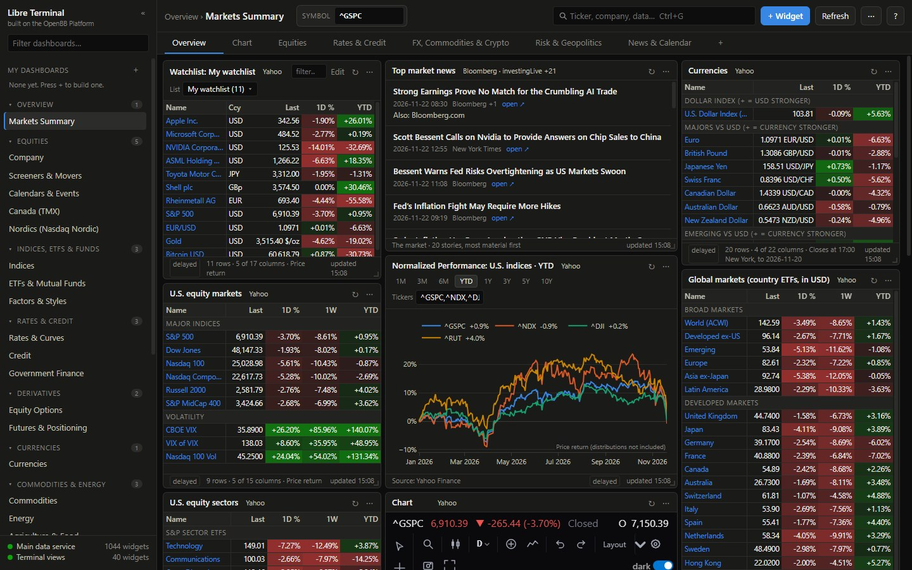

*Markets Summary: lista de seguimiento, principales noticias de mercado, futuros sobre índices y sobre deuda del Tesoro, índices y sectores estadounidenses, rentabilidades normalizadas, divisas y ETF por país en una sola pantalla.*

## Descarga y ejecución (Windows 10 / 11)

> **[Descargar Libre Terminal para Windows (.zip)](https://github.com/samlazs/libre-terminal/releases/latest/download/Libre-Terminal-Windows.zip)** &nbsp;·&nbsp; [Notas de la última versión](https://github.com/samlazs/libre-terminal/releases/latest)

No necesita herramientas de programación, Python ni cuentas; solo una conexión a internet y aproximadamente 1 GB de espacio libre:

1. **Descargue** [`Libre-Terminal-Windows.zip`](https://github.com/samlazs/libre-terminal/releases/latest/download/Libre-Terminal-Windows.zip). En la página de la versión, elija ese archivo, no *Source code (zip)*.
2. **Extraiga el ZIP.** Haga clic con el botón derecho en el archivo descargado, elija **Extraer todo...** y haga clic en **Extraer**. Los archivos no pueden ejecutarse desde la ventana del ZIP.
   - *Debería ver:* una carpeta `Libre-Terminal` con `Install.cmd`, `Start.cmd`, `Stop.cmd` y `READ-ME-FIRST.txt`. Lo más recomendable es una ubicación corta, como `C:\Libre-Terminal`; evite las carpetas de OneDrive.
3. **Instale una sola vez.** Haga doble clic en **`Install.cmd`**. El proceso tarda entre 2 y 5 minutos.
   - Si Windows muestra *«Windows protegió tu PC»*, haga clic en **Más información** y, a continuación, en **Ejecutar de todas formas**. Solo tendrá que hacerlo una vez.
   - *Debería ver:* una ventana negra con el progreso de la descarga, que termina con una línea en la que se le indica que haga doble clic en **Start.cmd**. Cierre la ventana.
4. **Inicie el terminal.** Haga doble clic en **`Start.cmd`**. El primer inicio tarda alrededor de un minuto.
   - *Debería ver:* el navegador abrirá el terminal en `http://127.0.0.1:6950` (guárdelo en favoritos). Puede cerrar la ventana negra; el terminal sigue ejecutándose en segundo plano.
5. **Deténgalo** con **`Stop.cmd`** cuando termine. Tras reiniciar el equipo, vuelva a ejecutar **`Start.cmd`**. Con **`Setup-Keys.cmd`** puede añadir [claves API gratuitas opcionales](#claves-api-gratuitas-opcionales) en cualquier momento.

Si algo falla, la propia ventana indica cómo proceder; la [tabla de solución de problemas](#actualización-y-solución-de-problemas) recoge los casos más habituales.

Todo se ejecuta en su propio equipo. El único tráfico que sale de él son las solicitudes a los proveedores de datos.

> Proyecto no oficial, sin vinculación con OpenBB ni con ningún proveedor de datos. Concebido exclusivamente para fines de análisis: los datos de mercado pueden llegar con retraso, estar incompletos o ser objeto de revisión, y nada de lo aquí incluido constituye asesoramiento de inversión. Consulte [Licencia y aviso legal](#licencia-y-aviso-legal).

## Dentro del terminal

### Renta variable, empresas comparables y documentación de la SEC

Escriba una sola vez un ticker o un nombre de empresa (`AAPL`, `RY.TO`, `7203.T`, `SHEL.L`) para obtener el historial de precios, una ficha del negocio, los estados financieros, los precios objetivo de los analistas y los cambios recientes de recomendación. Bajo la vista general, una tabla editable de empresas comparables (*comps*) convierte a USD la capitalización bursátil y el valor de empresa, y muestra múltiplos, márgenes, crecimiento, apalancamiento y las medianas del grupo de comparables.

Los estados financieros pueden mostrarse con los valores publicados, como estados financieros en análisis vertical (*common size*, porcentaje de ingresos o de activos totales) o como variación interanual. Growth & Ratios representa 3, 5 o 10 años de P/E, EV/EBITDA, EV/Sales, P/S o P/B frente a la mediana propia de cada múltiplo y su banda entre los percentiles 10 y 90, con las cifras tal como se conocían en cada fecha (documentación de la SEC para las empresas estadounidenses y Yahoo Finance para el resto, ajustadas por divisa y por la equivalencia de los ADR o de las distintas clases de acciones), junto al ROIC y al desglose DuPont del ROE. En el caso de los bancos estadounidenses, la ficha añade indicadores de calidad de activos de la FDIC y omite los múltiplos que carecen de sentido para una entidad bancaria. Otras pestañas recogen las operaciones de *insiders*, los tenedores institucionales según el formulario 13F, las posiciones cortas (*short interest*) de FINRA, las secciones Risk Factors y MD&A extraídas de los formularios 10-K/10-Q y comparaciones entre empresas con datos de la SEC.

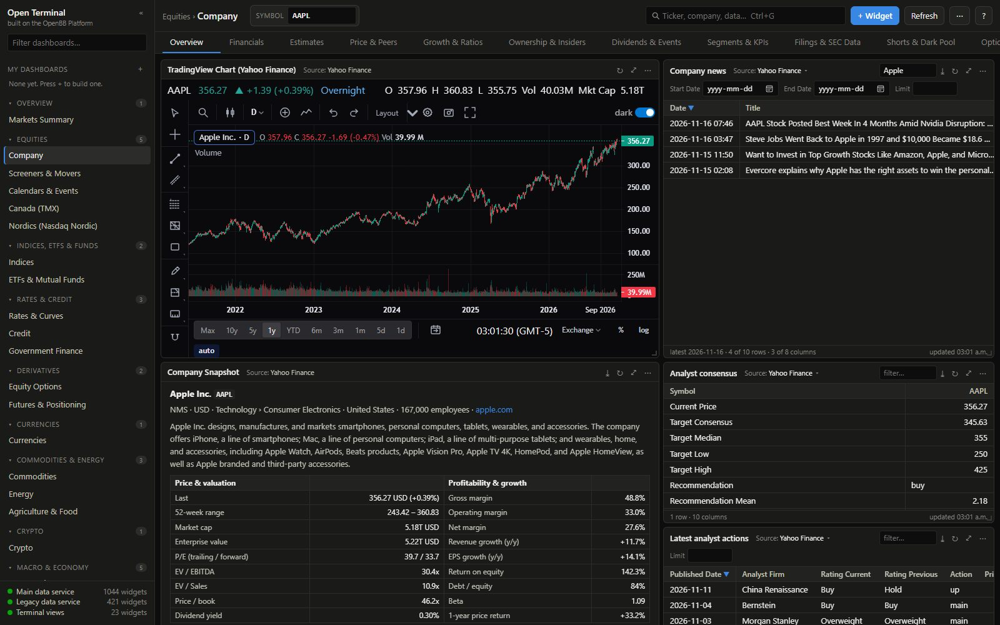

*Company Overview: gráfico de precios interactivo, ficha de valoración y rentabilidad, consenso de analistas y noticias de la empresa.*

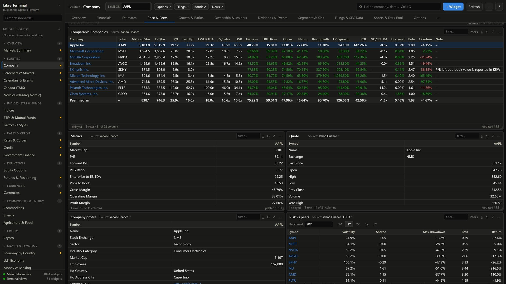

*Company > Price & Peers: tabla editable de comparables con múltiplos, márgenes, crecimiento, ROE, apalancamiento y medianas del grupo, sobre las tarjetas de métricas, cotización y riesgo frente a comparables.*

### Jornada de resultados y volatilidad de opciones

En la jornada de publicación de resultados, la pestaña Estimates contrasta el beneficio por acción (EPS) y los ingresos esperados con los publicados, junto al comunicado de prensa que la empresa presenta ante la SEC con el formulario 8-K (Exhibit 99.1). También muestra la variación de la cotización en dos sesiones, el movimiento implícito en opciones frente al movimiento realizado histórico, el historial de sorpresas de resultados de 12 trimestres (haga clic en cualquier fecha pasada para cargar la ficha y el comunicado de ese trimestre) y las revisiones de las estimaciones de los analistas a 30 y 90 días.

Además de las propias cadenas de opciones, las vistas de opciones representan la estructura temporal de la volatilidad implícita, las sonrisas de volatilidad fuera del dinero (OTM), superficies de volatilidad en 3D, el interés abierto por vencimiento y los perfiles de resultado de estrategias (*straddles*, *strangles* y *spreads*). La pestaña Volatility añade la exposición gamma de los creadores de mercado (*dealer gamma exposure*, GEX) por precio de ejercicio, con el nivel de *Max Pain*, y un cono de volatilidad realizada de 10 a 126 días con la volatilidad implícita actual superpuesta. Cada ticker se dirige automáticamente a la fuente adecuada: las acciones estadounidenses se obtienen de Yahoo Finance, Nasdaq o Cboe; los valores canadienses, de la Bolsa de Montreal (TMX); y las opciones sobre criptomonedas, de Deribit.

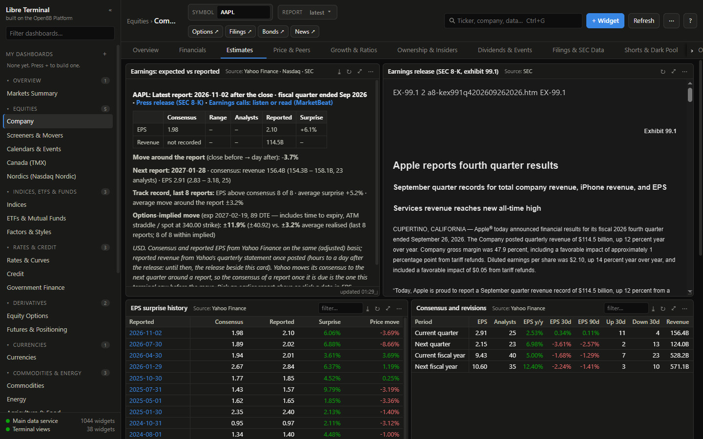

*Company > Estimates: consenso frente a resultados publicados, movimiento implícito en opciones frente al realizado, revisiones y el comunicado 8-K de la SEC integrado en la vista.*

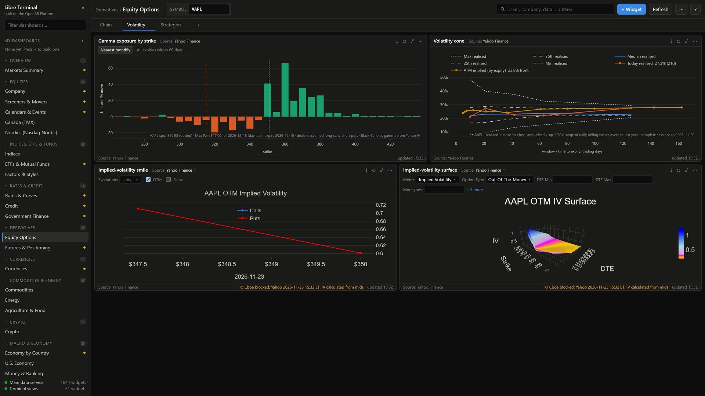

*Equity Options > Volatility: exposición gamma de los creadores de mercado por precio de ejercicio con el nivel de Max Pain, un cono de volatilidad realizada con la volatilidad implícita actual superpuesta, la sonrisa de volatilidad implícita y la superficie de volatilidad en 3D.*

### Curvas de rendimiento soberanas y trayectorias de política monetaria

Las curvas de deuda pública proceden directamente de los bancos centrales y los ministerios de finanzas. Seleccione un país para comparar la curva actual con la de hace 1 mes, 3 meses, 6 meses, 1 año, 2 años o 5 años, consultar las variaciones en puntos básicos (pb) por plazo y revisar el historial de tasas de política monetaria del BPI junto con las tasas a largo plazo de la OCDE. Una pantalla global independiente muestra una matriz de rendimientos de 45 países y las tasas de política monetaria de unos 40 bancos centrales.

En Policy Expectations, los registros de operaciones de swaps de índice a un día (OIS) vinculados a fechas de reunión que publica la CFTC se transforman en trayectorias de tasas implícitas en el mercado para seis grandes bancos centrales (Fed, BCE, BoE, BoJ, BoC y RBA). Los niveles descontados hoy se comparan con los de hace una semana y hace un mes. Una tabla recoge cada periodo entre reuniones con el movimiento descontado para esa reunión (en puntos básicos y como proporción de un movimiento de 25 pb) y su evolución en la última semana y el último mes. Justo debajo se abren los comunicados, las actas y las proyecciones económicas del FOMC, seguidos de las estimaciones de la prima por plazo de la Fed de San Francisco y las probabilidades de tasas de la Fed de Atlanta.

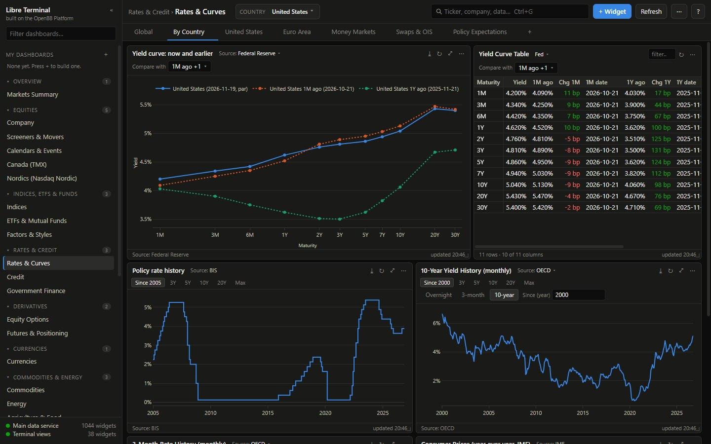

*Rates & Curves > By Country: curva a la par del Tesoro frente a la de hace 1 mes y 1 año, tabla de variaciones en puntos básicos, historial de tasas de política monetaria del BPI y rendimientos a 10 años de la OCDE.*

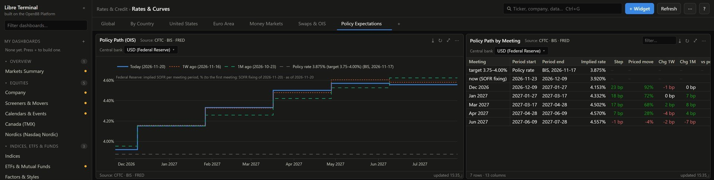

*Rates & Curves > Policy Expectations: trayectoria de la Fed implícita en los OIS (hoy frente a hace 1 semana y 1 mes), a partir de operaciones de swaps registradas ante la CFTC, sobre las publicaciones del FOMC.*

### Futuros y divisas

Un único panel de contratos de primer vencimiento abarca futuros sobre índices bursátiles, deuda del Tesoro, divisas, materias primas y criptomonedas del CME. Las variaciones se miden respecto del último precio de liquidación (el domingo por la noche, respecto del cierre del viernes) y se ordenan por magnitud. Debajo figuran la estructura temporal del VIX, las tasas de política monetaria implícitas en los futuros sobre fondos federales por mes y la curva del WTI. El panel Currencies combina un cuadro de cotizaciones al contado con la fortaleza relativa de cada divisa: su comportamiento frente a las otras siete divisas principales, junto a su variación frente al dólar por sí solo, con cierres de las 17:00 de Nueva York.

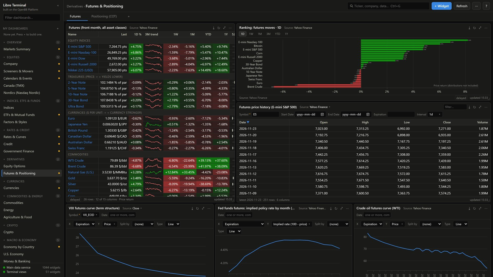

*Futures & Positioning > Futures: panel de contratos de primer vencimiento de todas las clases de activos, clasificación de las variaciones del día, historial de precios y curvas del VIX, de las tasas implícitas en los fondos federales y del WTI.*

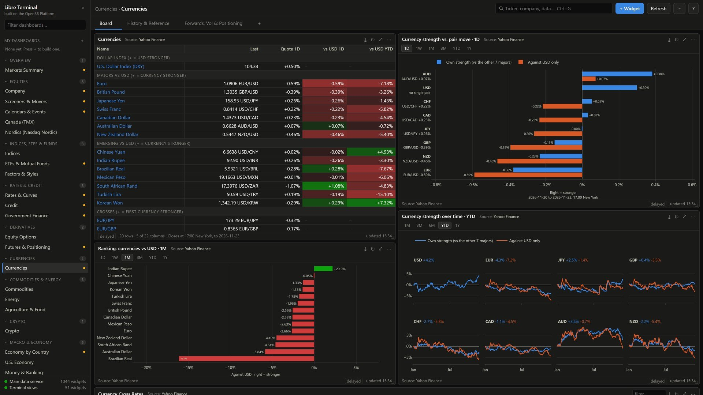

*Currencies > Board: cuadro de contado por región, fortaleza de cada divisa frente a las variaciones de los pares y clasificación frente al dólar.*

### Crédito corporativo: bonos de FINRA TRACE, diferenciales e índices CDS

Introduzca en Bond Lookup un ticker estadounidense, un nombre de empresa o un CUSIP para obtener de FINRA TRACE los bonos corporativos negociados de un emisor. Cada fila muestra el cupón, el vencimiento, las calificaciones de Moody's y S&P, el último precio comunicado, el rendimiento de la última operación (en bonos rescatables, el rendimiento al peor escenario o *yield-to-worst*, YTW) y las fechas de amortización anticipada. El terminal calcula además su propio rendimiento, la duración modificada, la convexidad, el DV01 y el *G-spread* frente al bono del Tesoro equivalente. Al lado se muestran la curva de rendimiento completa del emisor por vencimientos y el historial de precios de TRACE. Al hacer clic en un CUSIP se abre una calculadora de precios para ese bono, y el calendario de vencimientos de deuda (*debt maturity wall*) del emisor se obtiene de su 10-K más reciente.

Para el mercado de crédito en su conjunto, la pestaña Spreads combina los diferenciales ajustados por opción (OAS) de ICE BofA (grado de inversión, alto rendimiento, escalones de calificación de AAA a CCC y diferenciales corporativos regionales) con los niveles en vivo de los índices CDS *on-the-run* a 5 años (CDX IG, HY y EM; iTraxx Main y Crossover), obtenidos de las operaciones comunicadas a los repositorios de swaps de la CFTC. Otras pestañas de crédito abarcan el crédito privado (BDC, préstamos apalancados, CLO y gestoras alternativas cotizadas), el apalancamiento empresarial, el indicador de tensión en el mercado de bonos de la Fed de Nueva York y las encuestas sobre préstamos bancarios.

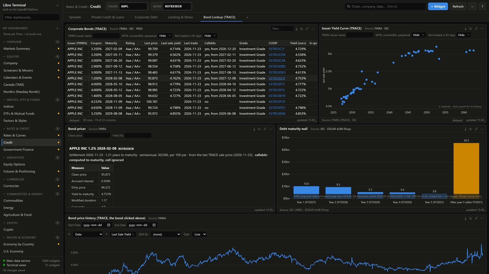

*Credit > Bond Lookup (TRACE): bonos activos de Apple con calificaciones y rendimientos, la curva de rendimiento del emisor, una calculadora de precios de bonos, el calendario de vencimientos de deuda según el último 10-K y el historial de precios de TRACE del CUSIP seleccionado.*

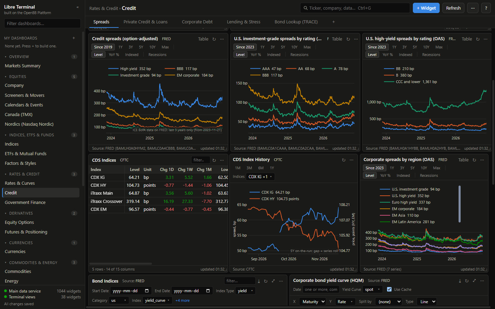

*Credit > Spreads: diferenciales ajustados por opción (OAS) de ICE BofA por calificación y región, junto a los niveles y el historial de los índices CDX e iTraxx a 5 años procedentes de la CFTC.*

### Mercados energéticos y fundamentales físicos de la EIA

El panel Energy abarca los crudos de referencia (WTI y Brent), los márgenes de refinación (*crack spreads* 3-2-1, de diésel y de gasolina), el gas natural TTF europeo frente al Henry Hub estadounidense, el uranio y la demanda y la generación horarias de la red eléctrica de EE. UU. por tipo de combustible.

Con una clave API gratuita de la EIA de EE. UU. se completan los balances físicos semanales y mensuales: inventarios de crudo comerciales y de la Reserva Estratégica de Petróleo (SPR); existencias en Cushing, de gasolina y de destilados, representadas frente a sus rangos y medias estacionales de 5 años; tasa de utilización de las refinerías; flujos comerciales de crudo de EE. UU.; exportaciones de gas natural licuado (GNL); y previsiones del Short-Term Energy Outlook (STEO). También se incluyen de serie los datos de producción y exportaciones internacionales de crudo de JODI.

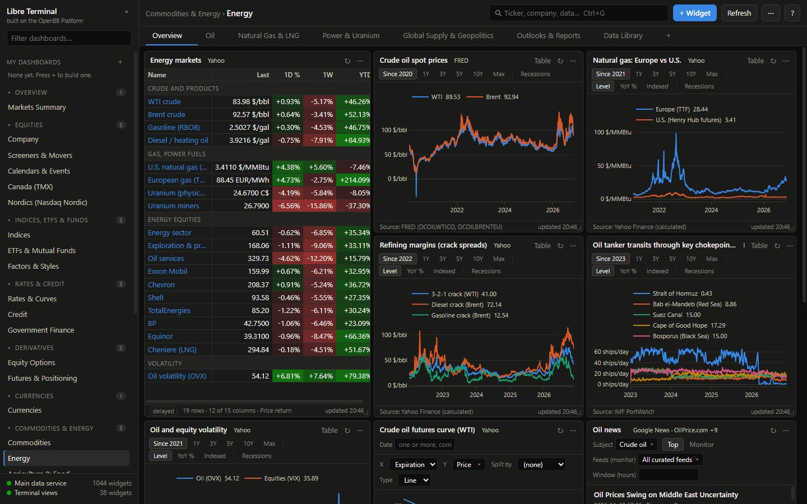

*Energy > Overview: futuros y acciones del sector energético, WTI/Brent, TTF frente a Henry Hub, márgenes de refinación y tránsitos de petroleros por estrechos clave.*

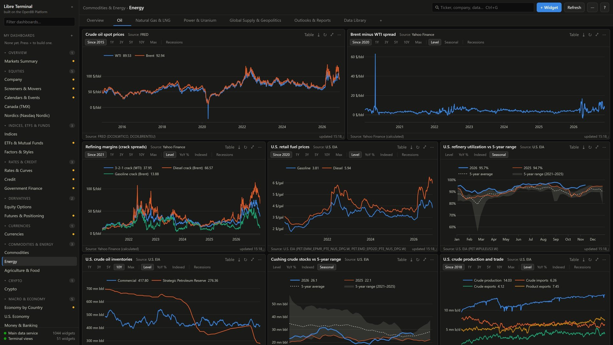

*Energy > Oil: existencias de crudo comerciales y de la SPR, bandas estacionales de 5 años para Cushing, gasolina y diésel, además de producción, comercio exterior y demanda (requiere la clave gratuita de la EIA).*

### Transporte marítimo, macroeconomía global y noticias en formato sala de situación

Con datos de IMF PortWatch, Trade & Shipping sigue a diario los tránsitos de buques por el estrecho de Ormuz, Bab el-Mandeb, el canal de Suez, el cabo de Buena Esperanza, el Bósforo, el canal de Panamá, el estrecho de Malaca y el estrecho de Taiwán. El tráfico se desglosa en petroleros, portacontenedores y graneleros (carga seca a granel), y se compara con el de un año antes y con la referencia de 2023, anterior a la crisis. Otras pestañas añaden mapas de interrupciones portuarias, diagramas de flujos comerciales y aranceles bilaterales.

Country Monitor reúne en una sola tabla el crecimiento del PIB, la inflación, el desempleo, las tasas de política monetaria y los rendimientos soberanos de 17 grandes economías. Al hacer clic en un país se actualizan, justo debajo, los paneles de inflación del FMI, tasas de política monetaria del BPI, curva de rendimiento y noticias. Otras pestañas siguen el índice de riesgo geopolítico de Caldara-Iacoviello en 44 países, la calidad crediticia de la banca estadounidense, las quiebras bancarias registradas por la FDIC y los ratios de cada banco frente a los percentiles de su grupo de comparables (FFIEC UBPR).

El panel News separa los titulares de mercado seleccionados (que agrupan en una sola fila las noticias de agencia duplicadas) de un flujo específico de comunicados oficiales de bancos centrales, institutos de estadística y reguladores financieros.

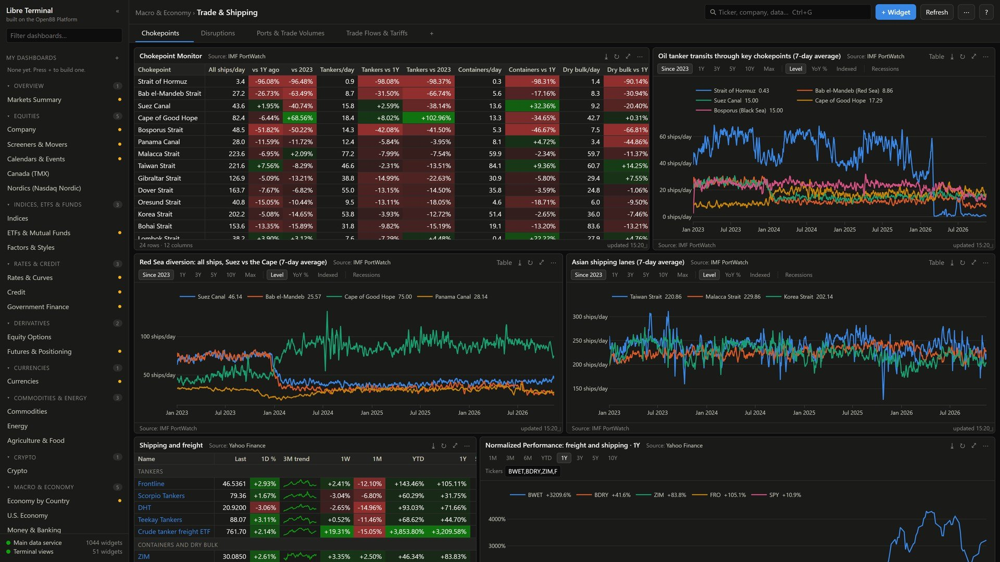

*Trade & Shipping > Chokepoints: número diario de buques frente a hace 1 año y frente a 2023, tránsitos de petroleros, mar Rojo frente a desvíos por el cabo de Buena Esperanza y rutas asiáticas.*

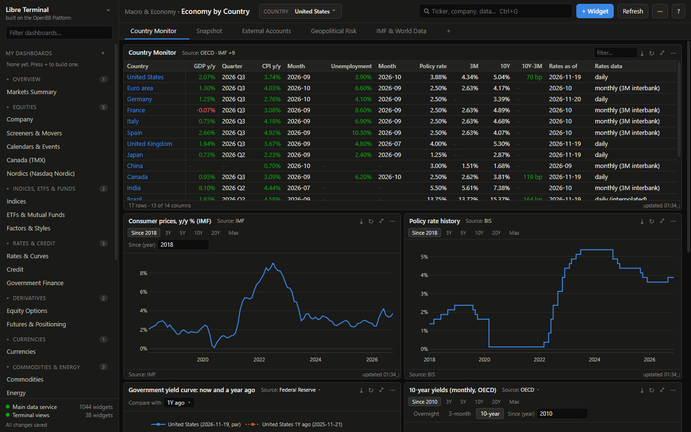

*Economy by Country > Country Monitor: cuadro macroeconómico de 17 economías con la inflación de precios al consumo del FMI y el historial de tasas de política monetaria del BPI.*

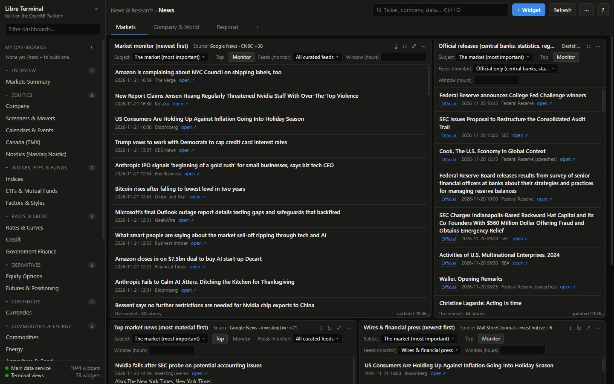

*News > Markets: prensa financiera seleccionada, con las noticias duplicadas agrupadas, a la izquierda, junto a los comunicados oficiales de la Fed, la SEC, la BEA y otros reguladores.*

## Cobertura por panel

| Área | Paneles y pestañas principales |
|---|---|
| **Overview** (visión general) | **Markets Summary**: cuadros de cotizaciones multiactivo con cinco horizontes de rentabilidad, futuros sobre índices y sobre deuda del Tesoro, listas de seguimiento, evolución normalizada, rendimientos del G10, matriz de estilos de la renta variable estadounidense, valores con mayores variaciones, riesgo geopolítico, pasos marítimos estratégicos, noticias y calendarios |
| **Equities** (renta variable) | **Company** (vista general, estados financieros, estimaciones y comunicados 8-K, pares y comparables (*comps*), crecimiento y ratios con bandas de valoración, accionariado e *insiders*, dividendos, documentación de la SEC, posiciones cortas y *dark pools* (mercados opacos), opciones), **Screeners & Movers**, **Calendars & Events**, **Canada (TMX)**, **Nordics (Nasdaq Nordic)** |
| **Indices, ETFs & Factors** (índices, ETF y factores) | **Indices** (cuadros mundiales, componentes, múltiplos de valoración del S&P 500 desde 1871, incluido el CAPE de Shiller, curva de futuros del VIX), **ETFs & Mutual Funds** (posiciones, exposiciones, ponderaciones sectoriales, formularios N-PORT, solapamiento de posiciones entre dos fondos), **Factors & Styles** (cuadros de factores, gráfico de rotación relativa (RRG), correlaciones y estadísticas de riesgo entre clases de activos, factores de Fama-French) |
| **Rates & Credit** (tasas y crédito) | **Rates & Curves** (rendimientos globales, por país, EE. UU., zona del euro, mercados monetarios, swaps y OIS de la CFTC, expectativas de política monetaria, documentos del FOMC), **Credit** (diferenciales OAS, índices CDS de la CFTC, crédito privado y BDC, deuda corporativa, encuestas de préstamos bancarios y tensiones en la banca, consulta de bonos de FINRA TRACE, curva del emisor, calculadora de precios de bonos, calendario de vencimientos de deuda), **Government Finance** (deuda pública, saldo de caja del Tesoro, subastas, balance de la Fed, fallos de liquidación de creadores de mercado primarios (*primary dealer fails*)) |
| **Derivatives** (derivados) | **Equity Options** (cadenas, estadísticas, estructura temporal, sonrisa de volatilidad implícita, superficie 3D, exposición gamma y *Max Pain*, cono de volatilidad, *straddles*, *strangles*, *spreads*, perfil de resultados), **Futures & Positioning** (panel de contratos de primer vencimiento, estructura temporal del VIX, tasas de política monetaria implícitas en los futuros sobre fondos federales, curva del WTI, historial de precios, informes *Commitments of Traders* (COT) de la CFTC para futuros sobre el S&P 500, el Nasdaq, deuda del Tesoro y divisas) |
| **Currencies** (divisas) | **Currencies** (cuadro de contado, fortaleza de cada divisa frente a las variaciones de los pares, matriz de tipos cruzados, diferenciales de tasas de política monetaria, contado frente al diferencial de tasas a 2 años, tipos de cambio efectivos reales (REER), reservas de divisas, *forwards* de divisas de la CFTC, volatilidad implícita, posicionamiento COT) |
| **Commodities & Energy** (materias primas y energía) | **Commodities** (cuadros de cotizaciones, curvas del WTI, el gas, el oro y el cobre, posicionamiento COT), **Energy** (crudo, productos refinados, márgenes de refinación, TTF frente a Henry Hub, inventarios estacionales de 5 años de la EIA, exportaciones de GNL, demanda horaria de la red y combinación de fuentes de generación, paradas nucleares, uranio, JODI, previsiones STEO), **Agriculture & Food** (curvas de cereales, materias primas blandas (*softs*) y ganado, posicionamiento COT, balances WASDE/PSD, datos agrícolas del USDA y de las Fed regionales) |
| **Crypto** (criptoactivos) | **Crypto** (cuadros de contado, historial de precios, libros de órdenes de Deribit, cadenas de opciones, sonrisa y superficie de volatilidad, tasas de financiación (*funding rates*), DVOL frente a la volatilidad realizada a 30 días) |
| **Macro & Economy** (macroeconomía) | **Economy by Country** (Country Monitor, resumen de la OCDE, cuentas externas, riesgo geopolítico de Caldara-Iacoviello, previsiones WEO del FMI), **U.S. Economy** (GDPNow de la Fed de Atlanta, estimaciones de inflación en tiempo real (*nowcasts*) de la Fed de Cleveland, tablas de IPC/IPP/nóminas/JOLTS del BLS, vivienda y sector inmobiliario comercial (CRE), encuestas empresariales, las 12 Fed regionales), **Money & Banking** (morosidad y castigos de cartera (*charge-offs*), quiebras bancarias de la FDIC, percentiles UBPR de cada banco frente a su grupo e informes regulatorios (*call reports*) del FFIEC, liquidez de la Fed y del BCE), **Trade & Shipping** (pasos marítimos estratégicos de IMF PortWatch, mapas de interrupciones y flujos, volúmenes portuarios, comercio bilateral y aranceles), **Data Explorers** (búsqueda de series de FRED, BLS, FMI, OCDE, BCE y la Reserva Federal, además de Data Status) |
| **Government & Regulation** (gobierno y regulación) | **U.S. Congress** (proyectos de ley, leyes, enmiendas, votaciones, miembros, calendarios de comisiones), **Federal Spending** (presupuestos de las agencias según USAspending, adjudicaciones de contratos y principales beneficiarios) |
| **News & Research** (noticias y análisis) | **News** (monitor de mercados, flujo oficial de bancos centrales y reguladores, noticias de empresas y regionales ordenadas por relevancia), **SEC Filings & Enforcement** (búsqueda de texto completo en EDGAR, visor de documentos, secciones extraídas, comunicados de litigios de la SEC, asesores registrados mediante el Form ADV) |

## Uso del terminal

- **Búsqueda desde cualquier pantalla (`/` o `Ctrl+G`):** Escriba un ticker, un nombre de empresa, un CIK de la SEC, un CUSIP o un conjunto de datos (`toyota`, `rheinmetall`, `SHEL.L`, `CIK 320193`, `037833100`, `cpi`, `sofr`, `wasde`). Las acciones se abren en Company; los ETF, en ETFs & Funds; y los índices, divisas, futuros o criptomonedas, en el gráfico principal.
- **Listas de seguimiento:** Mantenga sus propias listas de tickers con el último precio, la variación diaria, cinco horizontes de rentabilidad, minigráficos (*sparklines*) de 3 meses y rangos de 52 semanas en la divisa de negociación de cada valor.
- **Gráfico comparativo:** Represente hasta ocho valores o series de FRED (`FRED:DGS10`) en un mismo eje como precio, variación porcentual, ratio, diferencial o caída desde máximos (*drawdown*), con velas, volumen, medias móviles de 50 y 200 días, escala logarítmica y sombreado de las recesiones según el NBER.
- **Comparables editables:** Las tablas de empresas comparables seleccionan automáticamente el grupo de comparables y calculan las medianas; puede añadir o eliminar tickers para cada empresa, y su lista se guarda localmente.
- **Atribución de la fuente en cada tarjeta:** Cada tarjeta indica su fuente en la cabecera (`Source: SEC`). Haga clic en ella para cambiar a otro proveedor de los mismos datos o abrir la página de origen. Las tarjetas que dependen de un ticker se dirigen automáticamente a la bolsa o al proveedor que lo cubre (opciones estadounidenses a través de Yahoo/Nasdaq/Cboe, canadienses a través de TMX y sobre criptomonedas a través de Deribit; posiciones de ETF estadounidenses a través de Nasdaq y canadienses a través de TMX).
- **Controles de gráficos y tablas:** Cambie el intervalo de fechas (de `1M` a `Max`), alterne entre transformaciones (`Level`, `YoY %`, `Indexed`, `Seasonal` frente al rango de 5 años) o muestre y oculte columnas de las tablas sin modificar su diseño guardado. Exporte cualquier tabla a CSV (con su línea de fuente) o guarde cualquier gráfico como PNG.
- **Paneles personalizados:** Cree sus propias pestañas o paneles con `+`, reorganice libremente las tarjetas y restablezca el diseño original de cualquier panel predefinido mediante **⋯ > Reset to default layout**.
- **Atajos y estado:** Presione `?` para ver los atajos de teclado (`/` lleva el foco a la búsqueda, `s` cambia el símbolo de la página actual, `[` y `]` permiten pasar de una pestaña a otra, y un doble clic en la cabecera de una tarjeta la maximiza). Abra **Data Explorers > Data status** para ver qué fuentes presentan incidencias en origen y qué claves API están configuradas.

## Curvas de rendimiento soberanas oficiales

**Rates & Curves > By Country** construye cada curva a partir de su fuente oficial. Las curvas diarias cubren ocho grandes mercados de deuda soberana sin necesidad de clave API, y las tasas mensuales de la OCDE abarcan unos 30 más:

| País / Región | Plazos y frecuencia | Fuente oficial |
|---|---|---|
| Estados Unidos | De 1M a 30Y, diaria | Reserva Federal (curva a la par del Tesoro) |
| Zona del euro | De 3M a 30Y, diaria | Banco Central Europeo (curva de deuda pública AAA) |
| Alemania | De 6M a 30Y, diaria | Deutsche Bundesbank |
| Reino Unido | De 6M a 40Y, diaria | Banco de Inglaterra |
| Japón | De 1Y a 40Y, diaria | Ministerio de Finanzas |
| Canadá | Letras de 1M a 1Y y bonos de 2Y al plazo más largo, diaria | Banco de Canadá |
| Suecia | Letras de 1M a 6M y bonos de 2Y a 10Y, diaria | Riksbank |
| Brasil | De ~2M a 10Y, diaria | Tesouro Direto (bonos a tasa fija) |
| Francia, Italia, España, Suiza, Australia y ~30 más | 3M y 10Y, mensual | OCDE |

## Claves API gratuitas opcionales

La pestaña inicial de casi todos los paneles funciona sin ninguna clave. Las tarjetas que requieren una clave lo indican claramente y se sitúan después de las que no la necesitan. Registrarse para obtener cualquiera de estas claves públicas gratuitas lleva unos dos minutos:

| Proveedor | Qué añade la clave | Página de registro |
|---|---|---|
| **FRED** | Historial macroeconómico completo de EE. UU., diferenciales de crédito de ICE BofA, precios al contado de materias primas y el panel U.S. Economy *(muchos gráficos de visión general, tasas y macroeconomía también funcionan sin clave a través del canal CSV público de FRED)* | https://fredaccount.stlouisfed.org/apikeys |
| **EIA** | Inventarios de crudo, productos refinados y gas natural de la Administración de Información Energética de EE. UU., rangos estacionales de 5 años, exportaciones de GNL, datos de la red eléctrica y previsiones STEO | https://www.eia.gov/opendata/register.php |
| **BLS** | Tablas de IPC, IPP, situación del empleo (Employment Situation), JOLTS, salarios reales y productividad de la Oficina de Estadísticas Laborales de EE. UU. | https://data.bls.gov/registrationEngine/ |
| **Congress.gov** | Proyectos de ley, votaciones, enmiendas, perfiles de miembros e informes de comisiones de la Cámara de Representantes y el Senado de EE. UU. | https://api.congress.gov/sign-up/ |

Para añadir claves, haga doble clic en **`Setup-Keys.cmd`** en su carpeta `Libre-Terminal`, pegue las claves en el archivo que se abre, guárdelo y reinicie con **`Stop.cmd`** y **`Start.cmd`**. Las claves se almacenan en `local/api_keys.env`, en su equipo. Nunca se escriben en los registros ni se incluyen en commits, y cada clave solo se envía a su propio proveedor.

## Qué debe saber sobre los datos

- **Una cifra es correcta o aparece en blanco con una nota.** Cada tarjeta del terminal indica su fuente y la fecha del dato más reciente utilizado (Country Monitor muestra el periodo de cada celda). Las columnas numéricas declaran su unidad y cada importe indica su divisa. Las principales cifras derivadas (como los múltiplos de valoración y los rendimientos) que quedan fuera de un rango plausible se dejan en blanco con una nota en lugar de mostrarse, y la tarjeta señala cuándo se recurre a una fuente alternativa, a una copia guardada durante una interrupción del servicio o a una respuesta parcial.
- **Cotizaciones diferidas, sin operativa.** Los precios de mercado proceden de Yahoo Finance. Las cotizaciones pueden estar diferidas, y no se ofrece transmisión de datos tick a tick en tiempo real, introducción de órdenes ni alertas de precios.
- **Tiempos de actualización de resultados.** En la pestaña Company > Estimates, el EPS de consenso y el publicado proceden de Yahoo Finance con un criterio único y homogéneo. La tarjeta Earnings calendar muestra, en cambio, el consenso, el EPS publicado y la sorpresa según Nasdaq, por lo que sus cifras pueden diferir ligeramente de las de la pestaña Estimates. Las cifras publicadas aparecen cuando Yahoo las incorpora (normalmente entre unas horas y un día después de la publicación); entretanto, el comunicado de prensa del Exhibit 99.1 del formulario 8-K se carga directamente desde EDGAR. Como Yahoo elimina el consenso de ingresos de un trimestre justo después de la publicación, las sorpresas de ingresos pasadas solo aparecen en los trimestres que el terminal registró antes de la publicación. No se incluyen transcripciones de las conferencias de resultados.
- **Rentabilidad total frente a rentabilidad por precio.** Los cuadros de cotizaciones que solo contienen acciones y fondos muestran la rentabilidad total (con las distribuciones reinvertidas en la fecha ex-dividendo). Los que incluyen un índice, un futuro, una divisa o una criptomoneda muestran la rentabilidad por precio. La línea al pie de cada cuadro indica cuál de las dos se muestra.
- **Cobertura de crédito y bonos.** Los CDS abarcan los índices CDS *on-the-run* a 5 años a partir de los registros de operaciones de los repositorios de swaps de la CFTC; no se dispone de CDS sobre emisores individuales (*single-name*). Los precios de los bonos corporativos proceden de los informes de última operación de FINRA TRACE; no se incluyen cotizaciones de emisiones concretas del Tesoro de EE. UU.
- **Frecuencia de las curvas soberanas.** Las curvas diarias cubren los ocho mercados indicados más arriba. Los demás países se basan en series mensuales de la OCDE a 3 meses y 10 años, por lo que los diferenciales dentro de la zona del euro, como BTP-Bund y OAT-Bund, son mensuales.
- **Interrupciones de las fuentes.** Los proveedores públicos a veces trasladan o retiran sus canales de datos; **Data Explorers > Data status** enumera los que no están disponibles en ese momento. Cuando Cboe bloquea las solicitudes automatizadas a su canal de opciones, los análisis de opciones recurren automáticamente a las cadenas de Yahoo Finance (y calculan localmente las volatilidades implícitas y las griegas con Black-76), la curva del VIX pasa a basarse en los archivos de liquidación de Cboe y las instantáneas de índices estadounidenses utilizan Yahoo, con cada sustitución señalada en la tarjeta. Las barras intradía de Cboe y las cotizaciones históricas de opciones no tienen sustituto. La OCDE suspende ocasionalmente las solicitudes al alcanzarse su límite de frecuencia, y el servicio se restablece más tarde.
- **Alcance geográfico.** Los precios de las acciones, los estados financieros, las estimaciones de analistas, los tenedores y las tablas de comparables funcionan para valores cotizados en todo el mundo. La documentación de la SEC, FINRA TRACE, las posiciones cortas de FINRA, los datos bancarios de la FDIC/FFIEC y los análisis de opciones de EE. UU. se aplican a emisores estadounidenses (los mercados canadiense y nórdico tienen sus propios paneles).
- **Solo datos efectivos en macroeconomía.** Los paneles macroeconómicos muestran publicaciones oficiales y previsiones del FMI, no publicaciones de PMI. El único lugar con el consenso de las encuestas a economistas es la columna Nasdaq de la tarjeta del calendario económico (Economic calendar).
- **Plataforma compatible.** Windows 10 y 11 están probados y son compatibles.

## Actualización y solución de problemas

Todo lo personal (sus listas de seguimiento, diseños personalizados, listas de comparables y claves API opcionales) se guarda en la carpeta `local`.

- **Actualización a una versión más reciente:** Al iniciarse, **`Start.cmd`** comprueba en GitHub si hay una versión más reciente. Si la hay, muestra los cambios y le permite actualizar en el mismo lugar (conservando su carpeta `local`), omitir la actualización esta vez o desactivar las comprobaciones al inicio (`launcher.py update --enable` las vuelve a activar). Si ya dispone de la última versión, se inicia de inmediato. Para actualizar manualmente: ejecute **`Stop.cmd`** en la carpeta antigua, descargue y extraiga el nuevo ZIP, copie la carpeta `local` antigua en la nueva carpeta `Libre-Terminal` y, a continuación, ejecute **`Install.cmd`** y **`Start.cmd`**.
- **Copia de seguridad o cambio de equipo:** Detenga el terminal y copie la carpeta `local`. Para empezar completamente de cero, detenga el terminal y elimine `local`.

| Problema | Qué hacer |
|---|---|
| *«Windows protegió tu PC»* | Haga clic en **Más información** y, a continuación, en **Ejecutar de todas formas**. Solo es necesario una vez; `Install.cmd` desbloquea automáticamente los demás archivos `.cmd`. |
| Los archivos no se ejecutan / aviso *"inside the ZIP"* | Haga clic con el botón derecho en `Libre-Terminal-Windows.zip`, elija **Extraer todo...** y abra la carpeta `Libre-Terminal` extraída. |
| La instalación falla dentro de OneDrive o en una ruta larga | Mueva la carpeta extraída a una ruta local corta, como `C:\Libre-Terminal`, y vuelva a hacer doble clic en `Install.cmd`. Windows limita las rutas de archivo a 260 caracteres, por lo que `Install.cmd` se detiene antes de descargar nada cuando la ruta de la carpeta supera los 83 caracteres (salvo que estén activadas las rutas largas de Windows). |
| La instalación se detiene a medio camino | Suele deberse a un bloqueo de un proxy corporativo, un cortafuegos, una VPN o un antivirus. Pruebe con otra red (una conexión doméstica o el punto de acceso del teléfono) o pida al departamento de TI que autorice `astral.sh`, `github.com` y `pypi.org`; después, vuelva a ejecutar `Install.cmd`, que retoma el proceso donde se detuvo. |
| El antivirus elimina o bloquea archivos | Restáurelos, autorice la carpeta `Libre-Terminal` en el antivirus y vuelva a ejecutar `Install.cmd`. |
| El navegador no se abrió | Abra usted mismo `http://127.0.0.1:6950`. Si la página no carga, vuelva a ejecutar `Start.cmd` y lea las últimas líneas de su ventana. |
| El puerto ya está en uso | Abra el Símbolo del sistema dentro de `Libre-Terminal` y ejecute `Start.cmd --ui-port 7950 --v5-port 7900` (la configuración se guarda para los próximos inicios). |
| Primer inicio lento o tarjetas en blanco | El primer inicio tarda hasta alrededor de un minuto (90 segundos en un equipo lento) mientras se ponen en marcha los servicios de datos. Si un servicio en segundo plano se detiene o se bloquea, el terminal lo reinicia automáticamente; también puede hacer clic en **Restart**, junto a **Refresh** en la barra superior, para reiniciar los servicios de datos detenidos y borrar los errores almacenados en la caché del navegador. Los registros están en `local/logs/`. |
| Una tarjeta solicita una clave API | Añada la clave gratuita con **`Setup-Keys.cmd`** y, después, detenga e inicie el terminal. |
| Desea recuperar el diseño predeterminado | Haga clic en **⋯** en el panel y elija **Reset to default layout**. |
| Desinstalar | Ejecute **`Stop.cmd`** y elimine la carpeta `Libre-Terminal`. |

<details>
<summary><strong>Opciones avanzadas, macOS / Linux y desarrolladores</strong></summary>

### Opciones de inicio y del backend

- **Omitir la espera del primer inicio:** `Start.cmd --no-wait` abre el navegador de inmediato mientras los datos terminan de cargarse en segundo plano.
- **Omitir o gestionar manualmente la comprobación de actualizaciones:** `Start.cmd --no-update` (o definir `TERMINAL_NO_UPDATE=1`) omite una vez la comprobación en GitHub al inicio. Ejecute `.venv-v5\Scripts\python.exe scripts\launcher.py update` (añada `--check`, `--yes` o `--enable`, este último si eligió «don't ask again») para comprobar o actualizar manualmente.
- **Backend V4 heredado (+480 MB):** Ejecute `Install.cmd --with-v4` y `Start.cmd --with-v4` (añada `--v4-port 7901` si define puertos personalizados). Añade 39 tarjetas heredadas (FMP, Intrinio, Finviz, EconDB, WSJ) a los mismos paneles. Una [clave de FMP](https://site.financialmodelingprep.com/developer/docs) gratuita y opcional (250 llamadas/día) completa las tarjetas de FMP.
- **Carpeta local personalizada:** Defina `TERMINAL_LOCAL_DIR` antes de iniciar. Los servicios solo escuchan en `127.0.0.1`.
- **Permitir que una aplicación de escritorio de confianza use los datos del terminal:** Antes de iniciar, asigne a `TERMINAL_EXTRA_ORIGINS` el origen de la aplicación; por ejemplo, `setx TERMINAL_EXTRA_ORIGINS "tauri://localhost http://tauri.localhost"` para una aplicación Tauri (después, abra una ventana nueva e inicie el terminal). Solo se aceptan orígenes exactos (no `*`). Las aplicaciones autorizadas pueden leer datos y vistas, pero no pueden modificar su diseño guardado ni reiniciar servicios. Deje la variable sin definir salvo que confíe en la aplicación.

### macOS / Linux (experimental, sin probar)

Windows 10/11 es la única plataforma probada oficialmente. Para macOS y Linux se incluyen, sin garantía de funcionamiento, scripts de shell que comparten el mismo lanzador:

```sh
git clone https://github.com/samlazs/libre-terminal.git && cd libre-terminal
sh install.sh
sh start.sh          # opens http://127.0.0.1:6950 ; stop with: sh stop.sh
```

Para actualizar un clon de git, detenga el terminal, ejecute `git pull` y vuelva a ejecutar `Install.cmd` (o `sh install.sh`). Su carpeta `local/` no se modifica.

### Carpeta de datos local

Todo lo personal se guarda en `local/`, que git ignora. En cada inicio, el terminal escribe `local/README.txt`, donde se describe su contenido. Los registros están en `local/logs/` (`ui.log`, `v5.log`, `v4.log` y volcados de bloqueos). Cuando un registro supera los 5 MB, se renombra a `.log.1` (y el anterior, a `.log.2`), también mientras el terminal sigue en ejecución, de modo que los registros nunca crecen sin límite.

### Para colaboradores

La arquitectura, el contrato de fuentes, el esquema del estado guardado, los parches en tiempo de ejecución y la lista de pruebas se describen en [docs/ARCHITECTURE.md](ARCHITECTURE.md) (en inglés). Ejecute las comprobaciones sin conexión desde la carpeta del proyecto:

```text
# Windows
.venv-v5\Scripts\python.exe scripts\launcher.py test
.venv-v5\Scripts\python.exe scripts\launcher.py check

# macOS / Linux
.venv-v5/bin/python scripts/launcher.py test
.venv-v5/bin/python scripts/launcher.py check
```

`test` ejecuta en paralelo todos los archivos de pruebas sin conexión (unos 30 segundos, incluidas tres suites de navegador *headless* cuando Edge o Chrome están instalados; `--fast` las omite). `check` abarca codificación, lint, higiene y comprobaciones de fuentes. `gate` ejecuta los controles de publicación G1–G5 contra un terminal en ejecución y registra la evidencia.

</details>

## Licencia y aviso legal

Distribuido bajo la **GNU Affero General Public License v3.0 o posterior** ([LICENSE](../LICENSE)); los avisos de terceros figuran en [NOTICE](../NOTICE). OpenBB Platform y los demás paquetes de Python se instalan desde PyPI con sus propias licencias y no se redistribuyen aquí.

Proyecto no oficial, sin vinculación con OpenBB ni con ningún proveedor de datos, y sin su respaldo ni patrocinio; los nombres solo identifican software y fuentes de datos compatibles. Los datos proceden de terceros y están sujetos a sus propias condiciones, cuyo cumplimiento es responsabilidad del usuario, y pueden llegar con retraso, estar incompletos o ser erróneos. Nada de lo aquí incluido constituye asesoramiento de inversión, financiero, jurídico ni fiscal. El software se proporciona «tal cual», sin garantía de ningún tipo.
