# Libre Terminal

[English](../README.md) &nbsp;·&nbsp; [简体中文](README.zh-CN.md) &nbsp;·&nbsp; **日本語** &nbsp;·&nbsp; [한국어](README.ko.md) &nbsp;·&nbsp; [Español](README.es.md)

> *注：本ドキュメントは機械翻訳のうえネイティブスピーカーによる校閲を行っています。表現の違和感や改善のご提案などがありましたら、ぜひフィードバックをお寄せください。*

ご自身のパソコン上で動作し、ブラウザで操作する、無料・オープンソースのマーケットリサーチ・ターミナルです。

株式、オプション、国債イールドカーブ（利回り曲線）、社債、クレジットスプレッド、為替、コモディティ、エネルギー、海運、マクロ経済データ、SEC提出書類、ニュースを **28のダッシュボード** に集約しています。データは、オープンソースの [OpenBB Platform](https://github.com/OpenBB-finance/OpenBB) を通じて、公的機関・公式ソース（米連邦準備制度理事会（FRB）、欧州中央銀行（ECB）、国際決済銀行（BIS）、国際通貨基金（IMF）、OECD、米証券取引委員会（SEC）、FINRA、CFTC、米エネルギー情報局（EIA）、FDIC、Yahoo Finance、Nasdaq、TMX、Deribit）から取得します。

ほとんどの機能は、アカウント登録やログイン、APIキーなしですぐにご利用いただけます。FRED、EIA、BLS、Congress.gov の無料キー（任意）を追加すると、米国の経済・エネルギー・労働・立法関連のデータがさらに充実します。

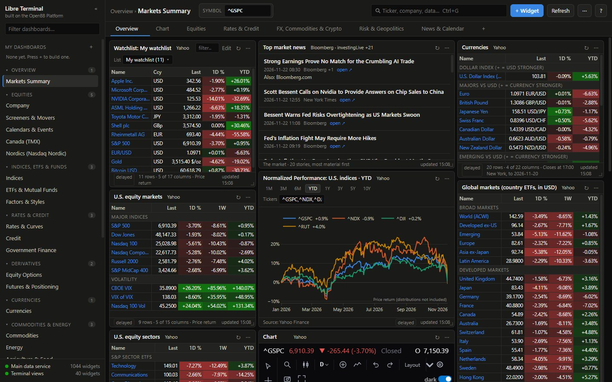

*Markets Summary：ウォッチリスト、主要マーケットニュース、株価指数先物・米国債先物、米国株価指数とセクター、基準化リターン、通貨、国別ETFを1画面に集約。*

## ダウンロードと起動（Windows 10 / 11）

> **[Libre Terminal Windows版をダウンロード（.zip）](https://github.com/samlazs/libre-terminal/releases/latest/download/Libre-Terminal-Windows.zip)** &nbsp;·&nbsp; [最新のリリースノート](https://github.com/samlazs/libre-terminal/releases/latest)

開発ツールや Python、アカウントは不要です。必要なのはインターネット接続と約1 GBの空き容量だけです。

1. **ダウンロード：** [`Libre-Terminal-Windows.zip`](https://github.com/samlazs/libre-terminal/releases/latest/download/Libre-Terminal-Windows.zip) をダウンロードします。リリースページでは *Source code (zip)* ではなく、このファイルを選んでください。
2. **ZIPを展開：** ダウンロードしたファイルを右クリックして **すべて展開...** を選び、**展開** をクリックします。ZIPを開いたウィンドウの中から直接ファイルを実行することはできません。
   - *表示される内容：* `Install.cmd`、`Start.cmd`、`Stop.cmd`、`READ-ME-FIRST.txt` を含む `Libre-Terminal` フォルダーが作成されます。保存先は `C:\Libre-Terminal` のような短いパスが最適です。OneDrive 配下のフォルダーは避けてください。
3. **インストール（初回のみ）：** **`Install.cmd`** をダブルクリックします。所要時間は2〜5分です。
   - *「Windows によって PC が保護されました」* と表示された場合は、**詳細情報** をクリックしてから **実行** をクリックします。この操作が必要なのは初回のみです。
   - *表示される内容：* 黒いウィンドウにダウンロードの進捗が表示され、最後に **Start.cmd** をダブルクリックするよう案内する行が表示されます。確認したらウィンドウを閉じてください。
4. **起動：** **`Start.cmd`** をダブルクリックします。初回の起動には1分ほどかかります。
   - *表示される内容：* ブラウザが開き、`http://127.0.0.1:6950` でターミナルが表示されます（ブックマークしておくと便利です）。黒いウィンドウは閉じてもかまいません。ターミナルはバックグラウンドで動作し続けます。
5. **終了：** 使い終わったら **`Stop.cmd`** で停止します。パソコンを再起動した後は、改めて **`Start.cmd`** を実行してください。**`Setup-Keys.cmd`** を使えば、[オプションの無料 API キー](#オプションの無料-api-キー)をいつでも追加できます。

問題が発生した場合は、ウィンドウに次の対処方法が表示されます。よくあるケースは[トラブルシューティング表](#アップデートとトラブルシューティング)にまとめています。

すべての処理はお使いのパソコン上で完結します。外部に送信される通信は、データプロバイダーへのリクエストのみです。

> 本プロジェクトは非公式のものであり、OpenBB およびいずれのデータプロバイダーとも提携関係にありません。リサーチ専用に開発されたもので、マーケットデータは遅延・欠落・事後修正が生じる場合があります。本ソフトウェアのいかなる内容も投資助言ではありません。詳しくは[ライセンスと免責事項](#ライセンスと免責事項)をご覧ください。

## ターミナルの主な機能

### 株式、類似企業比較（コンプス）、SEC提出書類

ティッカーまたは企業名（`AAPL`、`RY.TO`、`7203.T`、`SHEL.L`）を一度入力するだけで、株価推移、事業概要、財務諸表、アナリストの目標株価、直近のレーティング変更を確認できます。概要の下には編集可能な類似企業比較表（コンプス）があり、時価総額と企業価値（EV）をUSDに換算したうえで、各種マルチプル、利益率、成長率、レバレッジ、ピア中央値を表示します。

財務諸表は、報告値、構成比表示（売上高比・総資産比）、前年比変化の3通りで切り替えられます。Growth & Ratios では、P/E、EV/EBITDA、EV/Sales、P/S、P/B の過去3年・5年・10年の推移を、各マルチプル自身の中央値および10〜90パーセンタイル帯と対比して描画します。用いる数値は各時点で実際に入手可能だった値（米国企業はSEC提出書類、それ以外はYahoo Finance。通貨およびADR比率・株式クラス比率で調整済み）で、ROICとROEのデュポン分解も並べて表示します。米国の銀行については、概要にFDICの資産の質に関する指標を加え、銀行セクターには適さないマルチプルは非表示にします。そのほかのタブでは、インサイダー取引、13Fによる機関投資家の保有状況、FINRA空売り残高、10-K/10-Qから抽出したリスク要因（Risk Factors）とMD&A（経営者による財政状態・経営成績の分析）、SEC開示データの企業横断比較を扱います。

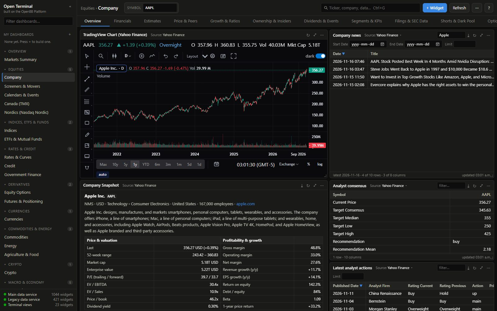

*Company Overview：インタラクティブな株価チャート、バリュエーションと収益性のスナップショット、アナリスト・コンセンサス、企業ニュース。*

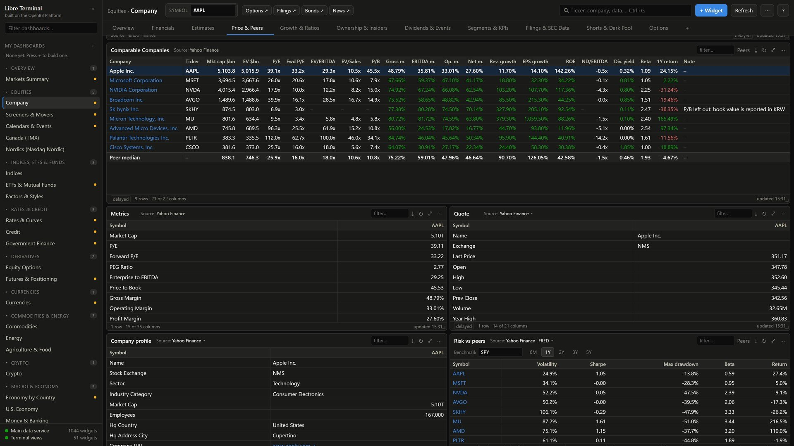

*Company > Price & Peers：マルチプル、利益率、成長率、ROE、レバレッジ、ピア中央値を備えた編集可能なピア比較表。その下に主要指標、クォート（価格情報）、ピア対比リスクの各カードを配置。*

### 決算発表日とオプション・ボラティリティ

決算発表日には、Estimates タブでEPSと売上高の予想値と実績値を対比し、その横に当該企業のSEC Form 8-K プレスリリース（Exhibit 99.1）を表示します。あわせて、2日間の株価変動、オプション市場が織り込む想定変動幅と過去の実現変動幅の比較、12四半期分の決算サプライズ履歴（過去の日付をクリックすると、その四半期のスコアカードとプレスリリースを表示）、アナリスト予想の30日・90日リビジョンも確認できます。

オプションチェーンそのものに加え、オプション関連のビューでは、インプライド・ボラティリティ（IV）期間構造、アウト・オブ・ザ・マネー（OTM）のボラティリティ・スマイル、3Dボラティリティ・サーフェス、限月別の建玉、戦略別のペイオフ（ストラドル、ストラングル、スプレッド）を描画します。Volatility タブでは、行使価格別のディーラーのガンマ・エクスポージャー（GEX）とマックスペイン（Max Pain）水準に加え、10〜126日の実現ボラティリティ・コーンに当日のインプライド・ボラティリティを重ねて表示します。各ティッカーは自動的に適切なソースへ振り分けられます。米国株はYahoo Finance、Nasdaq、Cboeから、カナダ銘柄はモントリオール取引所（TMX）から、暗号資産オプションはDeribitから取得します。

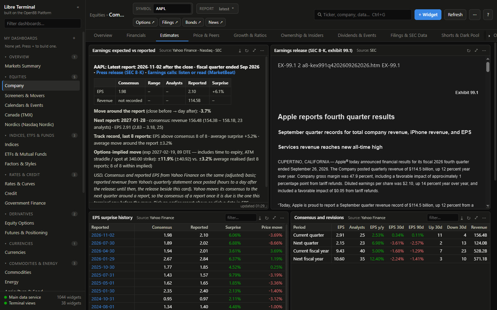

*Company > Estimates：コンセンサスと実績の比較、オプション織り込み変動幅と実現変動幅の比較、予想リビジョン、SEC 8-K リリースのインライン表示。*

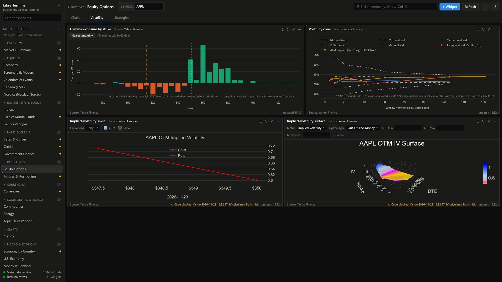

*Equity Options > Volatility：行使価格別のディーラーのガンマ・エクスポージャーとマックスペイン水準、当日のインプライド・ボラティリティを重ねた実現ボラティリティ・コーン、インプライド・ボラティリティ・スマイル、3Dボラティリティ・サーフェス。*

### 国債イールドカーブと中央銀行の政策金利パス

国債カーブは、中央銀行および財務省から直接取得します。国を選ぶと、当日のカーブを1か月前、3か月前、6か月前、1年前、2年前、5年前のカーブと対比して描画し、各年限のベーシスポイント（bp）変化を確認できるほか、BISの政策金利履歴とOECDの長期金利も並べて参照できます。別のグローバル画面では、45か国の利回りマトリクスと約40の中央銀行の政策金利を一覧できます。

Policy Expectations では、CFTCに報告された会合日基準のオーバーナイト・インデックス・スワップ（OIS）の取引データから、主要6中央銀行（FRB、ECB、BOE、日銀、BOC、RBA）の市場織り込み政策金利パスを算出します。当日の織り込みは、1週間前・1か月前と比較できます。表には会合期間ごとに、その会合で織り込まれている変更幅（bp表示、および25 bpの変更に対する比率）と、その1週間・1か月での変化を一覧表示します。その下にはFOMC声明、議事要旨、経済見通しが直接表示され、さらにサンフランシスコ連銀のタームプレミアム推計とアトランタ連銀の政策金利確率が続きます。

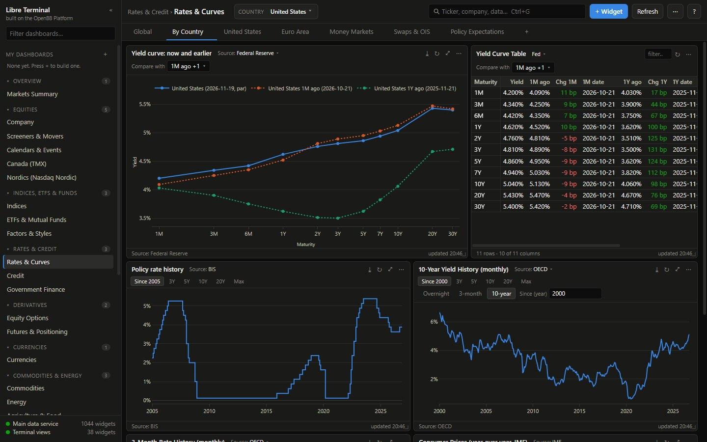

*Rates & Curves > By Country：1M前・1Y前と対比した米国債パー・イールドカーブ、各年限のbp変化表、BIS政策金利履歴、OECD 10年債利回り。*

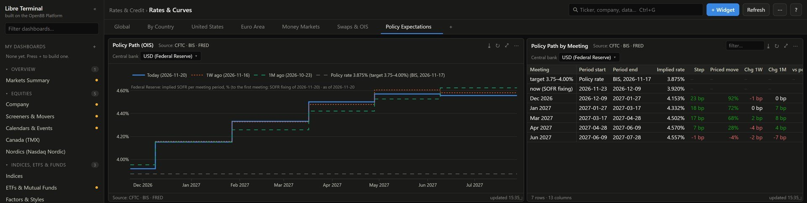

*Rates & Curves > Policy Expectations：CFTCのスワップ約定データから算出したOIS織り込みのFRB政策金利パス（当日と1W前・1M前の比較）と、その下に続くFOMC公表資料。*

### 先物と通貨

1枚の期近限月ボードで、株価指数、米国債、通貨、コモディティ、CMEの暗号資産先物をカバーします。値動きは前営業日の清算値（日曜夜は金曜の終値）を基準に算出し、ランキング表示します。その下にはVIX期間構造、FF金利先物から算出した月別の織り込み政策金利、WTIカーブを配置しています。Currencies ダッシュボードでは、スポットボードと通貨強弱を組み合わせ、各通貨の他の主要7通貨に対する強弱を、対ドルのみの騰落と並べて表示します（ニューヨーク時間17:00の終値ベース）。

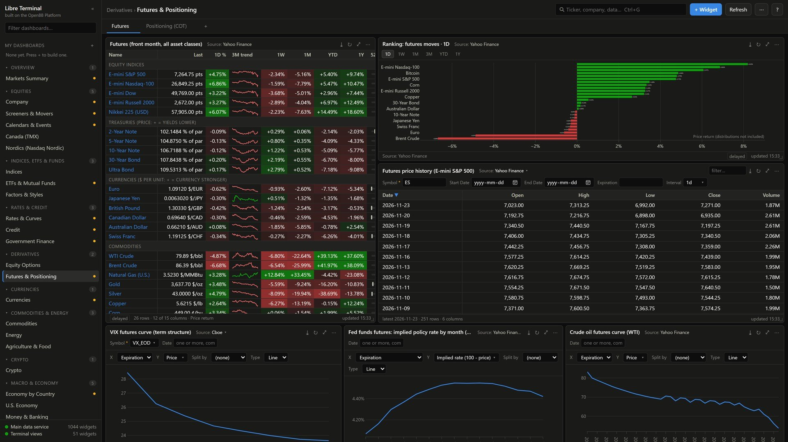

*Futures & Positioning > Futures：資産クラス横断の期近限月ボード、当日の騰落ランキング、価格推移、VIX・FF金利織り込み・WTIの各カーブ。*

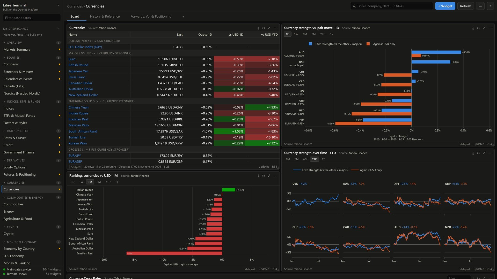

*Currencies > Board：地域別のスポットボード、通貨強弱と通貨ペア騰落の対比、対ドル騰落ランキング。*

### 社債クレジット：FINRA TRACE、スプレッド、CDS指数

Bond Lookup で米国のティッカー、企業名、またはCUSIPを入力すると、FINRA TRACEから当該発行体の取引実績のある社債を取得します。各行には、クーポン、満期、ムーディーズとS&Pの格付け、直近の報告価格、直近約定利回り（コーラブル債の場合は最低利回り（YTW））、コール日が表示されます。さらにターミナル独自に、利回り、修正デュレーション、コンベキシティ、DV01、および対応する年限の米国債に対するGスプレッドを算出します。発行体の全年限にわたるイールドカーブとTRACEの過去価格も並べて表示します。CUSIPをクリックするとその銘柄の債券プライサーが開き、発行体の債務償還スケジュール（満期構成）は直近の10-Kから取得します。

クレジット市場全体については、Spreads タブで、ICE BofAのオプション調整後スプレッド（OAS）（投資適格、ハイイールド、AAAからCCCまでの格付け帯、地域別の社債スプレッド）と、CFTCのスワップ・データ・リポジトリの約定データから算出したオン・ザ・ラン5年物CDS指数の最新水準（CDX IG・HY・EM、iTraxx Main・Crossover）を対比します。そのほかのクレジット関連タブでは、プライベート・クレジット（BDC、レバレッジドローン、CLO、上場オルタナティブ運用会社）、企業レバレッジ、NY連銀の社債市場ディストレス指標、銀行の貸出態度調査を扱います。

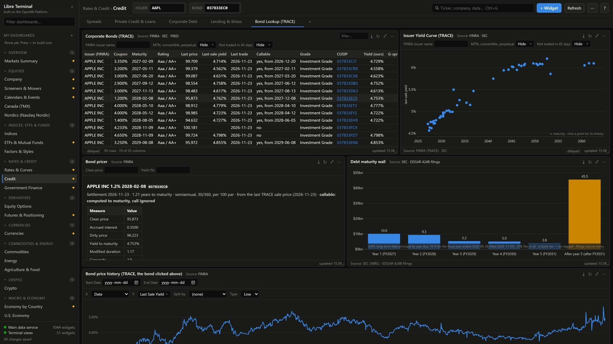

*Credit > Bond Lookup (TRACE)：格付けと利回りを付したAppleの取引中の社債一覧、発行体イールドカーブ、債券プライサー、直近の10-Kに基づく債務償還スケジュール、選択したCUSIPのTRACE価格推移。*

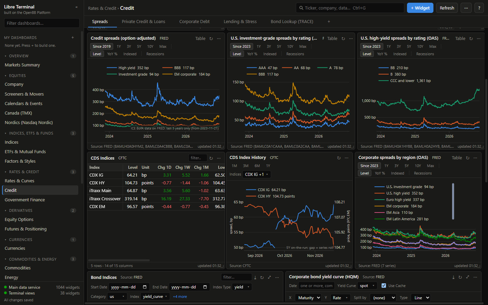

*Credit > Spreads：格付け別・地域別のICE BofAオプション調整後スプレッドと、CFTCデータに基づく5年物CDX・iTraxx指数の水準および推移。*

### エネルギー市場とEIAの需給ファンダメンタルズ

Energy ダッシュボードでは、原油指標（WTI、ブレント）、精製マージン（3-2-1、ディーゼル、ガソリンのクラックスプレッド）、欧州TTFと米ヘンリーハブの天然ガス価格、ウラン、米国電力網の時間別需要と燃料別発電量をカバーします。

無料の米EIA APIキーを設定すると、週次・月次の現物需給データが加わります。具体的には、商業用原油在庫と戦略石油備蓄（SPR）、クッシング在庫、ガソリン在庫、留出油在庫（いずれも過去5年の季節レンジおよび平均と対比して描画）、製油所稼働率、米国の原油貿易フロー、LNG輸出、短期エネルギー見通し（STEO）の予測値です。JODIによる各国の原油生産・輸出データも組み込まれています。

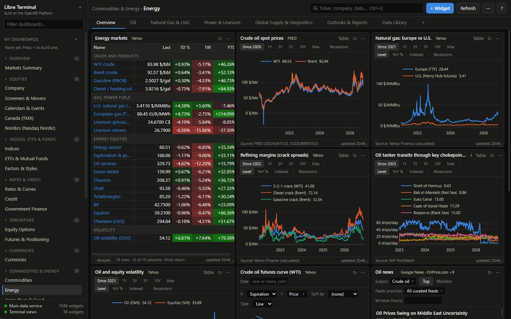

*Energy > Overview：エネルギー先物と関連株、WTI/ブレント、TTFとヘンリーハブの対比、クラックスプレッド、主要海峡のタンカー通航量。*

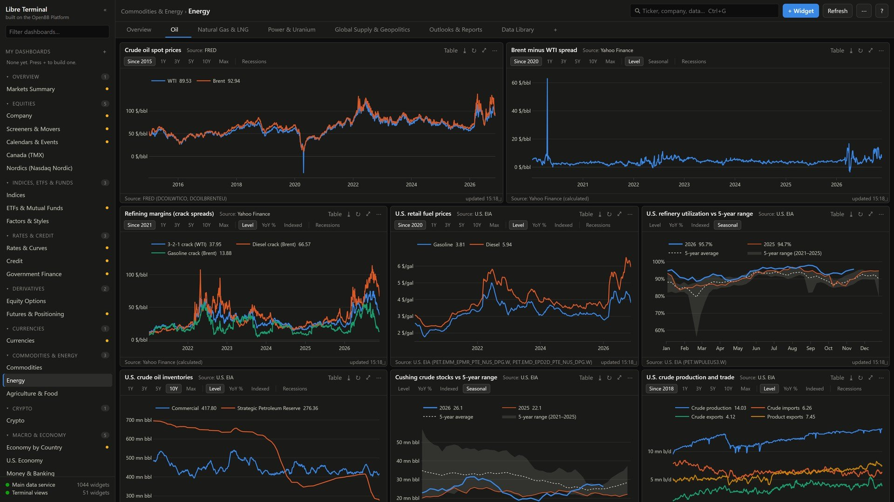

*Energy > Oil：商業用原油在庫とSPR、クッシング・ガソリン・ディーゼル在庫の5年季節レンジ、生産・貿易・需要（無料のEIAキーを使用）。*

### 海運、グローバルマクロ、シチュエーションルーム型ニュース

Trade & Shipping では、IMF PortWatch のデータを用いて、ホルムズ海峡、バブ・エル・マンデブ海峡、スエズ運河、喜望峰、ボスポラス海峡、パナマ運河、マラッカ海峡、台湾海峡の8つのチョークポイント（海上交通の要衝）における日次の船舶通航量を追跡します。通航量はタンカー、コンテナ船、ドライバルク船に分けて集計し、前年同期および危機前の2023年ベースラインと比較します。そのほかのタブでは、港湾の混乱状況マップ、貿易フロー図、二国間関税を確認できます。

Country Monitor は、主要17経済圏のGDP成長率、インフレ率、失業率、政策金利、国債利回りを1つの表にまとめています。国をクリックすると、下段のIMFインフレ率、BIS政策金利、イールドカーブ、ニュースの各パネルが連動して更新されます。そのほかのタブでは、Caldara-Iacoviello の地政学リスク指数（44か国）、米銀の与信の質（資産健全性）、FDICによる銀行破綻、個別銀行の財務比率とピアグループ内パーセンタイルの比較（FFIEC UBPR）を追跡します。

News ダッシュボードは、厳選したマーケット・ヘッドライン（重複する通信社配信記事は1行に集約）と、中央銀行、統計機関、金融規制当局が公表する公式リリース専用のストリームを分けて表示します。

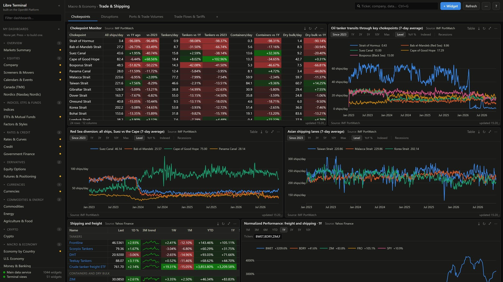

*Trade & Shipping > Chokepoints：日次の通航隻数（1年前および2023年との比較）、石油タンカーの通航量、紅海経由と喜望峰迂回の対比、アジア航路。*

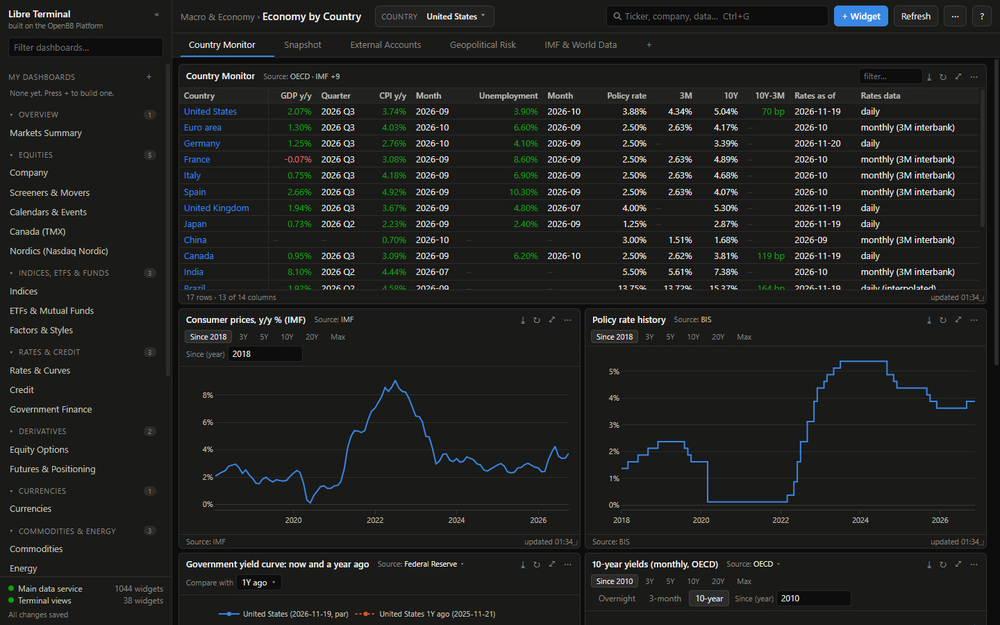

*Economy by Country > Country Monitor：17経済圏のマクロ・スコアカードと、IMFの消費者物価上昇率およびBIS政策金利の履歴。*

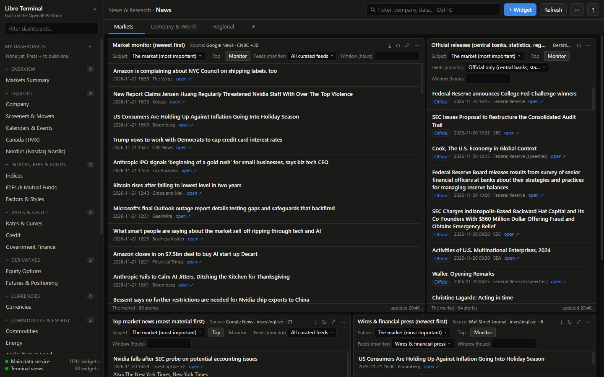

*News > Markets：左側に重複記事を集約した厳選金融ニュース、その横にFRB、SEC、BEAなど規制当局・公的機関の公式リリース。*

## ダッシュボード別のカバー範囲

| 分野 | ダッシュボードと主なタブ |
|---|---|
| **概要**（Overview） | **Markets Summary**：5つのリターン期間にわたるクロスアセットの相場ボード、株価指数先物・米国債先物、ウォッチリスト、基準化パフォーマンス、G10国債利回り、米国株スタイルボックス、値上がり・値下がり上位銘柄、地政学リスク、海運チョークポイント、ニュース、各種カレンダー |
| **株式**（Equities） | **Company**（概要、財務諸表、予想と8-Kリリース、ピアとコンプス、バリュエーション・バンド付きの成長性・財務比率、株主構成とインサイダー、配当、SEC提出書類、空売りとダークプール、オプション）、**Screeners & Movers**、**Calendars & Events**、**Canada (TMX)**、**Nordics (Nasdaq Nordic)** |
| **指数・ETF・ファクター**（Indices, ETFs & Factors） | **Indices**（世界の株価指数ボード、構成銘柄、1871年まで遡るS&P 500のバリュエーション・マルチプル（シラーCAPEを含む）、VIX先物カーブ）、**ETFs & Mutual Funds**（保有銘柄、エクスポージャー、セクター構成比、N-PORT報告書、2ファンド間の保有銘柄の重複）、**Factors & Styles**（ファクターボード、相対ローテーション・グラフ（RRG）、クロスアセットの相関・リスク統計、Fama-French ファクター） |
| **金利・クレジット**（Rates & Credit） | **Rates & Curves**（世界の国債利回り、国別、米国、ユーロ圏、短期金融市場、CFTCのスワップとOIS、政策金利見通し、FOMC関連文書）、**Credit**（OAS、CFTCのCDS指数、プライベート・クレジットとBDC、企業債務、銀行の貸出態度調査とストレス指標、FINRA TRACEによる社債検索、発行体カーブ、債券プライサー、債務償還スケジュール）、**Government Finance**（公的債務、米財務省の現金残高、国債入札、FRBのバランスシート、プライマリー・ディーラーの決済フェイル） |
| **デリバティブ**（Derivatives） | **Equity Options**（オプションチェーン、統計、期間構造、IVスマイル、3Dサーフェス、ガンマ・エクスポージャーとマックスペイン、ボラティリティ・コーン、ストラドル、ストラングル、スプレッド、ペイオフ）、**Futures & Positioning**（期近限月ボード、VIX期間構造、FF金利先物から算出した織り込み政策金利、WTIカーブ、価格推移、S&P 500・Nasdaq・米国債・通貨先物のCFTC建玉明細（COT）） |
| **通貨**（Currencies） | **Currencies**（スポットボード、通貨強弱と通貨ペア騰落の対比、クロスレート・マトリクス、政策金利差、スポットレートと2年金利差の対比、実質実効為替レート（REER）、外貨準備、CFTCの為替フォワード、インプライド・ボラティリティ、COTポジション） |
| **コモディティ・エネルギー**（Commodities & Energy） | **Commodities**（各種ボード、WTI・天然ガス・金・銅のカーブ、COTポジション）、**Energy**（原油、石油製品、精製クラックスプレッド、TTFとヘンリーハブの対比、EIAの5年季節在庫、LNG輸出、時間別の電力需要と電源構成、原子力発電所の停止状況、ウラン、JODI、STEO予測）、**Agriculture & Food**（穀物・ソフトコモディティ・畜産のカーブ、COTポジション、WASDE/PSDの需給、USDAおよび地区連銀の農業データ） |
| **暗号資産**（Crypto） | **Crypto**（スポットボード、価格推移、Deribitの板情報、オプションチェーン、ボラティリティ・スマイルとサーフェス、ファンディングレート、DVOLと30日実現ボラティリティの対比） |
| **マクロ経済**（Macro & Economy） | **Economy by Country**（Country Monitor、OECDスナップショット、対外収支、Caldara-Iacoviello 地政学リスク指数、IMF世界経済見通し（WEO）の予測）、**U.S. Economy**（アトランタ連銀GDPNow、クリーブランド連銀のインフレ・ナウキャスト、BLSのCPI/PPI/雇用統計/JOLTSの各表、住宅・商業用不動産（CRE）、企業景況感調査、全12地区連銀）、**Money & Banking**（延滞率・貸倒償却率、FDICによる銀行破綻、個別銀行のUBPRピア・パーセンタイルとFFIECコールレポート、FRBとECBの流動性）、**Trade & Shipping**（IMF PortWatch のチョークポイント、混乱状況マップと貿易フロー、港湾取扱量、二国間の貿易と関税）、**Data Explorers**（FRED、BLS、IMF、OECD、ECB、FRBの系列検索、および Data Status） |
| **政府・規制**（Government & Regulation） | **U.S. Congress**（法案、成立法、修正案、採決、議員、委員会日程）、**Federal Spending**（USAspending による省庁別予算、契約発注、主要受注先） |
| **ニュース・リサーチ**（News & Research） | **News**（マーケットモニター、中央銀行・規制当局の公式フィード、ランキング表示の企業ニュース・地域ニュース）、**SEC Filings & Enforcement**（EDGAR全文検索、提出書類ビューアー、抽出セクション、SEC訴訟リリース、Form ADV 登録投資顧問） |

## ターミナルの使い方

- **どこからでも検索（`/` または `Ctrl+G`）：** ティッカー、企業名、SEC CIK、CUSIP、またはデータセット名（`toyota`、`rheinmetall`、`SHEL.L`、`CIK 320193`、`037833100`、`cpi`、`sofr`、`wasde`）を入力します。個別株は Company、ETFは ETFs & Funds、株価指数・通貨・先物・暗号資産はメインチャートで開きます。
- **ウォッチリスト：** 任意のティッカーで独自のリストを作成でき、各銘柄の取引通貨建てで、直近値、前日比、5つのリターン期間、3か月のスパークライン、52週レンジを表示します。
- **比較チャート：** 最大8つの銘柄またはFRED系列（`FRED:DGS10`）を同一軸上に、価格、変化率、比率、スプレッド、ドローダウンで描画できます。ローソク足、出来高、50日・200日移動平均線、対数目盛、NBERの景気後退期シャドーにも対応しています。
- **編集可能なコンプス：** 類似企業比較表はピア企業を自動で選定して中央値を算出します。企業ごとにティッカーを追加・削除でき、そのリストはローカルに保存されます。
- **全カードにデータソースを明記：** 各カードのヘッダーにはデータソースが表示されます（`Source: SEC`）。クリックすると、同じデータを別のプロバイダーに切り替えたり、原典ページを開いたりできます。ティッカーに依存するカードは、その銘柄をカバーする取引所やプロバイダーへ自動的に振り分けられます（米国オプションは Yahoo/Nasdaq/Cboe、カナダのオプションは TMX、暗号資産オプションは Deribit。米国ETFの保有銘柄は Nasdaq、カナダETFは TMX）。
- **チャートと表の操作：** 期間（`1M`〜`Max`）の変更、表示形式（`Level`、`YoY %`、`Indexed`、5年レンジと対比する `Seasonal`）の切り替え、表の列の表示・非表示を、保存済みのレイアウトを変更せずに行えます。すべての表はCSV（ソース行付き）でエクスポートでき、すべてのチャートはPNGで保存できます。
- **カスタム・ダッシュボード：** `+` で独自のタブやダッシュボードを作成し、カードを自由に並べ替えられます。組み込みダッシュボードは、**⋯ > Reset to default layout** からいつでも初期レイアウトに戻せます。
- **ショートカットとステータス：** `?` を押すとキーボードショートカットの一覧が表示されます（`/` で検索欄へ移動、`s` で現在のページの銘柄を変更、`[` と `]` でタブを移動、カードのヘッダーをダブルクリックで最大化）。**Data Explorers > Data status** を開くと、上流で停止しているソースと、設定済みのAPIキーを確認できます。

## 公式ソースによる国債イールドカーブ

**Rates & Curves > By Country** では、各カーブを公式ソースから描画します。日次カーブはAPIキー不要で主要8つのソブリン市場をカバーし、月次のOECDデータでさらに約30か国をカバーします。

| 国・地域 | 年限と更新頻度 | 公式ソース |
|---|---|---|
| 米国 | 1M〜30Y、日次 | 米連邦準備制度理事会（FRB）（米国債パー・イールドカーブ） |
| ユーロ圏 | 3M〜30Y、日次 | 欧州中央銀行（AAA格国債カーブ） |
| ドイツ | 6M〜30Y、日次 | ドイツ連邦銀行 |
| 英国 | 6M〜40Y、日次 | イングランド銀行 |
| 日本 | 1Y〜40Y、日次 | 財務省 |
| カナダ | 1M〜1Y（短期国債）、2Y〜長期債、日次 | カナダ銀行 |
| スウェーデン | 1M〜6M（短期国債）、2Y〜10Y、日次 | スウェーデン国立銀行（リクスバンク） |
| ブラジル | 約2M〜10Y、日次 | Tesouro Direto（固定利付国債） |
| フランス、イタリア、スペイン、スイス、オーストラリアほか約30か国 | 3Mおよび10Y、月次 | OECD |

## オプションの無料 API キー

ほぼすべてのダッシュボードで、最初のタブはキーなしで利用できます。キーが必要なカードにはその旨が明示され、キー不要のカードの後に配置されています。以下の無料の公開キーは、いずれも2分ほどで登録できます。

| プロバイダー | キーで追加される内容 | 登録ページ |
|---|---|---|
| **FRED** | 米国マクロ経済データの全期間の履歴、ICE BofAのクレジットスプレッド、コモディティのスポット価格、U.S. Economy ダッシュボード *（概要・金利・マクロ関連の多くのチャートは、FREDの公開CSVフィード経由でキーなしでも利用できます）* | https://fredaccount.stlouisfed.org/apikeys |
| **EIA** | 米エネルギー情報局（EIA）の原油・石油製品・天然ガス在庫、5年季節レンジ、LNG輸出、電力網データ、STEO予測 | https://www.eia.gov/opendata/register.php |
| **BLS** | 米労働統計局（BLS）のCPI、PPI、雇用統計（Employment Situation）、JOLTS、実質賃金、生産性の各表 | https://data.bls.gov/registrationEngine/ |
| **Congress.gov** | 米下院・上院の法案、採決、修正案、議員プロフィール、委員会報告書 | https://api.congress.gov/sign-up/ |

キーを追加するには、`Libre-Terminal` フォルダー内の **`Setup-Keys.cmd`** をダブルクリックし、開いたファイルにキーを貼り付けて保存したうえで、**`Stop.cmd`** と **`Start.cmd`** で再起動します。キーはお使いのパソコン上の `local/api_keys.env` に保存されます。ログに記録されたりコミットされたりすることはなく、各キーはそれぞれのプロバイダーにのみ送信されます。

## データに関する留意事項

- **数値は「正確な値」か「注記付きの空欄」のいずれかです。** ターミナルの各カードには、データソースと、使用した最新データポイントの日付が表示されます（Country Monitor ではセルごとに対象期間を表示）。数値列には単位が明記され、すべての金額に通貨が示されます。主要な派生指標（バリュエーション・マルチプルや利回りなど）が妥当な範囲を外れる場合は、値を表示せず注記付きの空欄とします。また、代替ソースを使用している場合、障害時に保存済みのデータを表示している場合、部分的な結果しか得られなかった場合は、カード上にその旨を表示します。
- **価格データは遅延あり、取引機能なし。** 市場価格は Yahoo Finance から取得します。価格データは遅延する場合があり、リアルタイムのティック配信、発注機能、価格アラート機能はありません。
- **決算データの反映タイミング。** Company > Estimates タブでは、コンセンサスEPSと実績EPSを Yahoo Finance から一貫した基準で取得します。一方、Earnings Calendar カードは Nasdaq のコンセンサス、実績EPS、サプライズを表示するため、Estimates タブの数値とわずかに異なる場合があります。実績値は Yahoo に掲載された時点（通常は発表から数時間〜1日後）で反映されますが、それまでの間も SEC Form 8-K の Exhibit 99.1 プレスリリースは EDGAR から直接読み込まれます。Yahoo は決算発表の直後にその四半期の売上高コンセンサスを削除するため、過去の売上高サプライズは、ターミナルが発表前にコンセンサスを取得できていた四半期についてのみ表示されます。決算説明会のトランスクリプトは含まれません。
- **トータルリターンとプライスリターン。** 個別株とファンドのみで構成される相場ボードはトータルリターン（分配金は権利落ち日に再投資）を表示します。株価指数、先物、通貨、暗号資産を含むボードはプライスリターンを表示します。どちらを表示しているかは、各ボード下部のフッター行に記載されています。
- **クレジット・債券のカバー範囲。** CDSは、CFTCのスワップ・データ・リポジトリへの取引報告に基づくオン・ザ・ラン5年物のインデックスCDSが対象で、シングルネームCDSには対応していません。社債価格は FINRA TRACE の直近約定報告に基づきます。米国債の個別銘柄価格は含まれません。
- **国債カーブの更新頻度。** 日次カーブは上記の8市場が対象です。その他の国はOECDの月次の3か月物・10年物系列に依拠するため、BTP-Bund や OAT-Bund といったユーロ圏内のスプレッドは月次となります。
- **ソースの停止・中断。** 公的なデータプロバイダーは、配信先を変更したり配信を終了したりすることがあります。現在停止しているソースは **Data Explorers > Data status** に一覧表示されます。Cboe がオプションフィードへの自動リクエストをブロックした場合、オプション分析は自動的に Yahoo Finance のオプションチェーンに切り替わり（Black-76 モデルによるインプライド・ボラティリティとグリークスをローカルで計算）、VIXカーブは Cboe の清算値ファイルに、米国株価指数のスナップショットは Yahoo に切り替わります。いずれの代替ソースもカード上に明示されます。Cboe の日中足と過去のオプション・クォートには代替ソースがありません。OECD はレート制限に達するとリクエストの受け付けを一時停止することがありますが、時間をおいて回復します。
- **対象地域。** 株価、財務諸表、アナリスト予想、株主、ピア比較は世界中の上場銘柄に対応しています。SEC提出書類、FINRA TRACE、FINRA空売り残高、FDIC/FFIECの銀行データ、米国オプション分析は米国の発行体が対象です（カナダ市場と北欧市場には専用のダッシュボードがあります）。
- **マクロは実績値のみ。** マクロ関連のダッシュボードは公式統計とIMFの予測を表示し、PMIの公表値は含みません。エコノミスト予想のコンセンサスを掲載しているのは、Economic Calendar カードにある Nasdaq の列のみです。
- **対応プラットフォーム。** Windows 10 および 11 で動作検証済みで、正式にサポートしています。

## アップデートとトラブルシューティング

個人のデータ（ウォッチリスト、カスタムレイアウト、ピアリスト、オプションのAPIキー）は、すべて `local` フォルダー内に保存されます。

- **新しいリリースへのアップデート：** **`Start.cmd`** は起動時に GitHub で新しいリリースの有無を確認します。新しいバージョンがある場合は変更内容を表示し、その場でのアップデート（`local` フォルダーは保持されます）、今回のみスキップ、起動時チェックの無効化（`launcher.py update --enable` で再び有効化できます）から選択できます。すでに最新バージョンの場合は、そのまま起動します。手動でアップデートする場合は、旧フォルダーで **`Stop.cmd`** を実行し、新しいZIPをダウンロードして展開します。続いて旧フォルダーの `local` フォルダーを新しい `Libre-Terminal` フォルダーにコピーし、**`Install.cmd`** と **`Start.cmd`** を実行します。
- **バックアップとパソコンの移行：** ターミナルを停止し、`local` フォルダーをコピーします。完全に初期状態から始め直す場合は、ターミナルを停止して `local` を削除します。

| 症状 | 対処方法 |
|---|---|
| *「Windows によって PC が保護されました」* | **詳細情報** をクリックしてから **実行** をクリックします。この操作は初回のみ必要です。他の `.cmd` ファイルのブロックは `Install.cmd` が自動的に解除します。 |
| ファイルが実行できない / *"inside the ZIP"* と表示される | `Libre-Terminal-Windows.zip` を右クリックして **すべて展開...** を選び、展開された `Libre-Terminal` フォルダーを開きます。 |
| OneDrive 内や長いパスでインストールに失敗する | 展開したフォルダーを `C:\Libre-Terminal` のような短いローカルパスに移動し、改めて `Install.cmd` をダブルクリックします。Windows のファイルパスは260文字までに制限されているため、フォルダーのパスが83文字を超える場合、`Install.cmd` は何もダウンロードせずに処理を停止します（Windows の長いパスのサポートを有効にしている場合を除く）。 |
| インストールが途中で止まる | 多くの場合、社内プロキシ、ファイアウォール、VPN、ウイルス対策ソフトによるブロックが原因です。別のネットワーク（自宅の回線やスマートフォンのテザリング）を試すか、IT部門に `astral.sh`、`github.com`、`pypi.org` への通信の許可を依頼したうえで、改めて `Install.cmd` を実行してください。中断したところから再開されます。 |
| ウイルス対策ソフトがファイルを削除・ブロックする | ファイルを復元し、ウイルス対策ソフトで `Libre-Terminal` フォルダーを許可したうえで、改めて `Install.cmd` を実行します。 |
| ブラウザが開かない | `http://127.0.0.1:6950` を手動で開きます。ページが表示されない場合は、改めて `Start.cmd` を実行し、ウィンドウの最後の数行を確認してください。 |
| ポートがすでに使用されている | `Libre-Terminal` フォルダー内でコマンドプロンプトを開き、`Start.cmd --ui-port 7950 --v5-port 7900` を実行します（設定は次回以降の起動にも引き継がれます）。 |
| 初回起動が遅い、またはカードが空白のまま | 初回起動時は、データサービスの立ち上げに最大1分ほど（低速なマシンでは90秒）かかります。バックグラウンドのサービスが停止またはフリーズした場合は、ターミナルが自動的に再起動します。上部バーの **Refresh** の隣にある **Restart** をクリックして、停止したデータサービスを再起動し、ブラウザにキャッシュされたエラーを消去することもできます。ログは `local/logs/` にあります。 |
| カードでAPIキーを求められる | **`Setup-Keys.cmd`** で無料のキーを追加し、ターミナルを停止してから再度起動します。 |
| 初期レイアウトに戻したい | ダッシュボードの **⋯** をクリックし、**Reset to default layout** を選択します。 |
| アンインストール | **`Stop.cmd`** を実行し、`Libre-Terminal` フォルダーを削除します。 |

<details>
<summary><strong>高度な設定、macOS / Linux、開発者向け情報</strong></summary>

### 起動オプションとバックエンドの設定

- **初回起動時の待機を省略：** `Start.cmd --no-wait` を使うと、データの読み込みをバックグラウンドで続けながら、すぐにブラウザを開きます。
- **アップデート確認のスキップと手動管理：** `Start.cmd --no-update`（または `TERMINAL_NO_UPDATE=1` を設定）で、起動時の GitHub チェックを1回だけスキップします。手動で確認・アップデートするには `.venv-v5\Scripts\python.exe scripts\launcher.py update` を実行します（`--check` や `--yes` を付けるほか、"don't ask again" を選んだ後は `--enable` を付けて再び有効化できます）。
- **レガシー V4 バックエンド（+480 MB）：** `Install.cmd --with-v4` と `Start.cmd --with-v4` を実行します（ポートを独自に指定する場合は `--v4-port 7901` を追加）。同じダッシュボードに39枚のレガシーカード（FMP、Intrinio、Finviz、EconDB、WSJ）が追加されます。オプションの無料 [FMPキー](https://site.financialmodelingprep.com/developer/docs)（1日250コール）を設定すると、FMPのカードにデータが表示されます。
- **ローカルフォルダーの変更：** 起動前に `TERMINAL_LOCAL_DIR` を設定します。各サービスは `127.0.0.1` にのみバインドされます。
- **信頼できるデスクトップアプリにターミナルのデータ利用を許可：** 起動前に `TERMINAL_EXTRA_ORIGINS` にアプリのオリジンを設定します。たとえば Tauri アプリの場合は `setx TERMINAL_EXTRA_ORIGINS "tauri://localhost http://tauri.localhost"` を実行します（その後、新しいウィンドウを開いてターミナルを起動してください）。受け付けるのは完全一致のオリジンのみです（`*` は使用できません）。登録したアプリはデータやビューを読み取れますが、保存済みのレイアウトの変更やサービスの再起動はできません。信頼できるアプリでない限り、設定しないでください。

### macOS / Linux（試験的・未検証）

公式に動作検証しているプラットフォームは Windows 10/11 のみです。macOS と Linux 向けには、同じランチャーを共有するシェルスクリプトをベストエフォートで同梱しています。

```sh
git clone https://github.com/samlazs/libre-terminal.git && cd libre-terminal
sh install.sh
sh start.sh          # http://127.0.0.1:6950 を開きます（停止: sh stop.sh）
```

git clone で取得した環境をアップデートするには、ターミナルを停止して `git pull` を実行し、`Install.cmd`（または `sh install.sh`）を再実行します。`local/` フォルダーには影響しません。

### ローカルデータフォルダー

個人のデータはすべて `local/` に保存され、git の管理対象外です。ターミナルは起動のたびに、その内容を説明する `local/README.txt` を書き出します。ログは `local/logs/`（`ui.log`、`v5.log`、`v4.log`、およびフリーズ時のダンプ）にあります。5 MBを超えたログは `.log.1` に（それ以前のものは `.log.2` に）リネームされます。この処理はターミナルの稼働中にも行われるため、ログが際限なく肥大化することはありません。

### コントリビューター向け

アーキテクチャ、データソース規約、保存状態のスキーマ、ランタイムパッチ、テスト一覧は [docs/ARCHITECTURE.md](ARCHITECTURE.md)（英語）にまとめています。オフラインチェックはプロジェクトフォルダーから実行します。

```text
# Windows
.venv-v5\Scripts\python.exe scripts\launcher.py test
.venv-v5\Scripts\python.exe scripts\launcher.py check

# macOS / Linux
.venv-v5/bin/python scripts/launcher.py test
.venv-v5/bin/python scripts/launcher.py check
```

`test` はオフラインのテストファイルをすべて並列実行します（約30秒。Edge または Chrome がインストールされている場合は3つのヘッドレスブラウザ・テストスイートを含み、`--fast` を指定するとこれらを省略します）。`check` はエンコーディング、Lint、リポジトリの衛生状態、ソースの各チェックを行います。`gate` は稼働中のターミナルに対してリリースゲート G1–G5 を実行し、その結果をエビデンスとして記録します。

</details>

## ライセンスと免責事項

本ソフトウェアは **GNU Affero General Public License v3.0 以降** のもとでライセンスされています（[LICENSE](../LICENSE)）。第三者の権利表示は [NOTICE](../NOTICE) に記載しています。OpenBB Platform およびその他の Python パッケージは、それぞれのライセンスのもとで PyPI からインストールされるものであり、本リポジトリで再配布するものではありません。

本プロジェクトは非公式のものであり、OpenBB およびいずれのデータプロバイダーとも提携関係になく、その承認や後援も受けていません。各名称は、互換性のあるソフトウェアおよびデータソースを示す目的でのみ使用しています。データは第三者がそれぞれの利用規約に基づいて提供するもので、規約の遵守は利用者の責任となります。また、データには遅延、欠落、誤りが含まれる場合があります。本ソフトウェアのいかなる内容も、投資、金融、法務、税務に関する助言ではありません。本ソフトウェアは「現状のまま」提供され、いかなる種類の保証も行いません。
