# Libre Terminal

[English](../README.md) &nbsp;·&nbsp; [简体中文](README.zh-CN.md) &nbsp;·&nbsp; [日本語](README.ja.md) &nbsp;·&nbsp; **한국어** &nbsp;·&nbsp; [Español](README.es.md)

> *참고: 이 문서는 기계 번역 후 원어민의 검수를 거쳤습니다. 어색한 표현이나 개선 의견이 있으시면 언제든 피드백을 남겨 주시기 바랍니다.*

내 컴퓨터에서 실행되고 브라우저에서 열리는 무료 오픈소스 시장 리서치 터미널입니다.

주식, 옵션, 국채 수익률 곡선, 회사채, 신용 스프레드, 외환, 원자재, 에너지, 해운, 거시경제 데이터, SEC 공시, 뉴스를 **28개 대시보드**에 한데 모았습니다. 데이터는 오픈소스 [OpenBB Platform](https://github.com/OpenBB-finance/OpenBB)을 통해 공공·공식 출처(연방준비제도, ECB, BIS, IMF, OECD, SEC, FINRA, CFTC, 미국 에너지정보청(EIA), FDIC, Yahoo Finance, Nasdaq, TMX, Deribit)에서 가져옵니다.

대부분의 기능은 계정, 로그인, API 키 없이 바로 사용할 수 있습니다. FRED, EIA, BLS, Congress.gov의 무료 키(선택 사항)를 등록하면 미국 경제·에너지·노동·입법 데이터가 추가됩니다.

> **[인터랙티브 데모 체험하기](https://samlazs.github.io/libre-terminal/)** *(고정된 시장 스냅샷으로 브라우저에서 실제 UI를 직접 둘러볼 수 있습니다)*<br>
> **[Windows용 다운로드 (.zip)](https://github.com/samlazs/libre-terminal/releases/latest/download/Libre-Terminal-Windows.zip)**

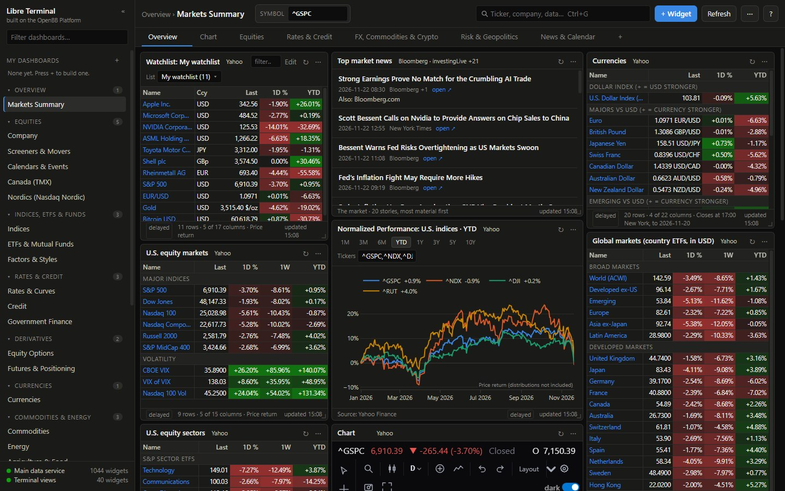

*Markets Summary: 관심종목, 주요 시장 뉴스, 지수·국채 선물, 미국 지수와 섹터, 정규화 수익률, 통화, 국가별 ETF를 한 화면에 담았습니다.*

## 다운로드 및 실행 (Windows 10 / 11)

> **[Windows용 Libre Terminal 다운로드 (.zip)](https://github.com/samlazs/libre-terminal/releases/latest/download/Libre-Terminal-Windows.zip)** &nbsp;·&nbsp; [최신 릴리스 노트](https://github.com/samlazs/libre-terminal/releases/latest)

코딩 도구, Python, 계정은 필요 없습니다. 인터넷 연결과 약 1 GB의 여유 공간만 있으면 됩니다.

1. **다운로드:** [`Libre-Terminal-Windows.zip`](https://github.com/samlazs/libre-terminal/releases/latest/download/Libre-Terminal-Windows.zip)을 내려받습니다. 릴리스 페이지에서는 *Source code (zip)*이 아니라 이 파일을 선택하십시오.
2. **ZIP 압축 풀기:** 내려받은 파일을 마우스 오른쪽 버튼으로 클릭하고 **모두 압축 풀기...**를 선택한 뒤 **압축 풀기**를 클릭합니다. ZIP 창 안에서는 파일을 실행할 수 없습니다.
   - *확인:* `Install.cmd`, `Start.cmd`, `Stop.cmd`, `READ-ME-FIRST.txt`가 들어 있는 `Libre-Terminal` 폴더가 보입니다. `C:\Libre-Terminal`처럼 짧은 경로가 가장 좋으며, OneDrive 폴더는 피하십시오.
3. **최초 1회 설치:** **`Install.cmd`**를 더블클릭합니다. 2~5분 정도 걸립니다.
   - *"Windows의 PC 보호"* 창이 나타나면 **추가 정보**를 클릭한 다음 **실행**을 클릭합니다. 이 작업은 한 번만 하면 됩니다.
   - *확인:* 검은 창에 다운로드 진행 상황이 표시되고, 마지막 줄에 **Start.cmd**를 더블클릭하라는 안내가 나옵니다. 창을 닫으십시오.
4. **시작:** **`Start.cmd`**를 더블클릭합니다. 첫 실행에는 1분 정도 걸립니다.
   - *확인:* 브라우저에서 `http://127.0.0.1:6950` 주소로 터미널이 열립니다(즐겨찾기에 추가해 두십시오). 검은 창은 닫아도 되며, 터미널은 백그라운드에서 계속 실행됩니다.
5. **종료:** 사용을 마치면 **`Stop.cmd`**로 종료합니다. 컴퓨터를 다시 시작한 뒤에는 **`Start.cmd`**를 다시 실행하십시오. [선택적 무료 API 키](#선택적-무료-api-키)는 언제든 **`Setup-Keys.cmd`**로 추가할 수 있습니다.

문제가 생기면 창에 다음 조치가 안내되며, 자주 발생하는 사례는 [문제 해결 표](#업데이트-및-문제-해결)에 정리되어 있습니다.

모든 처리는 사용자 컴퓨터 안에서 이루어집니다. 외부로 나가는 트래픽은 데이터 제공업체로 보내는 요청뿐입니다.

> 비공식 프로젝트이며 OpenBB 및 어떤 데이터 제공업체와도 관계가 없습니다. 리서치 전용으로 제작되었습니다. 시장 데이터는 지연되거나 불완전하거나 사후 수정될 수 있으며, 여기에 있는 어떤 내용도 투자 조언이 아닙니다. [라이선스 및 면책 조항](#라이선스-및-면책-조항)을 참고하십시오.

## 터미널 둘러보기

### 주식, 동종기업 비교(Comps), SEC 공시

티커나 회사명(`AAPL`, `RY.TO`, `7203.T`, `SHEL.L`)을 한 번만 입력하면 주가 추이, 사업 스냅샷, 재무제표, 증권가 목표주가, 최근 애널리스트 투자의견 변경 내역을 볼 수 있습니다. 개요 아래에 있는 편집 가능한 동종기업 비교표(Comps)는 시가총액과 기업가치(EV)를 USD로 환산하고 밸류에이션 배수, 마진, 성장률, 레버리지, 피어 중앙값을 보여줍니다.

재무제표는 보고 수치, 공통형 재무제표(매출액 또는 총자산 대비 비중), 전년 대비 증감 중에서 선택해 볼 수 있습니다. Growth & Ratios는 P/E, EV/EBITDA, EV/Sales, P/S, P/B의 3년·5년·10년 추이를 해당 배수의 중앙값 및 10~90 백분위 밴드와 함께 보여주며, ROIC와 ROE 듀퐁 분해도 나란히 제공합니다. 이때 각 시점 당시 공시·확인 가능했던 수치(Point-in-Time)를 사용합니다(미국 기업은 SEC 공시, 그 외 기업은 Yahoo Finance 기준이며 통화와 ADR 또는 종류주 교환비율을 조정). 미국 은행은 스냅샷에 FDIC 자산건전성 지표가 추가되고, 은행 업종에 적합하지 않은 배수는 제외됩니다. 그 밖의 탭에서는 내부자 거래, 13F 기관 보유 현황, FINRA 공매도 잔고, 10-K/10-Q에서 추출한 Risk Factors 및 MD&A, 기업 간 SEC 데이터 비교를 다룹니다.

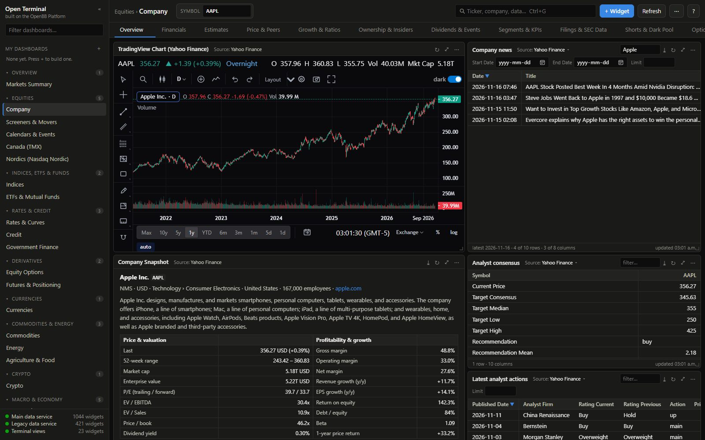

*Company Overview: 인터랙티브 주가 차트, 밸류에이션·수익성 스냅샷, 애널리스트 컨센서스, 기업 뉴스.*

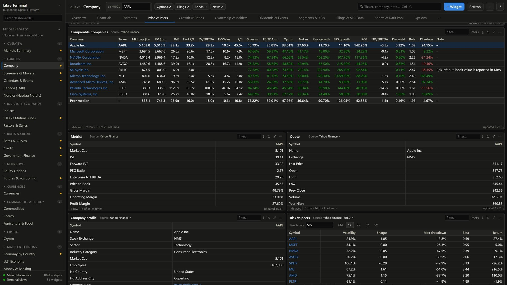

*Company > Price & Peers: 배수, 마진, 성장률, ROE, 레버리지, 피어 중앙값을 담은 편집 가능한 피어 표와 그 아래의 지표·시세·피어 대비 리스크 카드.*

### 실적 발표일과 옵션 변동성

실적 발표일에는 Estimates 탭에서 EPS와 매출의 예상치와 발표치를 회사의 SEC Form 8-K 보도자료(Exhibit 99.1)와 나란히 비교할 수 있습니다. 이 밖에도 2일간 주가 변동, 옵션 내재 변동폭 대 과거 실현 변동폭, 12개 분기의 어닝 서프라이즈 이력(과거 날짜를 클릭하면 해당 분기의 스코어카드와 보도자료를 불러옵니다), 30일·90일 애널리스트 추정치 수정 내역을 보여줍니다.

옵션 화면은 옵션 체인 외에도 내재변동성(IV) 기간구조, 외가격(OTM) 변동성 스마일, 3D 변동성 곡면, 만기별 미결제약정, 전략 손익 구조(스트래들, 스트랭글, 스프레드)를 차트로 제공합니다. Volatility 탭에는 맥스 페인(Max Pain) 수준을 표시한 행사가별 딜러 감마 익스포저(GEX)와, 현재 내재변동성을 겹쳐 놓은 10~126일 실현변동성 콘이 추가됩니다. 각 티커는 자동으로 적합한 소스에 연결됩니다. 미국 주식은 Yahoo Finance, Nasdaq, Cboe에서, 캐나다 종목은 몬트리올 거래소(TMX)에서, 암호화폐 옵션은 Deribit에서 데이터를 가져옵니다.

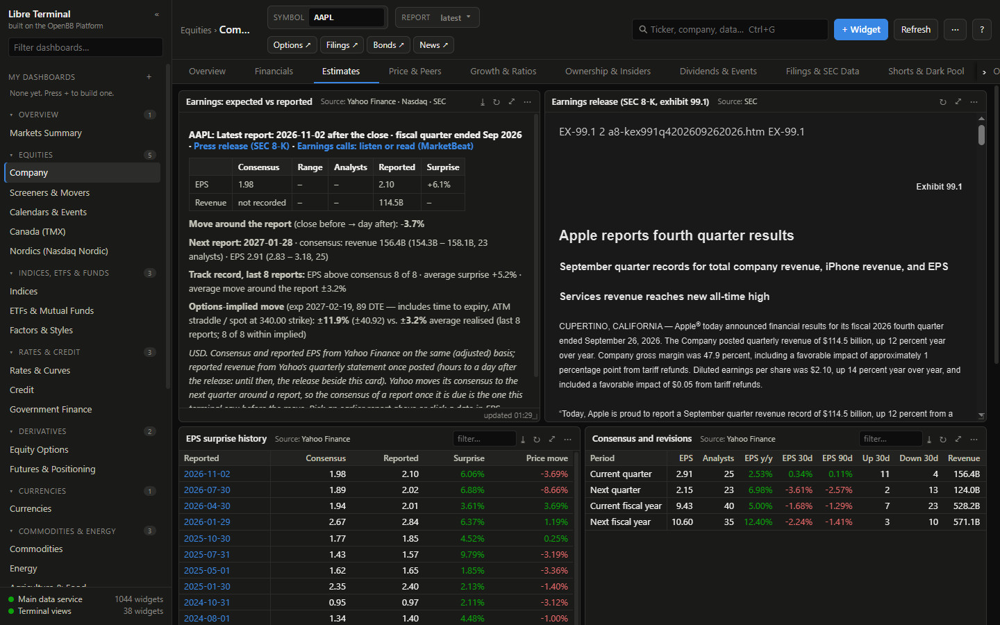

*Company > Estimates: 컨센서스 대 발표 실적, 옵션 내재 변동폭 대 실현 변동폭, 추정치 수정, 인라인으로 표시되는 SEC 8-K 보도자료.*

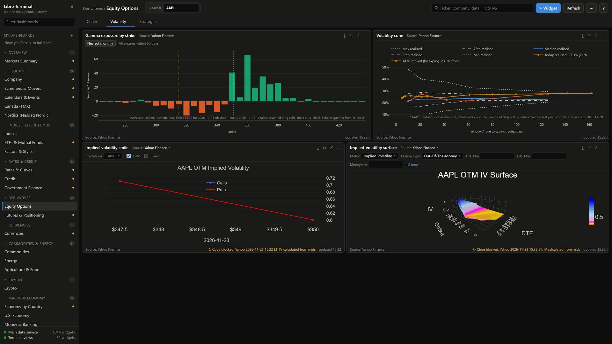

*Equity Options > Volatility: 맥스 페인(Max Pain) 수준을 표시한 행사가별 딜러 감마 익스포저, 현재 내재변동성을 겹친 실현변동성 콘, 내재변동성 스마일, 3D 변동성 곡면.*

### 국채 수익률 곡선과 중앙은행 정책 경로

국채 수익률 곡선은 각국 중앙은행과 재무부에서 직접 가져옵니다. 국가를 선택하면 현재 곡선을 1개월, 3개월, 6개월, 1년, 2년, 5년 전 곡선과 비교하고, 만기별 bp 변화를 확인하며, BIS 정책금리 이력을 OECD 장기금리와 함께 살펴볼 수 있습니다. 별도의 글로벌 화면에서는 45개국 국채 금리 매트릭스와 약 40개 중앙은행의 정책금리를 보여줍니다.

Policy Expectations에서는 CFTC에 보고된 회의일 기준 오버나이트 인덱스 스왑(OIS) 거래 데이터로 6개 주요 중앙은행(Fed, ECB, BoE, BoJ, BoC, RBA)의 시장 내재 기준금리 경로를 산출합니다. 현재 시장 반영치(프라이싱)는 1주 전 및 1개월 전과 비교됩니다. 표에는 각 회의 구간별로 해당 회의에 반영된 금리 변동폭(bp 및 25 bp 변동 대비 비중)과 지난 1주·1개월간의 변화가 표시됩니다. 바로 아래에서 FOMC 성명서, 의사록, 경제전망을 열람할 수 있고, 이어서 샌프란시스코 연은의 기간 프리미엄(Term Premium) 추정치와 애틀랜타 연은의 금리 확률이 표시됩니다.

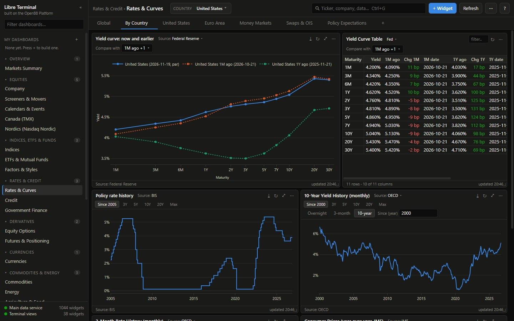

*Rates & Curves > By Country: 1M·1Y 전과 비교한 미 국채 액면 수익률 곡선(Par Curve), bp 변화 표, BIS 정책금리 이력, OECD 10년물 금리.*

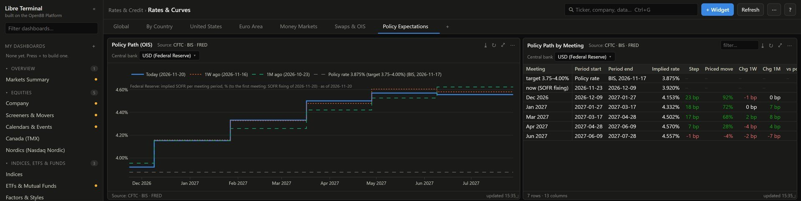

*Rates & Curves > Policy Expectations: CFTC 스왑 체결 데이터로 산출한 OIS 내재 연준 금리 경로(현재 대 1W·1M 전)와 그 아래의 FOMC 발표 자료.*

### 선물과 통화

최근월물 보드 하나로 주가지수, 국채, 통화, 원자재, CME 암호화폐 선물을 모두 다룹니다. 등락은 직전 정산가(일요일 저녁에는 금요일 종가) 대비로 계산해 순위를 매깁니다. 그 아래에는 VIX 기간구조, 월별 연방기금(Fed funds) 내재 정책금리, WTI 곡선이 배치됩니다. Currencies 대시보드는 현물 보드와 통화 강도를 함께 보여줍니다. 각 통화의 나머지 7개 주요 통화 대비 강도를 달러 대비 등락과 나란히 비교하며, 뉴욕 시간 17:00 종가를 기준으로 합니다.

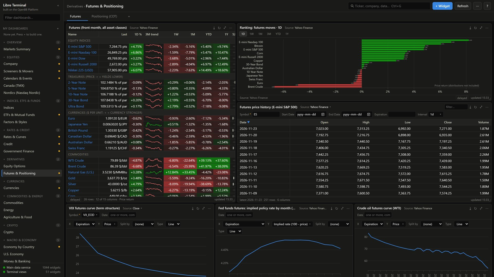

*Futures & Positioning > Futures: 자산군별 최근월물 보드, 당일 등락 순위, 가격 추이, VIX·연방기금 내재금리·WTI 곡선.*

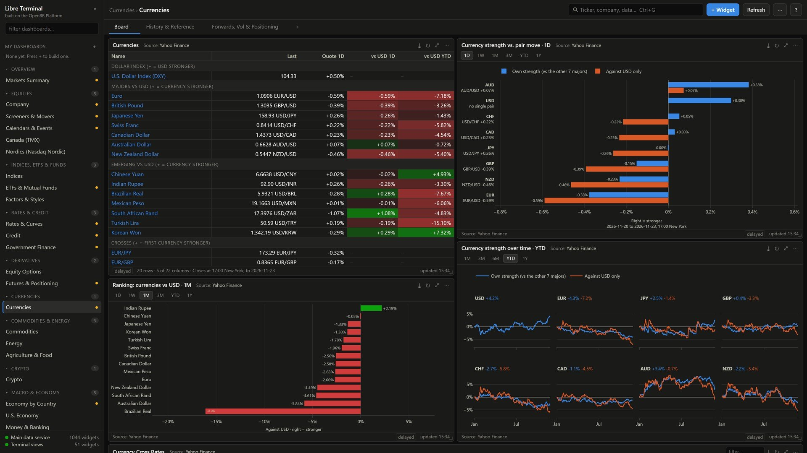

*Currencies > Board: 지역별 현물 보드, 통화 강도 대 통화쌍 등락, 달러 대비 순위.*

### 회사채 신용: FINRA TRACE 채권, 스프레드, CDS 지수

Bond Lookup에 미국 티커, 회사명 또는 CUSIP을 입력하면 FINRA TRACE에서 해당 발행사의 거래된 회사채를 불러옵니다. 각 행에는 쿠폰, 만기, Moody's 및 S&P 신용등급, 최종 보고 가격, 최종 체결 수익률(콜옵션부 채권은 최저수익률[YTW] 기준), 콜 일정이 표시됩니다. 터미널은 여기에 자체 계산한 수익률, 수정 듀레이션, 컨벡시티(볼록성), DV01, 만기가 대응하는 국채 대비 G-스프레드를 더합니다. 발행사의 전체 만기 수익률 곡선과 과거 TRACE 가격도 함께 보여줍니다. CUSIP을 클릭하면 해당 채권의 가격 계산기가 열리며, 발행사의 부채 만기 도래 구조(Debt Maturity Wall)는 최신 10-K에서 가져옵니다.

신용시장 전반을 보려면 Spreads 탭을 활용하십시오. 투자등급, 하이일드, AAA~CCC 등급 구간, 지역별 회사채의 ICE BofA 옵션조정스프레드(OAS)를, CFTC 스왑 데이터 저장소 체결 데이터로 산출한 지표물(On-the-run) 5년물 CDS 지수(CDX IG·HY·EM, iTraxx Main·Crossover)의 실시간 수준과 나란히 보여줍니다. 그 밖의 신용 탭에서는 사모신용(BDC, 레버리지론, CLO, 상장 대체투자 운용사), 기업 레버리지, 뉴욕 연은 회사채 시장 디스트레스 지표, 은행 대출 서베이를 다룹니다.

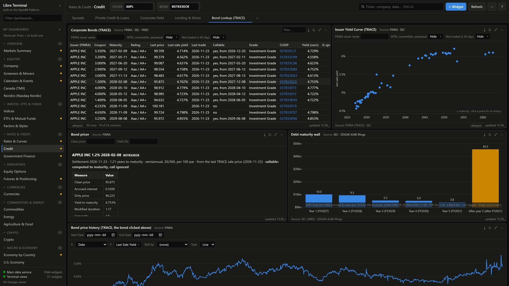

*Credit > Bond Lookup (TRACE): 신용등급과 수익률을 표시한 거래 활성 Apple 채권, 발행사 수익률 곡선, 채권 가격 계산기, 최신 10-K 기준 부채 만기 도래 구조, 선택한 CUSIP의 TRACE 가격 추이.*

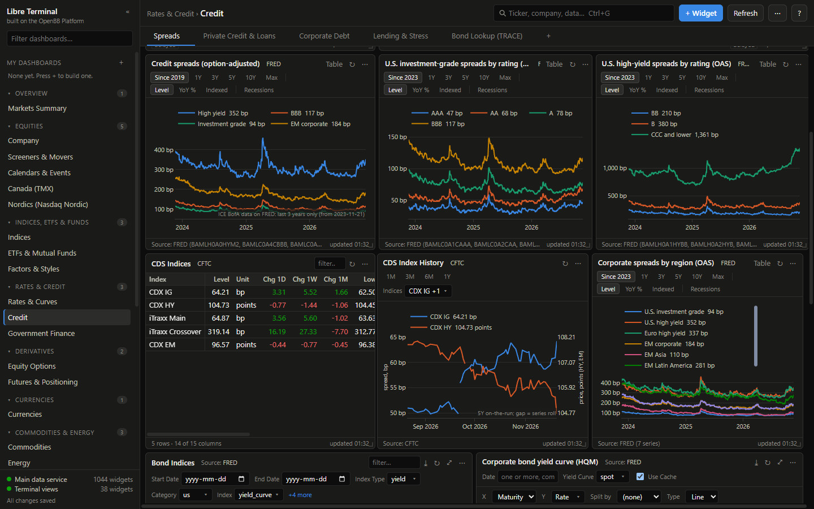

*Credit > Spreads: 등급별·지역별 ICE BofA 옵션조정스프레드(OAS)와 CFTC 기반 5년물 CDX 및 iTraxx 지수 수준과 추이.*

### 에너지 시장과 EIA 실물 펀더멘털

Energy 데스크는 원유 벤치마크(WTI, Brent), 정제마진(3-2-1, 디젤, 휘발유 크랙 스프레드), 유럽 TTF 대 미국 Henry Hub 천연가스, 우라늄, 미국 전력망의 시간대별 수요와 연료원별 발전량을 다룹니다.

무료 미국 EIA API 키를 등록하면 주간·월간 실물 수급 데이터가 채워집니다. 상업용 원유 재고와 전략비축유(SPR) 재고, 5년 계절 범위 및 평균과 비교한 Cushing·휘발유·중간유분 재고, 정제설비 가동률, 미국 원유 교역 흐름, LNG 수출, 단기 에너지 전망(STEO) 예측치가 여기에 포함됩니다. JODI의 국제 원유 생산 및 수출 데이터도 기본으로 내장되어 있습니다.

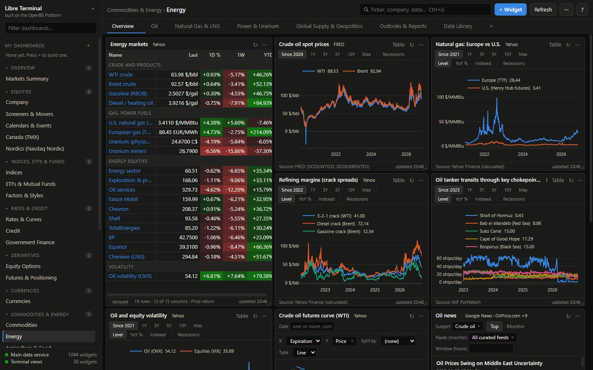

*Energy > Overview: 에너지 선물 및 주식, WTI/Brent, TTF 대 Henry Hub, 크랙 스프레드, 주요 해협의 유조선 통항.*

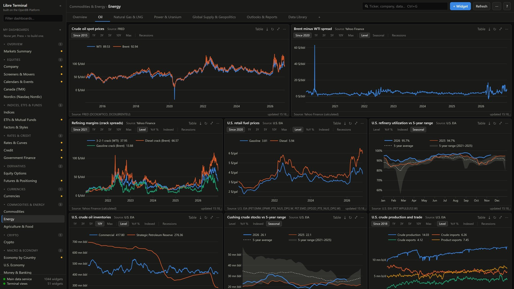

*Energy > Oil: 상업용 원유 및 SPR 재고, Cushing·휘발유·디젤의 5년 계절 밴드, 생산·교역·수요(무료 EIA 키 사용).*

### 해상 운송, 글로벌 거시경제, 상황실 뉴스

Trade & Shipping은 IMF PortWatch 데이터를 활용해 호르무즈 해협, 바브엘만데브 해협, 수에즈 운하, 희망봉, 보스포루스 해협, 파나마 운하, 말라카 해협, 대만 해협의 일별 선박 통항량을 추적합니다. 통항량은 유조선, 컨테이너선, 건화물선(드라이벌크)으로 나누어 1년 전 및 위기 이전인 2023년 기준치와 비교합니다. 추가 탭에서는 항만 차질 지도, 교역 흐름도, 양자 관세를 제공합니다.

Country Monitor는 17개 주요국의 GDP 성장률, 인플레이션, 실업률, 정책금리, 국채 금리를 하나의 표에 담았습니다. 국가를 클릭하면 아래의 IMF 인플레이션, BIS 정책금리, 수익률 곡선, 뉴스 패널이 함께 갱신됩니다. 그 밖의 탭에서는 44개국의 Caldara-Iacoviello 지정학적 리스크 지수, 미국 은행 신용건전성, FDIC 은행 파산 내역, 피어 그룹 백분위 대비 개별 은행 재무비율(FFIEC UBPR)을 추적합니다.

News 대시보드는 엄선된 시장 헤드라인(중복된 통신사 기사는 한 줄로 묶음)과, 중앙은행·통계청·금융감독기관이 발표하는 공식 보도자료 전용 피드를 구분해 보여줍니다.

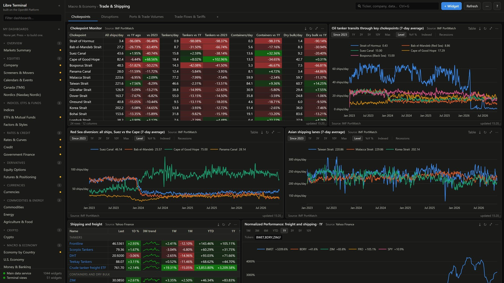

*Trade & Shipping > Chokepoints: 1년 전 및 2023년 대비 일별 선박 수, 유조선 통항, 홍해 대 희망봉 우회 항로, 아시아 항로.*

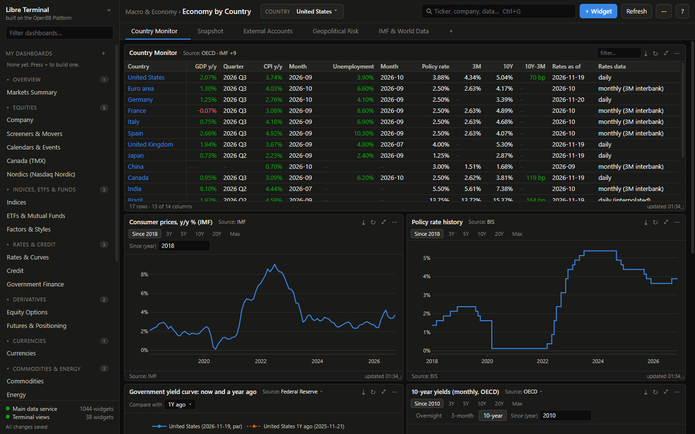

*Economy by Country > Country Monitor: IMF 소비자물가 상승률과 BIS 정책금리 이력을 포함한 17개국 거시경제 스코어카드.*

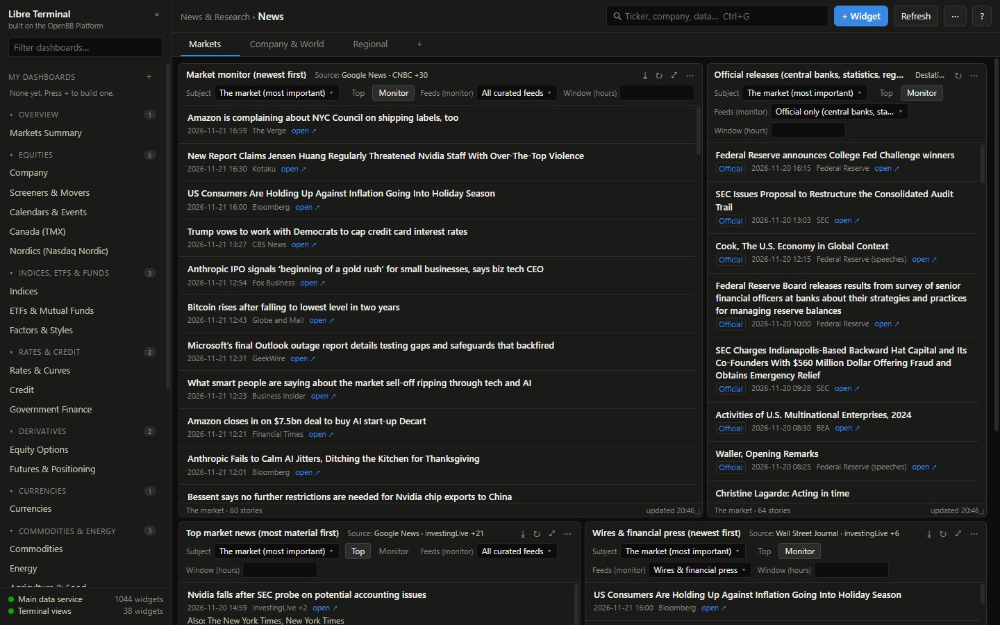

*News > Markets: 왼쪽에는 중복 기사를 묶은 엄선된 금융 언론 기사, 그 옆에는 Fed, SEC, BEA 및 기타 감독기관의 공식 발표.*

## 대시보드별 커버리지

| 영역 | 대시보드 및 주요 탭 |
|---|---|
| **개요** (Overview) | **Markets Summary**: 5개 수익률 기간의 크로스에셋 시세 보드, 지수·국채 선물, 관심종목, 정규화 성과, G10 국채 금리, 미국 주식 스타일 박스, 상승·하락 상위 종목, 지정학적 리스크, 해운 요충지, 뉴스, 일정 |
| **주식** (Equities) | **Company** (개요, 재무제표, 추정치 및 8-K 보도자료, 피어 및 동종기업 비교(Comps), 밸류에이션 밴드를 포함한 성장률·재무비율, 지분 구조 및 내부자, 배당, SEC 공시, 공매도 및 다크풀, 옵션), **Screeners & Movers**, **Calendars & Events**, **Canada (TMX)**, **Nordics (Nasdaq Nordic)** |
| **지수, ETF, 팩터** (Indices, ETFs & Factors) | **Indices** (세계 지수 보드, 구성종목, Shiller CAPE를 포함해 1871년까지 거슬러 올라가는 S&P 500 밸류에이션 배수, VIX 선물 곡선), **ETFs & Mutual Funds** (보유종목, 익스포저, 섹터 비중, N-PORT 공시, 두 펀드 간 보유종목 중복도), **Factors & Styles** (팩터 보드, 상대 회전 그래프(RRG), 크로스에셋 상관관계 및 리스크 통계, Fama-French 팩터) |
| **금리 및 신용** (Rates & Credit) | **Rates & Curves** (글로벌 국채 금리, 국가별, 미국, 유로존, 단기자금시장, CFTC 스왑 및 OIS, 정책금리 기대, FOMC 문서), **Credit** (OAS 스프레드, CFTC CDS 지수, 사모신용 및 BDC, 기업 부채, 은행 대출 서베이 및 스트레스, FINRA TRACE 채권 조회, 발행사 수익률 곡선, 채권 가격 계산기, 부채 만기 도래 구조), **Government Finance** (국가부채, 재무부 현금 잔고, 국채 입찰, 연준 대차대조표, 프라이머리 딜러 결제 불이행(Fails)) |
| **파생상품** (Derivatives) | **Equity Options** (옵션 체인, 통계, 기간구조, IV 스마일, 3D 곡면, 감마 익스포저 및 맥스 페인, 변동성 콘, 스트래들, 스트랭글, 스프레드, 손익 구조), **Futures & Positioning** (최근월물 보드, VIX 기간구조, 연방기금 내재 정책금리, WTI 곡선, 가격 추이, S&P 500·Nasdaq·국채·통화 선물의 CFTC 포지션 보고서(COT)) |
| **통화** (Currencies) | **Currencies** (현물 보드, 통화 강도 대 통화쌍 등락, 크로스 환율 매트릭스, 정책금리 차, 2년물 금리차 대비 현물환율, 실질실효환율(REER), 외환보유액, CFTC 외환 선도, 내재변동성, COT 포지션) |
| **원자재 및 에너지** (Commodities & Energy) | **Commodities** (보드, WTI·천연가스·금·구리 곡선, COT 포지션), **Energy** (원유, 석유제품, 정제마진, TTF 대 Henry Hub, EIA 5년 계절 재고, LNG 수출, 시간대별 전력 수요 및 연료 구성, 원전 가동 중단, 우라늄, JODI, STEO 예측), **Agriculture & Food** (곡물·소프트 원자재·축산물 곡선, COT 포지션, WASDE/PSD 수급, USDA 및 지역 연은 농업 데이터) |
| **암호화폐** (Crypto) | **Crypto** (현물 보드, 가격 추이, Deribit 호가창, 옵션 체인, 변동성 스마일 및 곡면, 펀딩비, DVOL 대 30일 실현변동성) |
| **거시경제** (Macro & Economy) | **Economy by Country** (Country Monitor, OECD 스냅샷, 대외계정, Caldara-Iacoviello 지정학적 리스크, IMF WEO 전망), **U.S. Economy** (애틀랜타 연은 GDPNow, 클리블랜드 연은 인플레이션 나우캐스트, BLS CPI/PPI/비농업 고용/JOLTS 표, 주택 및 상업용 부동산(CRE), 기업 서베이, 12개 지역 연은 전체), **Money & Banking** (연체율 및 대손상각률, FDIC 은행 파산, 개별 은행 UBPR 피어 백분위 및 FFIEC Call Report, 연준 및 ECB 유동성), **Trade & Shipping** (IMF PortWatch 해상 요충지, 차질 지도 및 교역 흐름, 항만 물동량, 양자 교역 및 관세), **Data Explorers** (FRED, BLS, IMF, OECD, ECB, 연방준비제도 시계열 검색 및 Data Status) |
| **정부 및 규제** (Government & Regulation) | **U.S. Congress** (법안, 법률, 수정안, 표결, 의원, 위원회 일정), **Federal Spending** (USAspending 기관별 예산, 계약 수주 내역, 상위 수주 기관·기업) |
| **뉴스 및 리서치** (News & Research) | **News** (시장 모니터, 중앙은행·감독기관 공식 피드, 순위별 기업 및 지역 뉴스), **SEC Filings & Enforcement** (EDGAR 전문 검색, 공시 뷰어, 추출 섹션, SEC 소송 발표(Litigation Releases), Form ADV 투자자문사) |

## 터미널 사용법

- **어디서나 검색 (`/` 또는 `Ctrl+G`):** 티커, 회사명, SEC CIK, CUSIP 또는 데이터셋(`toyota`, `rheinmetall`, `SHEL.L`, `CIK 320193`, `037833100`, `cpi`, `sofr`, `wasde`)을 입력합니다. 주식은 Company에서, ETF는 ETFs & Funds에서 열리며, 지수·통화·선물·코인은 메인 차트에서 열립니다.
- **관심종목(Watchlists):** 나만의 티커 목록을 만들어 최종 가격, 일간 변동, 5개 수익률 기간, 3개월 스파크라인, 52주 범위를 각 종목의 거래 통화 기준으로 확인할 수 있습니다.
- **비교 차트:** 최대 8개 종목 또는 FRED 시계열(`FRED:DGS10`)을 하나의 축에 가격, 변동률, 비율, 스프레드, 낙폭(드로다운)으로 표시합니다. 캔들스틱, 거래량, 50일·200일 이동평균, 로그 스케일, NBER 경기침체 음영도 지원합니다.
- **편집 가능한 Comps:** 동종기업 비교표는 피어를 자동으로 선정하고 중앙값을 계산합니다. 기업별로 티커를 추가하거나 제거할 수 있으며, 수정한 목록은 로컬에 저장됩니다.
- **모든 카드에 출처 표시:** 각 카드는 헤더에 출처를 표시합니다(`Source: SEC`). 이를 클릭하면 같은 데이터를 다른 제공업체로 전환하거나 원본 출처 페이지를 열 수 있습니다. 티커에 따라 달라지는 카드는 해당 종목을 다루는 거래소나 제공업체로 자동 연결됩니다(미국 옵션은 Yahoo/Nasdaq/Cboe, 캐나다 옵션은 TMX, 암호화폐 옵션은 Deribit, 미국 ETF 보유종목은 Nasdaq, 캐나다 ETF 보유종목은 TMX).
- **차트 및 표 제어:** 저장된 레이아웃을 수정하지 않고도 기간(`1M`~`Max`)을 바꾸거나, 변환 방식(`Level`, `YoY %`, `Indexed`, 5년 범위와 비교하는 `Seasonal`)을 전환하거나, 표의 열을 표시하거나 숨길 수 있습니다. 모든 표는 CSV(출처 행 포함)로 내보낼 수 있고, 모든 차트는 PNG로 저장할 수 있습니다.
- **사용자 정의 대시보드:** `+`로 나만의 탭이나 대시보드를 만들고 카드를 자유롭게 재배치할 수 있습니다. 기본 제공 대시보드는 **⋯ > Reset to default layout**으로 언제든 원래 레이아웃으로 되돌릴 수 있습니다.
- **단축키 및 상태:** `?`를 누르면 키보드 단축키를 볼 수 있습니다(`/`는 검색창으로 이동, `s`는 현재 페이지의 종목 변경, `[`와 `]`는 탭 간 이동, 카드 헤더를 더블클릭하면 카드 최대화). **Data Explorers > Data status**를 열면 업스트림에서 장애가 발생한 소스와 설정된 API 키를 확인할 수 있습니다.

## 공식 국채 수익률 곡선

**Rates & Curves > By Country**는 각 곡선을 공식 출처에서 가져와 그립니다. API 키 없이 8개 주요 국채 시장의 일별 곡선을 제공하며, OECD 월별 금리로 약 30개국을 추가로 다룹니다.

| 국가 / 지역 | 만기 및 주기 | 공식 출처 |
|---|---|---|
| 미국 | 1M~30Y, 일별 | 연방준비제도 (미 국채 액면 수익률 곡선, Par Curve) |
| 유로존 | 3M~30Y, 일별 | 유럽중앙은행 (AAA 등급 국채 곡선) |
| 독일 | 6M~30Y, 일별 | 독일 연방은행 (Deutsche Bundesbank) |
| 영국 | 6M~40Y, 일별 | 영란은행 (Bank of England) |
| 일본 | 1Y~40Y, 일별 | 일본 재무성 |
| 캐나다 | 단기채 1M~1Y, 2Y~최장기물, 일별 | 캐나다은행 (Bank of Canada) |
| 스웨덴 | 단기채 1M~6M, 2Y~10Y, 일별 | 스웨덴 중앙은행 (Riksbank) |
| 브라질 | 약 2M~10Y, 일별 | Tesouro Direto (고정금리 국채) |
| 프랑스, 이탈리아, 스페인, 스위스, 호주 외 약 30개국 | 3M 및 10Y, 월별 | OECD |

## 선택적 무료 API 키

거의 모든 대시보드의 첫 탭은 키 없이 작동합니다. 키가 필요한 카드에는 그 사실이 명확히 표시되며, 키 없이 작동하는 카드 뒤에 배치됩니다. 아래의 무료 공개 키는 각각 2분 정도면 발급받을 수 있습니다.

| 제공업체 | 키로 추가되는 데이터 | 가입 페이지 |
|---|---|---|
| **FRED** | 미국 거시경제 전체 이력, ICE BofA 신용 스프레드, 원자재 현물 가격, U.S. Economy 대시보드 *(개요, 금리, 거시경제 차트 중 다수는 FRED 공개 CSV 피드를 통해 키 없이도 작동합니다)* | https://fredaccount.stlouisfed.org/apikeys |
| **EIA** | 미국 에너지정보청(EIA)의 원유·석유제품·천연가스 재고, 5년 계절 범위, LNG 수출, 전력망 데이터, STEO 예측 | https://www.eia.gov/opendata/register.php |
| **BLS** | 미국 노동통계국(BLS)의 CPI, PPI, 고용상황(Employment Situation), JOLTS, 실질 임금, 생산성 표 | https://data.bls.gov/registrationEngine/ |
| **Congress.gov** | 미국 하원·상원 법안, 표결, 수정안, 의원 프로필, 위원회 보고서 | https://api.congress.gov/sign-up/ |

키를 추가하려면 `Libre-Terminal` 폴더에서 **`Setup-Keys.cmd`**를 더블클릭하고, 열리는 파일에 키를 붙여넣어 저장한 뒤 **`Stop.cmd`**와 **`Start.cmd`**로 다시 시작합니다. 키는 사용자 컴퓨터의 `local/api_keys.env`에 저장됩니다. 로그에 기록되거나 커밋되지 않으며, 각 키는 해당 제공업체에만 전송됩니다.

## 데이터 이용 시 유의사항

- **숫자는 정확하게 표시하거나, 메모와 함께 빈칸으로 둡니다.** 모든 카드는 출처와 사용한 최신 데이터 포인트의 날짜를 표시합니다(Country Monitor는 셀마다 해당 기간을 표시). 숫자 열에는 단위가 명시되고 모든 금액에는 통화가 표시됩니다. 주요 파생 수치(밸류에이션 배수, 수익률 등)가 타당한 범위를 벗어나면 그대로 표시하지 않고 메모와 함께 빈칸으로 둡니다. 대체 소스, 장애 중 제공되는 저장본, 부분 응답을 사용한 경우에도 카드에 그 사실이 표시됩니다.
- **지연 시세, 매매 기능 없음.** 시장 가격은 Yahoo Finance에서 가져옵니다. 시세는 지연될 수 있으며, 실시간 틱 스트리밍, 주문 입력, 가격 알림 기능은 없습니다.
- **실적 데이터 반영 시점.** Company > Estimates 탭의 컨센서스 EPS와 발표 EPS는 Yahoo Finance에서 일관된 단일 기준으로 가져옵니다. 반면 Earnings calendar 카드는 Nasdaq의 컨센서스, 발표 EPS, 서프라이즈를 표시하므로 Estimates 탭의 수치와 약간 다를 수 있습니다. 발표 수치는 Yahoo에 게시된 뒤(보통 발표 후 몇 시간에서 하루) 반영되며, 그 사이에는 SEC Form 8-K Exhibit 99.1 보도자료를 EDGAR에서 직접 불러옵니다. Yahoo는 실적 발표 직후 해당 분기의 매출 컨센서스를 삭제하므로, 과거 매출 서프라이즈는 터미널이 발표 전에 컨센서스를 확보한 분기에 대해서만 표시됩니다. 어닝콜 녹취록은 포함되지 않습니다.
- **총수익률(Total Return) 대 가격수익률(Price Return).** 주식과 펀드로만 구성된 시세 보드는 총수익률(분배금을 배당락일에 재투자한 기준)을 표시합니다. 지수, 선물, 통화, 암호화폐가 포함된 보드는 가격수익률을 표시합니다. 각 보드 아래의 하단 설명 줄에 어느 쪽인지 명시됩니다.
- **신용 및 채권 커버리지.** CDS는 CFTC 스왑 데이터 저장소 거래 보고서에 기반한 지표물(On-the-run) 5년물 CDS 지수만 다루며, 개별 기업(Single-name) CDS는 제공되지 않습니다. 회사채 가격은 FINRA TRACE 최종 체결 보고에서 가져오며, 미 국채의 개별 종목 호가는 포함되지 않습니다.
- **국채 곡선 주기.** 일별 곡선은 위에 나열한 8개 시장에 해당합니다. 그 밖의 국가는 OECD 월별 3개월물·10년물 시계열에 의존하므로, BTP-Bund, OAT-Bund 같은 유로존 역내 스프레드는 월별 데이터입니다.
- **소스 장애.** 공공 데이터 제공업체는 피드를 이전하거나 중단하는 경우가 있으며, **Data Explorers > Data status**에서 현재 장애가 발생한 피드를 확인할 수 있습니다. Cboe가 옵션 피드에 대한 자동화 요청을 차단하면 옵션 분석은 자동으로 Yahoo Finance 옵션 체인으로 대체되고(Black-76 내재변동성과 그릭스는 로컬에서 계산), VIX 곡선은 Cboe 정산 파일로 전환되며, 미국 지수 스냅샷은 Yahoo 데이터를 사용합니다. 대체된 데이터는 모두 카드에 표시됩니다. Cboe 일중 봉 데이터와 과거 옵션 호가는 대체 소스가 없습니다. OECD는 요청 한도에 도달하면 간혹 요청을 일시 중단했다가 이후 복구됩니다.
- **지역 범위.** 주가, 재무제표, 애널리스트 추정치, 주주 현황, 피어 비교(Comps)는 전 세계 상장 종목에 적용됩니다. SEC 공시, FINRA TRACE, FINRA 공매도 잔고, FDIC/FFIEC 은행 데이터, 미국 옵션 분석은 미국 발행사에만 적용됩니다(캐나다와 북유럽 시장은 별도 대시보드가 있습니다).
- **거시경제는 실제 발표치만 제공.** 거시경제 대시보드는 공식 발표치와 IMF 전망치를 보여주며, PMI 발표는 포함하지 않습니다. 이코노미스트 서베이 컨센서스를 볼 수 있는 곳은 Economic calendar 카드의 Nasdaq 열이 유일합니다.
- **지원 플랫폼.** Windows 10과 11에서 테스트되었으며 공식 지원됩니다.

## 업데이트 및 문제 해결

개인 데이터(관심종목, 사용자 정의 레이아웃, 피어 목록, 선택 사항인 API 키)는 모두 `local` 폴더에 저장됩니다.

- **새 릴리스로 업데이트:** **`Start.cmd`**는 실행할 때 GitHub에서 새 릴리스가 있는지 확인합니다. 새 버전이 있으면 변경 사항을 보여주고, 기존 폴더에서 바로 업데이트(`local` 폴더 유지), 이번만 건너뛰기, 시작 시 확인 끄기 중에서 선택하게 합니다(`launcher.py update --enable`로 다시 켤 수 있습니다). 이미 최신 버전이면 바로 실행됩니다. 수동으로 업데이트하려면 기존 폴더에서 **`Stop.cmd`**를 실행하고, 새 ZIP을 내려받아 압축을 푼 뒤, 기존 `local` 폴더를 새 `Libre-Terminal` 폴더에 복사하고 **`Install.cmd`**와 **`Start.cmd`**를 실행합니다.
- **백업 또는 컴퓨터 이전:** 터미널을 종료하고 `local` 폴더를 복사합니다. 완전히 새로 시작하려면 터미널을 종료한 뒤 `local`을 삭제합니다.

| 문제 | 해결 방법 |
|---|---|
| *"Windows의 PC 보호"* | **추가 정보**를 클릭한 다음 **실행**을 클릭합니다. 최초 1회만 필요하며, 나머지 `.cmd` 파일의 차단은 `Install.cmd`가 자동으로 해제합니다. |
| 파일이 실행되지 않음 / *"inside the ZIP"* 안내가 표시됨 | `Libre-Terminal-Windows.zip`을 마우스 오른쪽 버튼으로 클릭하고 **모두 압축 풀기...**를 선택한 뒤, 압축을 푼 `Libre-Terminal` 폴더를 엽니다. |
| OneDrive 또는 긴 경로에서 설치 실패 | 압축을 푼 폴더를 `C:\Libre-Terminal`처럼 짧은 로컬 경로로 옮기고 `Install.cmd`를 다시 더블클릭합니다. Windows는 파일 경로를 260자로 제한하므로, 폴더 경로가 83자를 넘으면 `Install.cmd`는 아무것도 내려받기 전에 중단됩니다(Windows 긴 경로 지원이 켜져 있는 경우는 제외). |
| 설치가 도중에 멈춤 | 대개 회사 프록시, 방화벽, VPN, 백신 프로그램의 차단이 원인입니다. 다른 네트워크(가정용 인터넷이나 휴대폰 핫스팟)를 사용하거나 IT 부서에 `astral.sh`, `github.com`, `pypi.org` 허용을 요청한 뒤 `Install.cmd`를 다시 실행합니다. 중단된 지점부터 이어서 진행됩니다. |
| 백신 프로그램이 파일을 삭제하거나 차단함 | 파일을 복원하고 백신 프로그램에서 `Libre-Terminal` 폴더를 예외로 허용한 뒤 `Install.cmd`를 다시 실행합니다. |
| 브라우저가 열리지 않음 | `http://127.0.0.1:6950`을 직접 엽니다. 페이지가 열리지 않으면 `Start.cmd`를 다시 실행하고 창의 마지막 몇 줄을 확인합니다. |
| 포트가 이미 사용 중 | `Libre-Terminal` 폴더에서 명령 프롬프트를 열고 `Start.cmd --ui-port 7950 --v5-port 7900`을 실행합니다(이후 실행 시에도 적용되도록 저장됩니다). |
| 첫 실행이 느리거나 카드가 비어 있음 | 데이터 서비스가 시작되는 동안 첫 실행에는 최대 1분 정도(느린 PC에서는 90초) 걸립니다. 백그라운드 서비스가 중단되거나 응답하지 않으면 터미널이 자동으로 재시작합니다. 상단 바의 **Refresh** 옆에 있는 **Restart**를 클릭해 멈춘 데이터 서비스를 재시작하고 브라우저에 캐시된 오류를 지울 수도 있습니다. 로그는 `local/logs/`에 있습니다. |
| 카드에서 API 키를 요구함 | **`Setup-Keys.cmd`**로 무료 키를 추가한 뒤 터미널을 종료했다가 다시 시작합니다. |
| 기본 레이아웃으로 되돌리기 | 대시보드에서 **⋯**를 클릭하고 **Reset to default layout**을 선택합니다. |
| 제거 | **`Stop.cmd`**를 실행한 뒤 `Libre-Terminal` 폴더를 삭제합니다. |

<details>
<summary><strong>고급 옵션, macOS / Linux, 개발자 정보</strong></summary>

### 시작 및 백엔드 옵션

- **첫 실행 대기 건너뛰기:** `Start.cmd --no-wait`를 사용하면 데이터가 백그라운드에서 로딩되는 동안 브라우저가 바로 열립니다.
- **업데이트 확인 건너뛰기 또는 수동 관리:** `Start.cmd --no-update`(또는 `TERMINAL_NO_UPDATE=1` 설정)를 사용하면 시작 시 GitHub 확인을 한 번 건너뜁니다. 수동으로 확인하거나 업데이트하려면 `.venv-v5\Scripts\python.exe scripts\launcher.py update`를 실행합니다(`--check`, `--yes`를 덧붙이거나, "don't ask again"을 선택한 뒤에는 `--enable`을 덧붙입니다).
- **레거시 V4 백엔드(+480 MB):** `Install.cmd --with-v4`와 `Start.cmd --with-v4`를 실행합니다(사용자 지정 포트를 설정할 때는 `--v4-port 7901`을 추가). 같은 대시보드에 39개의 레거시 카드(FMP, Intrinio, Finviz, EconDB, WSJ)가 추가됩니다. 선택 사항인 무료 [FMP 키](https://site.financialmodelingprep.com/developer/docs) (하루 250회 호출)를 등록하면 FMP 카드에 데이터가 채워집니다.
- **사용자 지정 local 폴더:** 실행 전에 `TERMINAL_LOCAL_DIR`을 설정합니다. 서비스는 `127.0.0.1`에만 바인딩됩니다.
- **신뢰할 수 있는 데스크톱 앱에 터미널 데이터 사용 허용:** 실행 전에 `TERMINAL_EXTRA_ORIGINS`에 해당 앱의 오리진을 설정합니다. 예를 들어 Tauri 앱이라면 `setx TERMINAL_EXTRA_ORIGINS "tauri://localhost http://tauri.localhost"`를 실행합니다(그런 다음 새 창을 열고 터미널을 시작합니다). 정확히 일치하는 오리진만 허용되며 `*`는 사용할 수 없습니다. 등록된 앱은 데이터와 화면을 읽을 수 있지만, 저장된 레이아웃을 변경하거나 서비스를 재시작할 수는 없습니다. 신뢰하는 앱이 아니라면 설정하지 마십시오.

### macOS / Linux (실험적, 미검증)

공식적으로 테스트된 플랫폼은 Windows 10/11뿐입니다. macOS와 Linux용으로는 동일한 런처를 공유하는 셸 스크립트가 별도 보증 없이(best-effort) 포함되어 있습니다.

```sh
git clone https://github.com/samlazs/libre-terminal.git && cd libre-terminal
sh install.sh
sh start.sh          # opens http://127.0.0.1:6950 ; stop with: sh stop.sh
```

git으로 클론한 경우 업데이트하려면 터미널을 종료하고 `git pull`을 실행한 뒤 `Install.cmd`(또는 `sh install.sh`)를 다시 실행합니다. `local/` 폴더는 변경되지 않습니다.

### 로컬 데이터 폴더

개인 데이터는 모두 git이 무시하는 `local/`에 저장됩니다. 터미널은 시작할 때마다 폴더 내용을 설명하는 `local/README.txt`를 작성합니다. 로그는 `local/logs/`에 있습니다(`ui.log`, `v5.log`, `v4.log`, 프리즈 덤프). 5 MB를 넘은 로그는 `.log.1`로 이름이 바뀌고(그 이전 파일은 `.log.2`로), 이 과정은 터미널 실행 중에도 이루어지므로 로그가 무한정 커지지 않습니다.

### 기여자 안내

아키텍처, 소스 계약(source contract), 저장 상태 스키마, 런타임 패치, 테스트 목록은 [docs/ARCHITECTURE.md](ARCHITECTURE.md) (영문)에 정리되어 있습니다. 프로젝트 폴더에서 오프라인 검사를 실행합니다.

```text
# Windows
.venv-v5\Scripts\python.exe scripts\launcher.py test
.venv-v5\Scripts\python.exe scripts\launcher.py check

# macOS / Linux
.venv-v5/bin/python scripts/launcher.py test
.venv-v5/bin/python scripts/launcher.py check
```

`test`는 모든 오프라인 테스트 파일을 병렬로 실행합니다(약 30초 소요, Edge 또는 Chrome이 설치되어 있으면 헤드리스 브라우저 테스트 스위트 3개 포함, `--fast`로 이를 건너뜀). `check`는 인코딩, 린트, 코드 위생(hygiene), 소스 검사를 수행합니다. `gate`는 실행 중인 터미널을 대상으로 릴리스 게이트 G1–G5를 실행하고 그 증거를 기록합니다.

</details>

## 라이선스 및 면책 조항

**GNU Affero General Public License v3.0 또는 이후 버전**에 따라 라이선스가 부여됩니다([LICENSE](../LICENSE)). 서드파티 고지는 [NOTICE](../NOTICE)에 있습니다. OpenBB Platform 및 기타 Python 패키지는 각자의 라이선스에 따라 PyPI에서 설치되며, 여기에서 재배포되지 않습니다.

비공식 프로젝트이며 OpenBB 또는 어떤 데이터 제공업체와도 제휴, 보증, 후원 관계가 없습니다. 각 명칭은 호환되는 소프트웨어와 데이터 출처를 식별하기 위한 목적으로만 사용됩니다. 데이터는 제3자가 각자의 약관에 따라 제공하며, 해당 약관을 준수할 책임은 사용자에게 있습니다. 데이터는 지연되거나 불완전하거나 부정확할 수 있습니다. 여기의 어떤 내용도 투자, 금융, 법률, 세무 자문이 아닙니다. 본 소프트웨어는 어떠한 종류의 보증도 없이 "있는 그대로(as is)" 제공됩니다.
