# Libre Terminal

[English](../README.md) &nbsp;·&nbsp; **简体中文** &nbsp;·&nbsp; [日本語](README.ja.md) &nbsp;·&nbsp; [한국어](README.ko.md) &nbsp;·&nbsp; [Español](README.es.md)

> *注：本文档由机器翻译并经母语人士校对，如发现用词不当或有任何改进建议，欢迎随时反馈。*

一款免费、开源的市场研究终端，在你自己的电脑上本地运行，通过浏览器打开使用。

它将股票、期权、主权债券收益率曲线、公司债、信用利差、外汇、大宗商品、能源、航运、宏观数据、SEC 文件和新闻汇集于一处，共 **28 个看板**。数据来自公开及官方来源（美联储、欧洲央行（ECB）、国际清算银行（BIS）、国际货币基金组织（IMF）、经合组织（OECD）、美国证监会（SEC）、FINRA、CFTC、美国能源信息署（EIA）、FDIC、Yahoo Finance、Nasdaq、TMX 和 Deribit），经由开源的 [OpenBB Platform](https://github.com/OpenBB-finance/OpenBB) 获取。

绝大部分功能开箱即用，无需注册账户、登录或 API 密钥。另可选配 FRED、EIA、BLS 和 Congress.gov 的免费密钥，获取更多美国经济、能源、劳动力及立法数据。

> **[体验交互式演示](https://samlazs.github.io/libre-terminal/)** *（在浏览器中基于静态市场快照直接体验真实界面）*<br>
> **[下载 Windows 版（.zip）](https://github.com/samlazs/libre-terminal/releases/latest/download/Libre-Terminal-Windows.zip)**

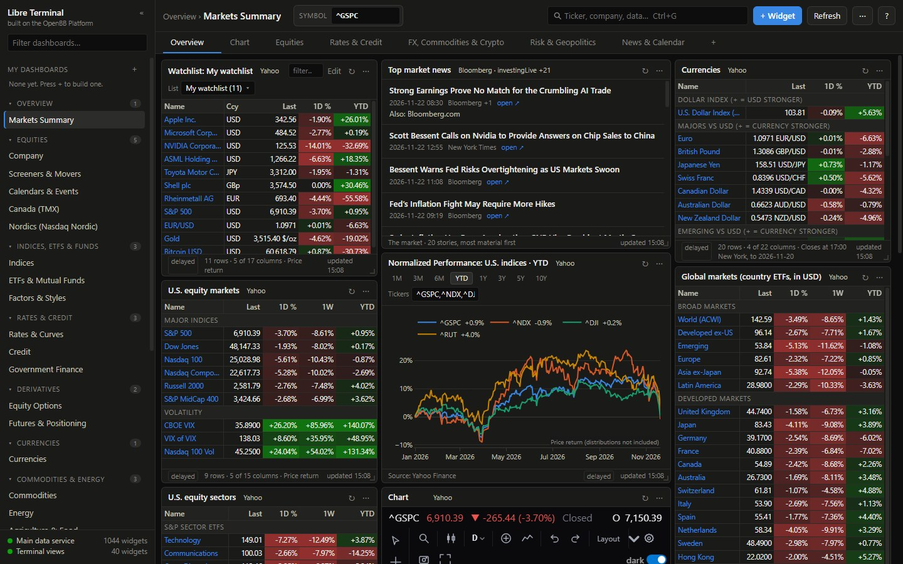

*Markets Summary：自选列表、市场要闻、股指与美国国债期货、美国主要股指与行业板块、归一化收益、外汇以及国家 ETF，尽在同一屏。*

## 下载与运行（Windows 10 / 11）

> **[下载 Windows 版 Libre Terminal（.zip）](https://github.com/samlazs/libre-terminal/releases/latest/download/Libre-Terminal-Windows.zip)** &nbsp;·&nbsp; [最新版本发布说明](https://github.com/samlazs/libre-terminal/releases/latest)

无需任何编程工具、Python 或账户，只需联网并预留约 1 GB 可用空间：

1. **下载** [`Libre-Terminal-Windows.zip`](https://github.com/samlazs/libre-terminal/releases/latest/download/Libre-Terminal-Windows.zip)。在发布页面上请选择该文件，而不是 *Source code (zip)*。
2. **解压 ZIP 文件。** 右键单击下载的文件，选择 **全部解压缩...**，然后点击 **提取**。文件无法在 ZIP 窗口内直接运行。
   - *预期结果：* 出现一个 `Libre-Terminal` 文件夹，内含 `Install.cmd`、`Start.cmd`、`Stop.cmd` 和 `READ-ME-FIRST.txt`。建议放在较短的路径下，例如 `C:\Libre-Terminal`；避免放在 OneDrive 文件夹中。
3. **一次性安装。** 双击 **`Install.cmd`**，耗时 2 至 5 分钟。
   - 如果 Windows 提示 *"Windows 已保护你的电脑"*，请点击 **更多信息**，再点击 **仍要运行**。此操作只需执行一次。
   - *预期结果：* 弹出一个黑色窗口显示下载进度，最后一行会提示你双击 **Start.cmd**。届时关闭该窗口即可。
4. **启动。** 双击 **`Start.cmd`**。首次启动约需 1 分钟。
   - *预期结果：* 浏览器自动在 `http://127.0.0.1:6950` 打开终端（建议加入书签）。黑色窗口可以关闭，终端会在后台继续运行。
5. **停止。** 使用完毕后运行 **`Stop.cmd`**。重启电脑后，再次运行 **`Start.cmd`** 即可。随时可通过 **`Setup-Keys.cmd`** 添加[可选的免费 API 密钥](#可选免费-api-密钥)。

如遇问题，窗口中会提示下一步操作；常见情况可参阅[问题排查表](#更新与常见问题排查)。

所有程序均在你自己的电脑上运行，唯一的对外流量是向各数据提供方发出的请求。

> 本项目为非官方项目，与 OpenBB 及任何数据提供方均无关联。仅供研究之用：市场数据可能存在延迟、缺失或事后修订，本项目任何内容均不构成投资建议。详见[许可证与免责声明](#许可证与免责声明)。

## 终端功能一览

### 股票、可比公司与 SEC 文件

只需输入一次股票代码或公司名称（`AAPL`、`RY.TO`、`7203.T`、`SHEL.L`），即可获取历史价格、公司业务概况、财务报表、卖方目标价以及近期分析师评级调整。概览下方是可编辑的可比公司估值表（Comps），将市值和企业价值统一折算为美元，并列示估值倍数、利润率、增长、杠杆及同业中位数。

财务报表可在报告值、同型财务报表（占营收或总资产百分比）与同比变动之间切换。Growth & Ratios 以 3、5 或 10 年为窗口，绘制 P/E、EV/EBITDA、EV/Sales、P/S 或 P/B 走势，并对照各倍数自身的中位数及第 10 至第 90 百分位区间；所用数据均为每个交易日当时可获得的口径（美国公司取自 SEC 文件，其他地区取自 Yahoo Finance，并按币种及 ADR 或股份类别比例调整），旁边同时展示 ROIC 与 ROE 杜邦拆解。对于美国银行，概况中会补充 FDIC 资产质量指标，并略去对银行没有意义的估值倍数。其他标签页涵盖内部人交易、13F 机构持仓、FINRA 卖空余额、从 10-K/10-Q 中提取的风险因素（Risk Factors）与管理层讨论与分析（MD&A），以及跨公司的 SEC 数据对比。

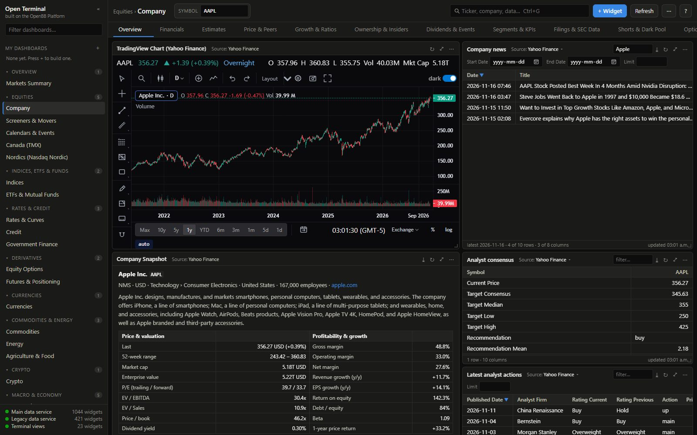

*Company Overview：交互式价格图表、估值与盈利能力概况、分析师一致预期及公司新闻。*

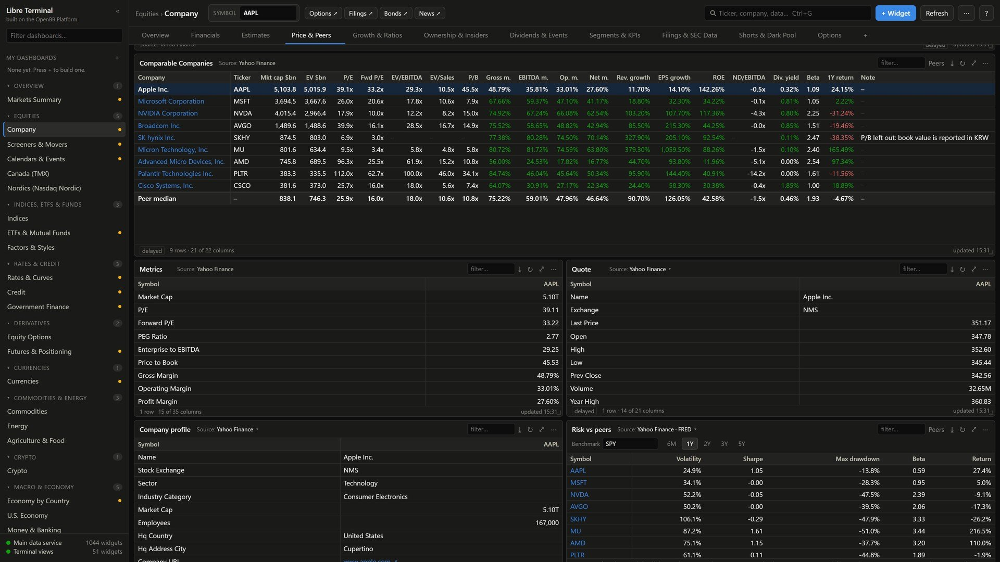

*Company > Price & Peers：可编辑的同业对比表，列示估值倍数、利润率、增长、ROE、杠杆及同业中位数，下方为指标、报价及相对同业风险卡片。*

### 财报日与期权波动率

财报发布当天，Estimates 标签页将 EPS 与营收的预期值和实际公布值并列对照，旁边附上公司 SEC 8-K 表格披露的新闻稿（Exhibit 99.1）。该页还展示两日股价变动、期权隐含波动幅度与历史已实现波动幅度、12 个季度的业绩超预期（Surprise）历史（点击任一历史日期即可加载该季度的业绩概览及新闻稿），以及 30 天和 90 天的分析师预期修正。

除期权链本身外，期权视图还绘制隐含波动率期限结构、虚值期权波动率微笑、3D 波动率曲面、按到期日分布的未平仓合约，以及策略损益图（跨式、宽跨式与价差策略）。Volatility 标签页另提供按行权价分布的做市商 Gamma 敞口（GEX）及最大痛点（Max Pain）水平，以及覆盖 10 至 126 天的已实现波动率锥，并叠加当日隐含波动率。每个代码都会自动匹配至对应的数据源：美股取自 Yahoo Finance、Nasdaq 或 Cboe，加拿大标的对接至蒙特利尔交易所（TMX），加密货币期权则对接至 Deribit。

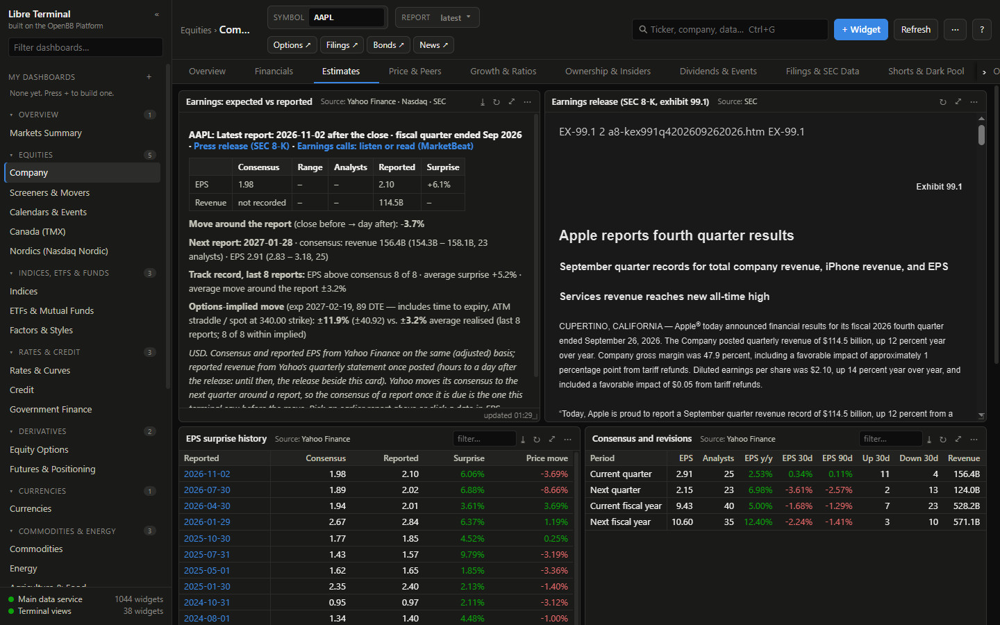

*Company > Estimates：一致预期与实际业绩对比、期权隐含波动幅度与实际波动幅度、预期修正，以及内嵌的 SEC 8-K 新闻稿。*

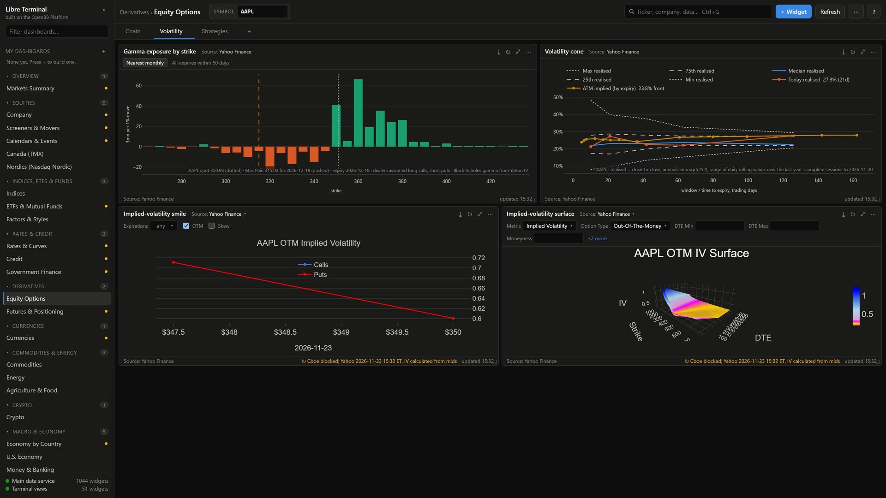

*Equity Options > Volatility：按行权价分布的做市商 Gamma 敞口及最大痛点水平、叠加当日隐含波动率的已实现波动率锥、隐含波动率微笑，以及 3D 波动率曲面。*

### 主权债券收益率曲线与央行政策路径

国债收益率曲线直接取自各国央行和财政部。选定国家后，可将当日曲线与 1 个月、3 个月、6 个月、1 年、2 年或 5 年前对比，查看各期限基点（bp）变动，并对照 OECD 长期利率回顾 BIS 政策利率历史。另有一个全球视图，展示 45 个国家的收益率矩阵以及约 40 家央行的政策利率。

在 Policy Expectations 页面，终端基于 CFTC 公布的议息会议期限隔夜指数掉期（OIS）成交数据，推算 6 家主要央行（美联储、欧洲央行、英格兰银行、日本央行、加拿大央行和澳洲联储）的市场隐含利率路径，并将当前市场定价与一周前、一个月前进行对比。表格逐一列出每个会议区间市场隐含的利率变动（以基点计，并折算为一次 25 bp 调整的比例），以及过去一周和一个月的变化。FOMC 声明、会议纪要和经济预测可直接在下方展开查看，随后是旧金山联储的期限溢价估算和亚特兰大联储的利率概率。

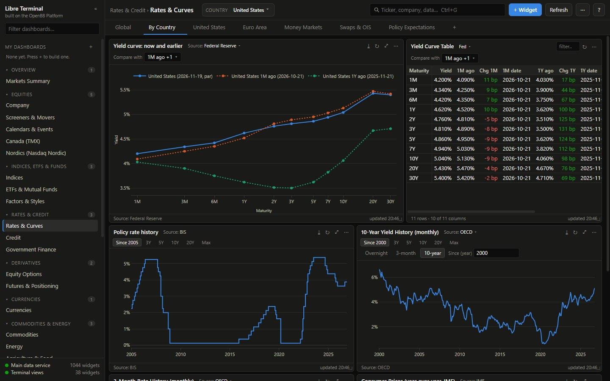

*Rates & Curves > By Country：美国国债平价收益率曲线与 1M、1Y 前对比，各期限基点变动表、BIS 政策利率历史及 OECD 10Y 收益率。*

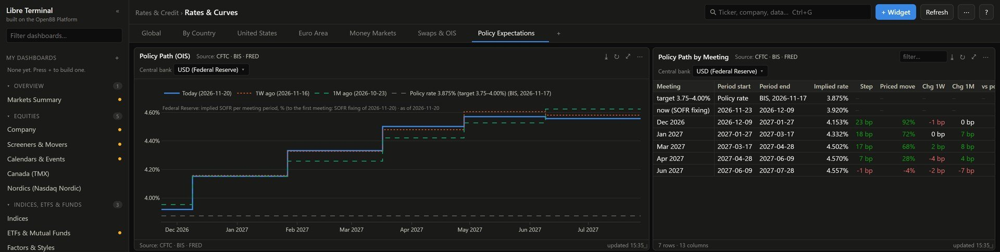

*Rates & Curves > Policy Expectations：基于 CFTC 掉期成交记录推算的 OIS 隐含美联储政策路径（当前与 1W、1M 前对比），下方为 FOMC 发布文件。*

### 期货与外汇

一张近月合约行情板涵盖股指、国债、外汇、大宗商品及 CME 加密货币期货。涨跌幅以前一结算价为基准计算（周日晚间则以上周五收盘价为基准），并进行排名。下方依次为 VIX 期限结构、按月份排列的联邦基金期货隐含政策利率以及 WTI 曲线。Currencies 看板将即期行情板与货币强弱指标搭配展示：每种货币相对其他 7 种主要货币的强弱，与其单独兑美元的涨跌并列呈现，统一采用纽约时间 17:00 收盘价。

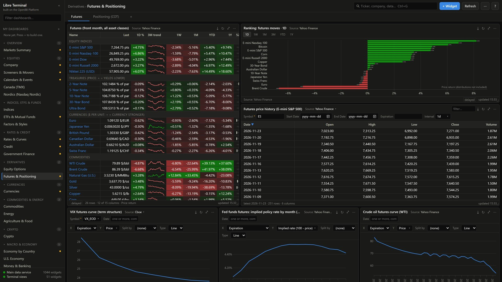

*Futures & Positioning > Futures：跨资产类别近月合约行情板、当日涨跌排名、历史价格，以及 VIX、联邦基金隐含利率和 WTI 曲线。*

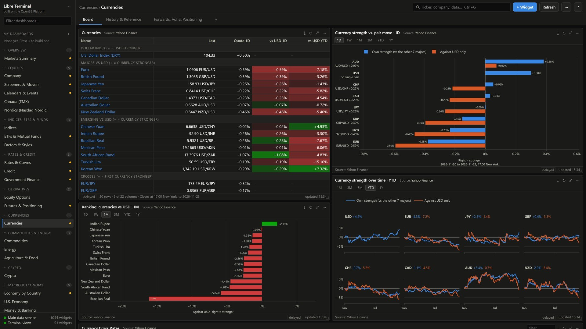

*Currencies > Board：按地区划分的即期行情板、货币强弱与货币对涨跌对比，以及兑美元涨跌排名。*

### 公司信用：FINRA TRACE 债券、信用利差与 CDS 指数

在 Bond Lookup 中输入美股代码、公司名称或 CUSIP，即可从 FINRA TRACE 调取该发行人有成交记录的公司债。每行显示票息、到期日、穆迪与标普评级、最新成交价、最新成交收益率（可赎回债券显示最低收益率，即 YTW）以及赎回日。终端还会自行计算收益率、修正久期、凸性、基点价值（DV01）与相对期限匹配国债的 G 利差（G-spread）。旁边同时展示该发行人全期限收益率曲线及 TRACE 历史价格。点击 CUSIP 即可打开该债券的定价器，发行人的债务到期分布（到期墙）则取自其最新 10-K。

着眼于更广泛的信用市场，Spreads 标签页将 ICE BofA 期权调整利差（OAS，涵盖投资级、高收益、AAA 至 CCC 各评级档位及各地区公司债利差）与当期活跃（On-the-Run）5 年期 CDS 指数的实时水平（CDX IG、HY 和 EM；iTraxx Main 与 Crossover）并列展示，后者基于 CFTC 掉期交易报告库（SDR）的成交记录推算。其他信用标签页涵盖私募信贷（BDC、杠杆贷款、CLO 及上市另类资产管理公司）、企业杠杆、纽约联储公司债市场困境指数以及银行信贷调查。

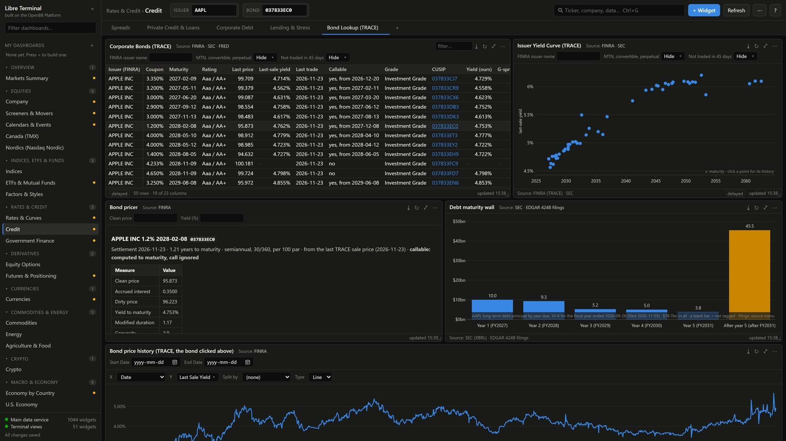

*Credit > Bond Lookup (TRACE)：Apple 存续债券及其评级与收益率、发行人收益率曲线、债券定价器、取自最新 10-K 的债务到期墙，以及所选 CUSIP 的 TRACE 历史价格。*

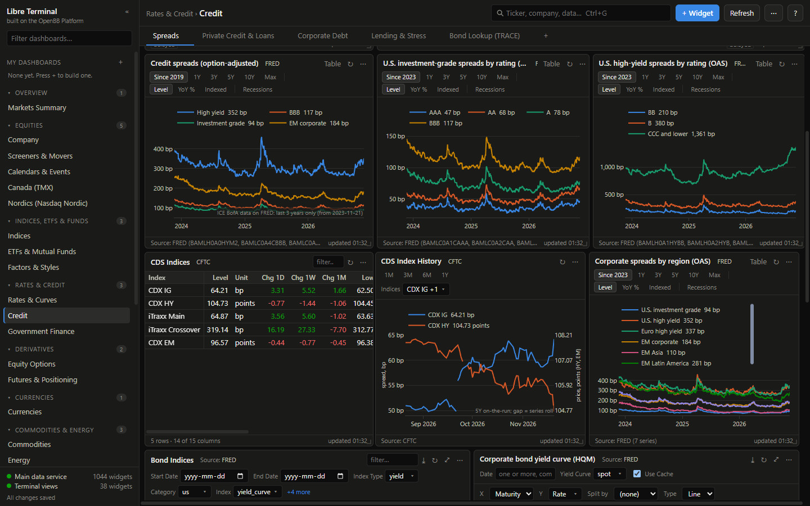

*Credit > Spreads：按评级和地区划分的 ICE BofA 期权调整利差，以及基于 CFTC 数据的 5 年期 CDX 与 iTraxx 指数水平及历史走势。*

### 能源市场与 EIA 实物基本面

Energy 看板涵盖原油基准（WTI 与 Brent）、炼油利润（3-2-1、柴油及汽油裂解价差）、欧洲 TTF 与美国 Henry Hub 天然气对比、铀，以及美国电网逐小时用电负荷与分燃料发电量。

配置免费的美国 EIA API 密钥后，即可补全周度和月度的实物供需数据，包括商业原油与战略石油储备（SPR）库存，库欣、汽油及馏分油库存（对照其 5 年季节性区间及均值绘制），炼厂开工率、美国原油进出口流向、LNG 出口以及短期能源展望（STEO）预测。此外还内置了 JODI 的全球原油产量与出口数据。

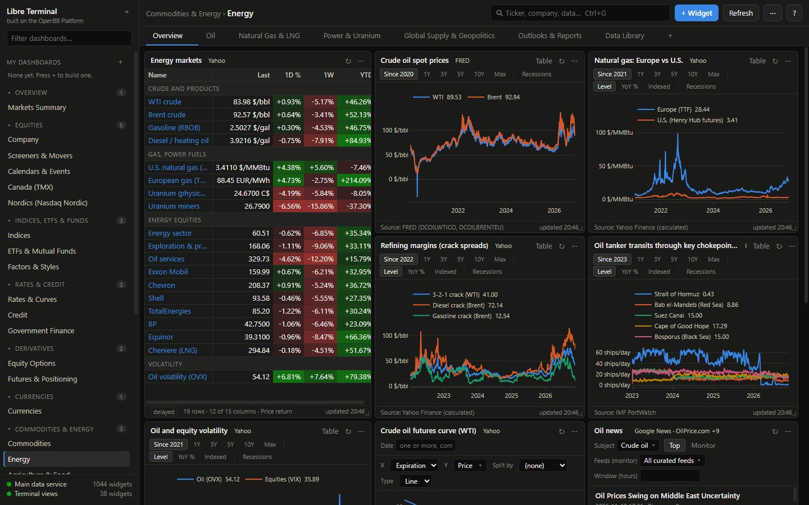

*Energy > Overview：能源期货与能源股、WTI/Brent、TTF 与 Henry Hub 对比、裂解价差，以及经由关键海峡的油轮通行量。*

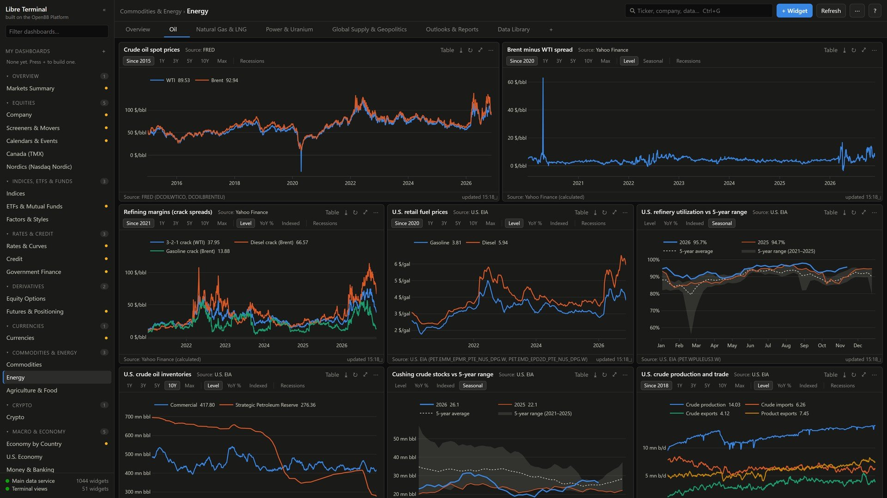

*Energy > Oil：商业原油与 SPR 库存，库欣、汽油及柴油的 5 年季节性区间，以及产量、贸易与需求数据（需免费 EIA 密钥）。*

### 海运、全球宏观与新闻监控

Trade & Shipping 基于 IMF PortWatch 数据，追踪霍尔木兹海峡、曼德海峡、苏伊士运河、好望角、博斯普鲁斯海峡、巴拿马运河、马六甲海峡和台湾海峡的每日船舶通行量。通行量按油轮、集装箱船和干散货船分类统计，并与上年同期及危机前的 2023 年基准对比。其他标签页还提供港口中断地图、贸易流向图以及双边关税。

Country Monitor 将 17 个主要经济体的 GDP 增速、通胀、失业率、政策利率及主权债券收益率汇总于一张表格。点击某个国家，下方的 IMF 通胀、BIS 政策利率、收益率曲线及新闻面板随即联动更新。其他标签页追踪 44 个国家的 Caldara-Iacoviello 地缘政治风险指数、美国银行业信贷质量、FDIC 银行倒闭记录，以及单家银行各项比率在同组银行中的百分位排名（FFIEC UBPR）。

News 看板将精选市场头条（重复的通讯社稿件合并为一行）与各国央行、统计机构及金融监管机构发布的官方公告专栏分开呈现。

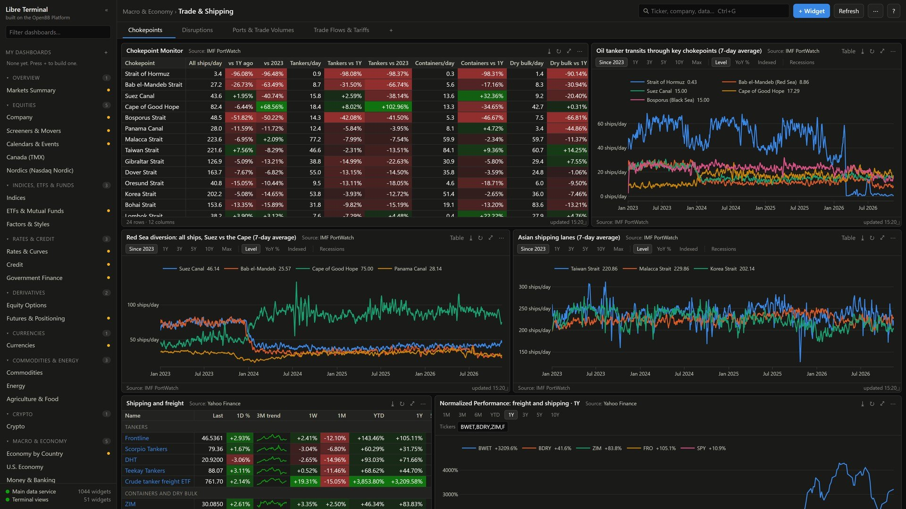

*Trade & Shipping > Chokepoints：每日船舶通行量与 1 年前及 2023 年对比、油轮通行量、红海与好望角绕行对比，以及亚洲航线。*

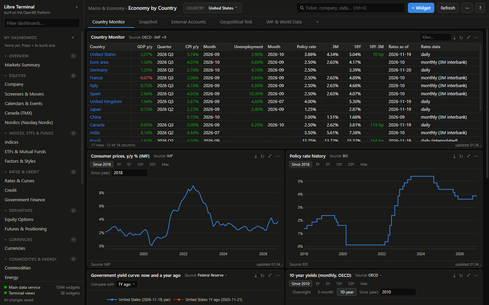

*Economy by Country > Country Monitor：17 个经济体的宏观概览表，附 IMF 消费者物价通胀及 BIS 政策利率历史。*

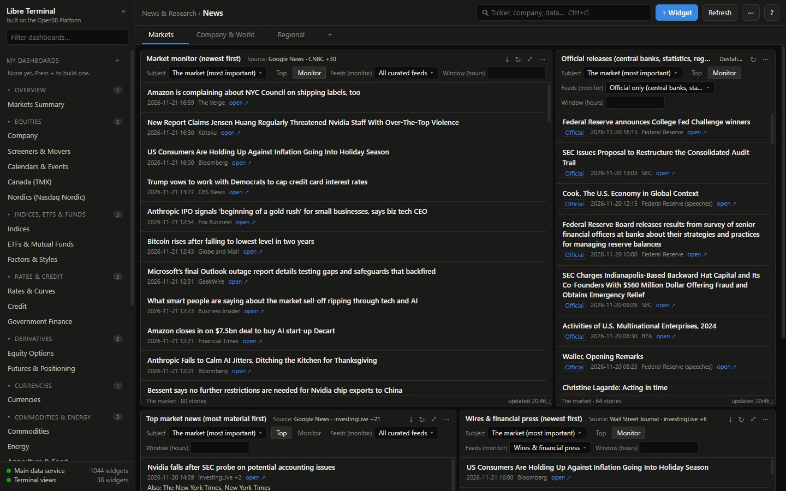

*News > Markets：左侧为合并重复稿件后的精选财经媒体报道，右侧为美联储、SEC、BEA 及其他监管机构的官方公告。*

## 各看板覆盖范围

| 领域 | 看板及主要标签页 |
|---|---|
| **概览** | **Markets Summary**：覆盖 5 个收益区间的跨资产报价板、股指与美国国债期货、自选列表、归一化表现、G10 国债收益率、美股风格箱、涨跌幅榜、地缘政治风险、航运咽喉要道、新闻及日历 |
| **股票** | **Company**（概览、财务报表、盈利预期与 8-K 新闻稿、同业与可比公司、增长与比率及估值区间、股东与内部人、分红、SEC 文件、做空与暗池交易、期权）、**Screeners & Movers**、**Calendars & Events**、**Canada (TMX)**、**Nordics (Nasdaq Nordic)** |
| **指数、ETF 与因子** | **Indices**（全球行情板、成分股、含 Shiller CAPE 在内且可追溯至 1871 年的 S&P 500 估值倍数、VIX 期货曲线）、**ETFs & Mutual Funds**（持仓、敞口、行业权重、N-PORT 文件、两只基金的持仓重叠度）、**Factors & Styles**（因子行情板、相对轮动图（RRG）、跨资产相关性与风险统计、Fama-French 因子） |
| **利率与信用** | **Rates & Curves**（全球收益率、分国家、美国、欧元区、货币市场、CFTC 掉期与 OIS、政策预期、FOMC 文件）、**Credit**（OAS 利差、CFTC CDS 指数、私募信贷与 BDC、企业债务、银行信贷调查与压力指标、FINRA TRACE 债券查询、发行人曲线、债券定价器、债务到期墙）、**Government Finance**（公共债务、财政部现金余额、国债拍卖、美联储资产负债表、一级交易商交割失败） |
| **衍生品** | **Equity Options**（期权链、统计、期限结构、IV 微笑、3D 曲面、Gamma 敞口与最大痛点、波动率锥、跨式、宽跨式、价差、损益图）、**Futures & Positioning**（近月合约行情板、VIX 期限结构、联邦基金隐含政策利率、WTI 曲线、历史价格，以及 S&P 500、Nasdaq、国债和外汇期货的 CFTC 持仓报告（COT）） |
| **外汇** | **Currencies**（即期行情板、货币强弱与货币对涨跌对比、交叉汇率矩阵、政策利差、即期汇率与 2 年期利差对比、实际有效汇率（REER）、外汇储备、CFTC 外汇远期、隐含波动率、COT 持仓） |
| **大宗商品与能源** | **Commodities**（行情板，WTI、天然气、黄金及铜期货曲线，COT 持仓）、**Energy**（原油、成品油、炼油裂解价差、TTF 与 Henry Hub 对比、EIA 5 年季节性库存、LNG 出口、电网逐小时负荷与燃料结构、核电站停运、铀、JODI、STEO 预测）、**Agriculture & Food**（谷物、软商品及牲畜期货曲线、COT 持仓、WASDE/PSD 供需平衡表、USDA 及地区联储农业数据） |
| **加密货币** | **Crypto**（现货行情板、历史价格、Deribit 订单簿、期权链、波动率微笑与曲面、资金费率、DVOL 与 30 日已实现波动率对比） |
| **宏观经济** | **Economy by Country**（Country Monitor、OECD 概览、对外账户、Caldara-Iacoviello 地缘政治风险、IMF WEO 预测）、**U.S. Economy**（亚特兰大联储 GDPNow、克利夫兰联储通胀实时预测、BLS CPI/PPI/非农就业/JOLTS 表格、住房与商业地产、企业景气调查、全部 12 家地区联储）、**Money & Banking**（逾期率、核销率、FDIC 银行倒闭、单家银行 UBPR 同组百分位及 FFIEC Call Report、美联储与欧洲央行流动性）、**Trade & Shipping**（IMF PortWatch 咽喉要道、中断地图与流向、港口吞吐量、双边贸易与关税）、**Data Explorers**（检索 FRED、BLS、IMF、OECD、ECB 及美联储数据序列，另含 Data Status） |
| **政府与监管** | **U.S. Congress**（法案、法律、修正案、投票、议员、委员会日程）、**Federal Spending**（USAspending 各机构预算、合同授予及主要受款方） |
| **新闻与研究** | **News**（市场监控、央行及监管机构官方公告流、按排名呈现的公司及地区新闻）、**SEC Filings & Enforcement**（EDGAR 全文检索、文件查看器、章节提取、SEC 诉讼公告、Form ADV 投资顾问） |

## 终端使用技巧

- **全局搜索（`/` 或 `Ctrl+G`）：** 输入股票代码、公司名称、SEC CIK、CUSIP 或数据集（`toyota`、`rheinmetall`、`SHEL.L`、`CIK 320193`、`037833100`、`cpi`、`sofr`、`wasde`）。股票在 Company 中打开，ETF 在 ETFs & Funds 中打开，指数、货币、期货或加密货币则在主图表中打开。
- **自选列表：** 维护个人代码列表，显示最新价、当日涨跌、5 个收益区间、3 个月迷你走势图以及 52 周价格区间，均以各证券的交易币种计价。
- **对比图表：** 在同一坐标轴上绘制最多 8 只证券或 FRED 序列（`FRED:DGS10`），可按价格、涨跌幅、比值、价差或回撤展示，支持 K 线、成交量、50 日与 200 日均线、对数坐标以及 NBER 衰退期阴影。
- **可编辑的可比公司表：** 可比公司估值表会自动选取同业并计算中位数；你也可以针对每家公司增删代码，列表保存在本地。
- **每张卡片均标注数据来源：** 每张卡片的标题栏都注明来源（`Source: SEC`）。点击即可为同一数据切换至其他提供方，或打开原始来源页面。依赖代码的卡片会自动对接至覆盖该标的的交易所或数据提供方（美股期权经由 Yahoo/Nasdaq/Cboe，加拿大期权经由 TMX，加密货币期权经由 Deribit；美国 ETF 持仓经由 Nasdaq，加拿大 ETF 持仓经由 TMX）。
- **图表与表格控制：** 调整日期范围（`1M` 至 `Max`），切换数据变换方式（`Level`、`YoY %`、`Indexed`，或对照 5 年区间的 `Seasonal`），或显示、隐藏表格列，均不会改动已保存的布局。任何表格均可导出为 CSV（附带来源行），任何图表均可保存为 PNG。
- **自定义看板：** 通过 `+` 创建自己的标签页或看板，自由调整卡片位置；任何内置看板都可通过 **⋯ > Reset to default layout** 恢复原始布局。
- **快捷键与状态：** 按 `?` 查看键盘快捷键（`/` 聚焦搜索框，`s` 切换当前页面的代码，`[` 与 `]` 切换标签页，双击卡片标题栏可将其最大化）。打开 **Data Explorers > Data status** 可查看哪些上游数据源当前不可用，以及已配置了哪些 API 密钥。

## 官方主权债券收益率曲线

**Rates & Curves > By Country** 中的每条曲线均取自其官方来源。日度曲线覆盖 8 个主要主权债券市场，无需 API 密钥；OECD 月度利率另覆盖约 30 个市场：

| 国家/地区 | 期限与频率 | 官方来源 |
|---|---|---|
| 美国 | 1M 至 30Y，日度 | 美联储（美国国债平价收益率曲线） |
| 欧元区 | 3M 至 30Y，日度 | 欧洲央行（AAA 级政府债券曲线） |
| 德国 | 6M 至 30Y，日度 | 德意志联邦银行 |
| 英国 | 6M 至 40Y，日度 | 英格兰银行 |
| 日本 | 1Y 至 40Y，日度 | 日本财务省 |
| 加拿大 | 1M 至 1Y 国库券，2Y 至长期国债，日度 | 加拿大央行 |
| 瑞典 | 1M 至 6M 国库券，2Y 至 10Y，日度 | 瑞典央行（Riksbank） |
| 巴西 | ~2M 至 10Y，日度 | Tesouro Direto（固定利率债券） |
| 法国、意大利、西班牙、瑞士、澳大利亚及约 30 个其他国家 | 3M 和 10Y，月度 | OECD |

## 可选免费 API 密钥

几乎每个看板的首个标签页都无需任何密钥即可使用。需要密钥的卡片会明确标注，并排在免密钥卡片之后。以下均为免费的公共密钥，注册任意一个约需 2 分钟：

| 提供方 | 密钥新增内容 | 注册页面 |
|---|---|---|
| **FRED** | 完整的美国宏观历史数据、ICE BofA 信用利差、大宗商品现货价格以及 U.S. Economy 看板 *（许多概览、利率和宏观图表也可通过 FRED 的公开 CSV 数据源免密钥使用）* | https://fredaccount.stlouisfed.org/apikeys |
| **EIA** | 美国能源信息署的原油、成品油和天然气库存、5 年季节性区间、LNG 出口、电网数据以及 STEO 预测 | https://www.eia.gov/opendata/register.php |
| **BLS** | 美国劳工统计局的 CPI、PPI、就业形势报告、JOLTS、实际收入及劳动生产率表格 | https://data.bls.gov/registrationEngine/ |
| **Congress.gov** | 美国众议院和参议院的法案、投票、修正案、议员资料及委员会报告 | https://api.congress.gov/sign-up/ |

添加密钥的方法：双击 `Libre-Terminal` 文件夹中的 **`Setup-Keys.cmd`**，将密钥粘贴到打开的文件中并保存，然后依次运行 **`Stop.cmd`** 和 **`Start.cmd`** 重启终端。密钥保存在你本机的 `local/api_keys.env` 中，从不写入日志或提交到代码库，且每个密钥只会发送给其对应的提供方。

## 数据须知

- **数据要么准确，要么留空并附说明。** 每张卡片都注明数据来源及所用最新数据点的日期（Country Monitor 会显示每个单元格的数据所属期）。数值列均标明单位，所有金额均注明币种。关键衍生指标（如估值倍数和收益率）一旦超出合理范围，将留空并附说明，而非照常显示；若使用了备用数据源、数据源中断期间提供的缓存副本，或仅返回部分结果，卡片上均会予以标注。
- **报价存在延迟，不支持交易。** 市场价格来自 Yahoo Finance。报价可能存在延迟，且不提供实时逐笔行情推送、下单或价格提醒功能。
- **财报数据的时效。** 在 Company > Estimates 标签页中，一致预期 EPS 与实际 EPS 均来自 Yahoo Finance，口径统一。Earnings Calendar 卡片则列示 Nasdaq 的一致预期、实际 EPS 及超预期幅度，因此其数值可能与 Estimates 标签页略有出入。实际业绩需待 Yahoo 发布后才会显示（通常在财报发布后数小时至一天内），在此期间 SEC 8-K 表格 Exhibit 99.1 新闻稿会直接从 EDGAR 加载。由于 Yahoo 会在财报发布后立即移除该季度的营收一致预期，历史营收超预期数据仅涵盖终端在财报发布前已获取过的季度。不包含业绩电话会议文字记录。
- **总回报（含分红再投资）与价格回报。** 仅包含股票和基金的报价板显示总回报（分红于除息日再投资）。包含指数、期货、货币或加密货币的报价板则显示价格回报。每个报价板下方的脚注行会注明所显示的回报类型。
- **信用与债券覆盖范围。** CDS 数据覆盖当期活跃 5 年期指数 CDS，来源为 CFTC 掉期交易报告库（SDR）的成交报告；不提供单名 CDS。公司债价格来自 FINRA TRACE 最新成交报告；不包含美国国债个券报价。
- **主权曲线频率。** 日度曲线覆盖上文所列的 8 个市场。其他国家依赖 OECD 的 3 个月期和 10 年期月度序列，因此意德利差（BTP-Bund）与法德利差（OAT-Bund）等欧元区内部利差均为月度数据。
- **数据源中断。** 公共数据提供方有时会迁移或停用其数据源；**Data Explorers > Data status** 会列出当前不可用的数据源。当 Cboe 屏蔽对其期权数据源的自动请求时，期权分析会自动回退至 Yahoo Finance 期权链（在本地计算 Black-76 隐含波动率及希腊字母），VIX 曲线改用 Cboe 结算文件，美国指数快照则改用 Yahoo，所有替代来源均会在卡片上标注。Cboe 日内 K 线和历史期权报价没有替代来源。OECD 在请求达到频率上限时偶尔会暂停响应，稍后自行恢复。
- **地域范围。** 股票价格、财务报表、分析师预期、股东及同业可比数据适用于全球上市公司。SEC 文件、FINRA TRACE、FINRA 卖空余额、FDIC/FFIEC 银行数据以及美国期权分析仅适用于美国发行人（加拿大和北欧市场另有专属看板）。
- **宏观数据仅含实际值。** 宏观看板展示官方发布数据和 IMF 预测，不含 PMI 数据。唯一提供经济学家调查一致预期的地方，是 Economic Calendar 卡片中的 Nasdaq 列。
- **支持平台。** 已在 Windows 10 和 11 上测试并提供支持。

## 更新与常见问题排查

所有个人数据（自选列表、自定义布局、同业列表及可选 API 密钥）均保存在 `local` 文件夹中。

- **更新到新版本：** **`Start.cmd`** 每次启动时都会在 GitHub 上检查是否有新版本。如有，它会显示更新内容，并让你选择原地更新（保留 `local` 文件夹）、本次跳过或关闭启动检查（运行 `launcher.py update --enable` 可重新开启）。如已是最新版本，则直接启动。如需手动更新：在旧文件夹中运行 **`Stop.cmd`**，下载并解压新的 ZIP，将旧的 `local` 文件夹复制到新的 `Libre-Terminal` 文件夹中，然后依次运行 **`Install.cmd`** 和 **`Start.cmd`**。
- **备份或更换电脑：** 停止终端后复制 `local` 文件夹即可。如需完全重置，停止终端后删除 `local`。

| 问题 | 解决方法 |
|---|---|
| *"Windows 已保护你的电脑"* | 点击 **更多信息**，然后点击 **仍要运行**。只需操作一次；`Install.cmd` 会自动解除其他 `.cmd` 文件的锁定。 |
| 文件无法运行 / 提示 *"inside the ZIP"* | 右键单击 `Libre-Terminal-Windows.zip`，选择 **全部解压缩...**，然后打开解压出的 `Libre-Terminal` 文件夹。 |
| 在 OneDrive 或过长路径下安装失败 | 将解压后的文件夹移至较短的本地路径（如 `C:\Libre-Terminal`），然后再次双击 `Install.cmd`。Windows 将文件路径长度限制在 260 个字符以内，因此当文件夹路径超过 83 个字符时（除非已启用 Windows 长路径支持），`Install.cmd` 会在下载任何内容之前停止。 |
| 安装中途停止 | 通常是公司代理、防火墙、VPN 或杀毒软件拦截所致。可尝试更换网络（家庭宽带或手机热点），或请 IT 部门放行 `astral.sh`、`github.com` 和 `pypi.org`，然后再次运行 `Install.cmd`；安装会从中断处继续。 |
| 杀毒软件删除或拦截文件 | 恢复被删除的文件，在杀毒软件中将 `Libre-Terminal` 文件夹加入白名单，然后再次运行 `Install.cmd`。 |
| 浏览器未自动打开 | 手动打开 `http://127.0.0.1:6950`。如页面无法加载，请再次运行 `Start.cmd` 并查看窗口中的最后几行信息。 |
| 端口已被占用 | 在 `Libre-Terminal` 文件夹中打开命令提示符，运行 `Start.cmd --ui-port 7950 --v5-port 7900`（该设置会保存，供以后启动沿用）。 |
| 首次启动较慢或卡片空白 | 首次启动时需等待数据服务就绪，最长约 1 分钟（较慢的电脑上约 90 秒）。如果某个后台服务停止或无响应，终端会自动将其重启；你也可以点击顶栏中 **Refresh** 旁边的 **Restart**，重启卡住的数据服务并清除浏览器中缓存的错误。日志位于 `local/logs/`。 |
| 卡片提示需要 API 密钥 | 通过 **`Setup-Keys.cmd`** 添加免费密钥，然后停止并重新启动终端。 |
| 想恢复默认布局 | 点击看板上的 **⋯**，选择 **Reset to default layout**。 |
| 卸载 | 运行 **`Stop.cmd`**，然后删除 `Libre-Terminal` 文件夹。 |

<details>
<summary><strong>高级选项、macOS / Linux 与开发者</strong></summary>

### 启动与后端选项

- **跳过首次启动等待：** `Start.cmd --no-wait` 会立即打开浏览器，数据在后台继续加载。
- **跳过或手动管理更新检查：** `Start.cmd --no-update`（或设置 `TERMINAL_NO_UPDATE=1`）可跳过本次启动时的 GitHub 检查。运行 `.venv-v5\Scripts\python.exe scripts\launcher.py update` 可手动检查或更新（可附加 `--check`、`--yes`，或在选择 "don't ask again" 之后附加 `--enable`）。
- **旧版 V4 后端（+480 MB）：** 运行 `Install.cmd --with-v4` 和 `Start.cmd --with-v4`（如设置了自定义端口，请附加 `--v4-port 7901`）。这会在现有看板中新增 39 张旧版卡片（FMP、Intrinio、Finviz、EconDB、WSJ）。另可选配免费的 [FMP 密钥](https://site.financialmodelingprep.com/developer/docs)（每天 250 次调用）以补全 FMP 卡片数据。
- **自定义本地文件夹：** 启动前设置 `TERMINAL_LOCAL_DIR`。各服务仅绑定 `127.0.0.1`。
- **允许受信任的桌面应用调用终端数据：** 启动前将 `TERMINAL_EXTRA_ORIGINS` 设置为该应用的源（origin），例如 Tauri 应用可运行 `setx TERMINAL_EXTRA_ORIGINS "tauri://localhost http://tauri.localhost"`（然后打开一个新窗口再启动终端）。仅接受精确匹配的源（不支持 `*`）。列入的应用可以读取数据和视图，但无法更改你保存的布局或重启服务。除非你信任该应用，否则请勿设置此项。

### macOS / Linux（实验性，未经测试）

Windows 10/11 是唯一经过官方测试的平台。另附共用同一启动器的 Shell 脚本，供 macOS 和 Linux 用户使用，仅尽力提供支持：

```sh
git clone https://github.com/samlazs/libre-terminal.git && cd libre-terminal
sh install.sh
sh start.sh          # 打开 http://127.0.0.1:6950；停止请运行：sh stop.sh
```

如需更新通过 git 克隆的版本，请先停止终端，运行 `git pull`，然后重新运行 `Install.cmd`（或 `sh install.sh`）。你的 `local/` 文件夹不受影响。

### 本地数据文件夹

所有个人数据都保存在 `local/` 中，该文件夹已被 git 忽略。终端每次启动时都会写入 `local/README.txt`，说明该文件夹的内容。日志位于 `local/logs/`（`ui.log`、`v5.log`、`v4.log` 及卡死转储文件）。日志超过 5 MB 时会被重命名为 `.log.1`（原有的 `.log.1` 则顺延为 `.log.2`），终端运行期间同样如此，因此日志不会无限增长。

### 贡献者指南

架构设计、数据源约定、保存状态的数据结构、运行时补丁及测试清单详见 [docs/ARCHITECTURE.md](ARCHITECTURE.md)（英文）。在项目文件夹中运行离线检查：

```text
# Windows
.venv-v5\Scripts\python.exe scripts\launcher.py test
.venv-v5\Scripts\python.exe scripts\launcher.py check

# macOS / Linux
.venv-v5/bin/python scripts/launcher.py test
.venv-v5/bin/python scripts/launcher.py check
```

`test` 会并行运行所有离线测试文件（约 30 秒；若已安装 Edge 或 Chrome，还包括 3 组无头浏览器测试套件，可用 `--fast` 跳过）。`check` 涵盖编码、代码规范（lint）、项目整洁度及数据源检查。`gate` 针对正在运行的终端执行发布关卡 G1–G5，并记录相应证据。

</details>

## 许可证与免责声明

本项目依据 **GNU Affero General Public License v3.0 or later** 授权（[LICENSE](../LICENSE)）；第三方声明见 [NOTICE](../NOTICE)。OpenBB Platform 及其他 Python 软件包均从 PyPI 安装，遵循其各自的许可证，本项目不对其进行再分发。

本项目为非官方项目，与 OpenBB 及任何数据提供方均无关联，亦未获得其背书或赞助；文中提及的名称仅用于标识兼容的软件和数据来源。数据来自第三方并受其各自条款约束，你有责任遵守相关条款；数据可能存在延迟、缺失或错误。本项目任何内容均不构成投资、财务、法律或税务建议。本软件按“原样”提供，不附带任何形式的担保。
